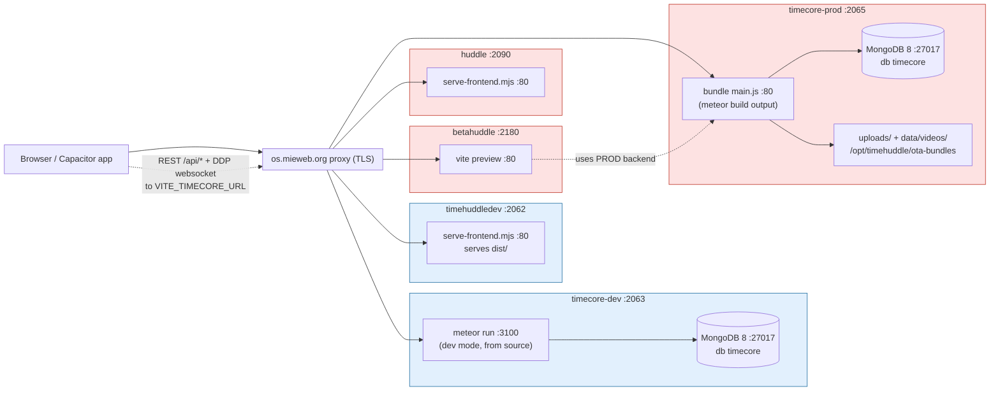

# TimeHuddle deployment reference

How every container is set up, as inspected on 2026-11-22. Procedures are in
[SKILL.md](SKILL.md). When you find a host that no longer matches this, update this file.

## Architecture

### How the frontend reaches the backend

- A frontend host only serves static files. The browser loads `dist/`, then talks
  **directly** to the backend's public URL. Requests don't go through the frontend host.
- That URL is `VITE_TIMECORE_URL`, which is **baked in at build time** from the
  frontend host's `.env` / `.env.production` (`src/lib/api.ts`, `src/lib/ddp.ts`). If
  you change it, you have to rebuild the frontend. A restart isn't enough.
- Traffic over that URL:
  - REST: wormhole methods at `/api/...`, plus avatar and media endpoints
  - auth: `/api/auth/*` (better-auth style token endpoints served by Meteor)
  - DDP: a websocket for live data
- The backend only accepts browser calls from origins listed in its `CORS_ORIGINS`. A
  new frontend origin needs adding there, followed by a backend restart.
- `serve-frontend.mjs` also calls the backend from the server for `/watch/:id` link
  previews. It reads the backend URL from `dist/server-config.json`.
- Health endpoints on the backend: `/health` returns `{"status":"ok",…}`, and `/hi`
  returns `{"message":"hi from meteor backend"}`.

## Common to all hosts

- Debian 13, Node 24, user `pdharamkar`, repo at `~/timehuddle`, deployed from remote
  `origin` (mieweb/timehuddle). `timehuddledev` also has a `mfisher31` fork remote, so
  never fetch from that.
- **pm2 runs as root. Always `sudo pm2 …`.** Plain `pm2` talks to an empty per-user
  daemon. sudo needs no password.
- **The real runtime env lives in root's pm2 dump** (`/root/.pm2/dump.pm2`), not in
  `.env` files. `sudo pm2 restart <app>` reuses the saved env. `--update-env` would
  replace it with your SSH shell's env, so **never pass `--update-env`** unless you
  mean to. Never run `pm2 delete` on a backend, because that loses the env.
- `.env*`, `ecosystem.config.cjs`, `meteor-backend/uploads`, `meteor-backend/data/videos`
  and `meteor-backend/prod-build` are all gitignored. `git clean -fd` was dry-run on
  every host and removes nothing. It's safe as long as nobody adds `-x`.
- nginx is installed on some hosts but inactive. Node binds :80 or :3100 itself, so
  leave nginx off.
- The env files hold secrets. Print **key names only**. For URLs, redact credentials.

## Hosts

### timehuddledev (dev frontend)

|                      |                                                                                 |
| -------------------- | ------------------------------------------------------------------------------- |
| pm2 app              | `timehuddle-frontend`: `npm run serve:dist`, cwd `~/timehuddle`, `PORT=80`      |
| Backend it points at | `https://timecore-dev.os.mieweb.org` (`.env.production` overrides `.env`)       |
| Last deploy          | 2026-11-22 → `09bd2aa0` (#877), manual; previous build kept in `/tmp/dist.prev` |
| Starts on boot?      | **No.** There's no pm2 startup unit. After a reboot, run `sudo pm2 resurrect`   |
| Logs                 | `/home/pdharamkar/.pm2/logs/timehuddle-frontend-{out,error}.log`                |

### timecore-dev (dev backend)

|                 |                                                                                                                                                      |
| --------------- | ---------------------------------------------------------------------------------------------------------------------------------------------------- |
| pm2 app         | `timehuddle-meteor`: `npm start` = **`meteor run`** (dev mode, built from source on every start, slow), cwd `meteor-backend`, `PORT=3100`            |
| Env source      | The pm2 dump only. There's no ecosystem file. `meteor-backend/.env.local` is **stale** (it says db `timeharbor`, but the live db is `timecore`)      |
| DB              | MongoDB 8.0.21, `127.0.0.1:27017`, replica set `rs0`, no auth. Live db `timecore` (~42 MB). Leftover dbs: `timeharbor`, `timehuddle`, `staging_prod` |
| Files           | `meteor-backend/data/uploads`, `meteor-backend/data/videos`                                                                                          |
| Starts on boot? | Yes (`pm2-root` enabled)                                                                                                                             |
| History         | About 3,400 crash restarts between Oct 29 and Nov 2. Stable since then                                                                               |
| Restart time    | Healthy about 20 s after `pm2 restart` (2026-11-22)                                                                                                  |
| Last deploy     | 2026-11-22 → `09bd2aa0` (#877), manual, backup `~/backups/dev_20261123T013457`                                                                       |

### huddle (prod frontend)

|                      |                                                                                         |
| -------------------- | --------------------------------------------------------------------------------------- |
| pm2 app              | `timehuddle-frontend`: `node scripts/serve-frontend.mjs`, cwd `~/timehuddle`, `PORT=80` |
| Backend it points at | `https://timecore-prod.os.mieweb.org` (from `.env`)                                     |
| Starts on boot?      | **No.** There's no pm2 startup unit                                                     |
| Live commit (Nov 22) | `ed1d0621` (#863)                                                                       |

### betahuddle (beta frontend)

|                      |                                                                                                        |
| -------------------- | ------------------------------------------------------------------------------------------------------ |
| pm2 app              | `timehuddle-frontend`: `npx vite preview --port 80 --host` (unlike the others)                         |
| Backend it points at | ⚠️ **PROD**: `https://timecore-prod.os.mieweb.org`. Beta is a different frontend on **real prod data** |
| Starts on boot?      | No (`pm2-root` is installed but inactive)                                                              |
| Live commit (Nov 22) | `0813f3ef` (#701, Oct 13). Very stale                                                                  |

### timecore-prod (prod backend) ⚠️

|                        |                                                                                                                                                                                   |
| ---------------------- | --------------------------------------------------------------------------------------------------------------------------------------------------------------------------------- |
| pm2 apps               | `timehuddle-meteor`: **node runs `meteor-backend/prod-build/bundle/main.js`**, `PORT=80`. Also `pm2-logrotate`                                                                    |
| How the bundle is made | On the host: `cd meteor-backend && npm run build:prod` (Meteor 3.4.1 at `/usr/local/bin/meteor`, 8 GB heap), then `npm install --omit=dev` in `prod-build/bundle/programs/server` |
| Env source             | The pm2 dump (35 keys). `~/timehuddle/ecosystem.config.cjs` has the same keys, but its script (`meteor run --production`) is **outdated**, so don't `pm2 start` it                |
| DB                     | MongoDB 8.0.21, `127.0.0.1:27017`, single-node replica set `rs0` (PRIMARY), no auth. Live db **`timecore`** (~45 MB on disk, 20 MB dumped). `timehuddle` (0.7 MB) is a leftover   |
| Files                  | `meteor-backend/uploads` (17 MB), `meteor-backend/data/videos` (**4 GB**), `/opt/timehuddle/ota-bundles` (180 MB)                                                                 |
| Cron                   | Daily 08:00 `scripts/daily-engagement-report.js`                                                                                                                                  |
| Starts on boot?        | Yes (`pm2-root` active)                                                                                                                                                           |
| Disk                   | **80% used, ~9.6 GB free.** `~/backups` (~8 GB) and `~/th-backup-20261102-2058` (1.6 GB) take a lot of it                                                                         |
| Live bundle (Nov 22)   | Built 2026-11-17 17:40 UTC from `ed1d0621`, after backup `db_backup_2026-11-17T17-36-18`                                                                                          |

**CI does not ship backend code to prod.** `deploy_prod` in `main.yml` runs
`npm install` and `pm2 restart`. That restarts the **old bundle**, because nothing
rebuilds `prod-build/`. Use the manual procedure in SKILL.md for real backend changes.

#### Existing backups on timecore-prod (`~/backups`)

| Pattern                                   | What it is                                                                             | Size   |
| ----------------------------------------- | -------------------------------------------------------------------------------------- | ------ |
| `db_backup_<ISO>/mongodb/timecore/*.bson` | `mongodump --db timecore`                                                              | ~20 MB |
| `full_backup_<ISO>/`                      | `mongodb/` + `uploads/` + `data/videos` + `ecosystem.config.cjs` + `app-source.tar.gz` | ~1 GB  |
| `timecore_*`, `pre_*`, `env_backup_*`     | older one-offs from the July migration                                                 | small  |

All of them sit on the same container as the database. If the container is lost, so are
the backups. Pull a copy off the host (SKILL.md step P2).

## CI status (Nov 22)

`Main Branch Deployment` has failed on every push since about Nov 11. Dev is skipped
whenever a check fails. The latest blocker: `prefer-const` in
`meteor-backend/tests/github-source.test.ts:52`. To check, run
`gh run list --workflow main.yml --limit 5`, then
`gh run view <id> --log-failed | grep -i error`.
