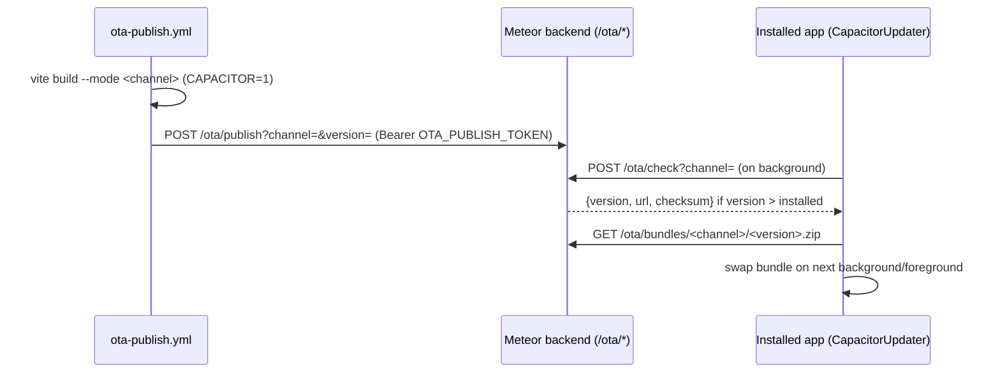

# Mobile release (iOS + Android)

The apps are a Capacitor 8 shell (`com.mieweb.timehuddle`) around the same Vite build
as the web app (`webDir: dist`). There are **two ways** to get a change onto phones:

| Change                                                                                                              | Path                                                                                            | Store review?                               |
| ------------------------------------------------------------------------------------------------------------------- | ----------------------------------------------------------------------------------------------- | ------------------------------------------- |
| Web only: React, CSS, copy                                                                                          | **OTA bundle** (`ota-publish.yml`), which installed apps download in the background             | No                                          |
| Native: plugins, permissions, icons, Capacitor upgrades, `capacitor.config.ts`, anything under `ios/` or `android/` | **New store build**: TestFlight/App Store (`testflight.yml`) and Google Play (`play-store.yml`) | Yes (Apple); Play internal track is instant |

**Who triggers what (the user's rule):**

- **OTA is part of deploying.** A dev deploy ends with the `testflight` OTA, and a prod
  deploy ends with the `production` OTA. The `deploy` skill runs those steps (D-OTA and
  P5), so don't publish OTA on its own unless the user asks.
- **Native store builds happen only on explicit request.** This means TestFlight/App
  Store binaries and Google Play bundles. Never start one as a side effect of a deploy
  or an OTA publish. If a deploy contains native changes that OTA can't deliver, tell
  the user and wait for them to ask for a build.

When the user asks to "release the app", work out which path the change needs first.
Run `git diff --stat <last release>..origin/main -- ios android capacitor.config.ts package.json`.
Native changes, or a changed Capacitor dependency in `package.json`, mean a store build.

## How OTA works



| Channel      | Backend (stores and serves bundles)                                                                                            | Frontend for shared links   | Built with          | Store build that listens                           |
| ------------ | ------------------------------------------------------------------------------------------------------------------------------ | --------------------------- | ------------------- | -------------------------------------------------- |
| `production` | `timecore-prod` (`/opt/timehuddle/ota-bundles`)                                                                                | huddle.os.mieweb.org        | `--mode production` | App Store / Play builds (`OTA_CHANNEL=production`) |
| `testflight` | `timecore-dev` (`meteor-backend/data/ota`, the default since `OTA_DIR` is unset; `/opt/timehuddle/ota-bundles` there is stale) | timehuddledev.os.mieweb.org | `--mode testflight` | TestFlight dev builds (`OTA_CHANNEL=testflight`)   |

**Local publish:** `npm run ota:testflight` / `npm run ota:production` build with the
matching `.env.<mode>` and publish. `scripts/ota-cli.mjs` reads `OTA_PUBLISH_TOKEN` from
`.env.<channel>` or `.env.local`. On this machine `.env.testflight` has it, and there's
no production token locally. Testflight is published by hand, never automatically:
`1.0.2` on 2026-11-03 was the last one.

**What's live:**
`curl -s "https://timecore-prod.os.mieweb.org/ota/latest?channel=production"` and
`curl -s "https://timecore-dev.os.mieweb.org/ota/latest?channel=testflight"`.
The response gives `version`, `publishedAt` and `size`.

### Version rules (read before releasing)

- The bundle version defaults to `package.json` `version`. The OTA updater only ships a
  bundle **strictly newer** than what a device has.
- **A push to main republishes `production` under the same version.** It overwrites the
  zip, but devices that already have that version ignore it. **Phones only get new web
  code when `package.json` is bumped.** That bump also tags the previous version and
  drafts its GitHub Release (`tag-release.yml`), and it needs a
  `release-notes/<version>.md` (see `release-notes/README.md`).
- The bundle must also be newer than the **native** version, or devices treat it as
  stale:
  - Android `versionName` = `package.json` version (read in `android/app/build.gradle`).
    A Play build at `1.2.0` therefore ignores the `1.2.0` OTA bundle. Bump before the
    next OTA.
  - iOS `MARKETING_VERSION` is hand-set in `ios/App/App.xcodeproj/project.pbxproj`
    (`1.0`, build `13`). Store builds need `CURRENT_PROJECT_VERSION` bumped every
    upload.
- ⚠️ **Push-to-main OTA points prod phones at the prod backend, which may be older.**
  OTA ships web code from `main` straight to App Store/Play users. Their backend is
  `timecore-prod`, which only updates on a manual deploy (see the `deploy` skill). Web
  code that needs new backend methods will break on phones until prod backend is
  deployed. Check this before bumping the version.

### OTA steps

The exact publish-and-verify commands tied to deploys are in the `deploy` skill (D-OTA
for testflight, P5 for production). Use them. The notes below are for a standalone OTA
publish the user asks for directly.

1. Confirm the channel. `production` reaches every store user, so get an explicit "yes".
2. Normal release: merge a PR that bumps `package.json` `version` and adds
   `release-notes/<version>.md`. The push to main publishes `production` automatically.
3. Manual or testflight publish:
   `gh workflow run ota-publish.yml -f channel=testflight` (optionally `-f version=1.2.1`).
   Then watch it with `gh run watch $(gh run list --workflow ota-publish.yml --limit 1 --json databaseId -q '.[0].databaseId')`.
4. Verify with `/ota/latest` (above). The workflow already fails if the bundle doesn't
   contain the right backend and frontend URLs.
5. **Kill switch for a bad bundle:** publish a fixed, higher version, then gate old
   clients without a rebuild:
   `OTA_PUBLISH_TOKEN=… node scripts/ota-min-version.mjs --channel production --version <fixed>`
   (`--clear` removes the gate). The token matches the backend env, so ask the user for
   it and never print it.

## iOS: TestFlight / App Store

**CI:** `gh workflow run testflight.yml -f environment=dev|prod` runs on `macos-latest`.
The steps are: `npm ci`, `vite build`, `cap sync ios`, `scripts/patch-ios-spm.py`, then
`mieweb/actions/ios@v1` (fastlane match signing from `mieweb/mobile-signing`, archive,
TestFlight upload).

- ⚠️ **This workflow has never run** (no runs in its history). Its secrets
  (`MATCH_PASSWORD`, `MATCH_GIT_BASIC_AUTHORIZATION`, `APPLE_API_KEY_*`) aren't repo or
  environment secrets. Only `APPLE_TEAM_ID` is. They may be org-level, which we can't
  list (403). Expect the first run to fail on signing, and treat it as a trial.
- `prod` uses the `production` environment (it may need an approval click in GitHub).

**Local (how iOS builds have actually shipped so far):**

```bash
nvm use
npm run testflight:ios   # dev backend, OTA_CHANNEL=testflight → opens Xcode
npm run prod:ios         # prod backend, OTA_CHANNEL=production → opens Xcode
```

Then in Xcode: bump **Build** (`CURRENT_PROJECT_VERSION`), and **Version** if it's a
new marketing release. Run Product → Archive, then Distribute App → App Store Connect →
Upload. This machine has Xcode 27, CocoaPods and fastlane. To submit for App Store
review after TestFlight, follow `docs/APP_STORE_SUBMISSION_CHECKLIST.md` in App Store
Connect.

## Android: Google Play

**CI (works, last ran 2026-11-05, versionCode 3 → internal, draft):**

```bash
gh workflow run play-store.yml -f track=internal -f release_status=completed
#   track: internal | alpha | beta | production
#   release_status: completed (live on track) | draft (finish in Play Console)
#   version_code: optional override; default = run_number + 1
```

The workflow builds `npm run build:android:prod` (prod backend, `OTA_CHANNEL=production`)
and checks that the bundle contains `timecore-prod`. It then signs the AAB with the
upload key (`production` environment secrets, all present) and uploads to the track.
The AAB is kept as a run artifact for 30 days.

- Start with `internal`, then promote in the Play Console. Releasing to `production`
  from CI needs an explicit "yes".
- Play rejects a reused versionCode. If a run fails after upload, re-run with a higher
  `version_code`.
- There's no dev/testflight Android build in CI. For a local dev APK, run
  `npm run testflight:android` (opens Android Studio). For live reload on a device, run
  `npm run dev:android`.

**Local release build:** run `npm run prod:android`, then in Android Studio use Build →
Generate Signed App Bundle (you need the upload keystore, which lives only in CI
secrets).

## Before any store release

1. `git fetch origin && git log --oneline -5 origin/main`. CI builds `main`, not your
   tree.
2. Prod backend has the backend code this build needs (`deploy` skill).
3. Versions: `package.json` (Android versionName + OTA), and iOS Version/Build.
4. A release note exists for the version (`release-notes/<version>.md`).
5. Name the platform, track or environment, and commit, and get a "yes" for anything
   that reaches real users (prod TestFlight → App Store, Play alpha/beta/production,
   OTA `production`).

## Debugging

| Symptom                                        | Check                                                                                                                                 |
| ---------------------------------------------- | ------------------------------------------------------------------------------------------------------------------------------------- |
| Phones not getting a web change                | Was `package.json` bumped? `/ota/latest` version vs the device's. Is the bundle newer than the native version?                        |
| App shows blank / can't reach server after OTA | `/ota/latest` `publishedAt`. The OTA workflow log "Verify bundle points at the right backend". Then roll forward plus the kill switch |
| OTA workflow fails at publish                  | `OTA_PUBLISH_TOKEN` secret vs the backend's pm2 env. Is the backend `/ota/*` up?                                                      |
| Play upload rejected                           | versionCode already used, so pass `version_code`                                                                                      |
| iOS SPM / CapgoCapacitorUpdater build error    | `python3 scripts/patch-ios-spm.py` must run after `cap sync ios`                                                                      |
| Workflow run status                            | `gh run list --workflow <file>.yml --limit 5`, then `gh run view <id> --log-failed`                                                   |
