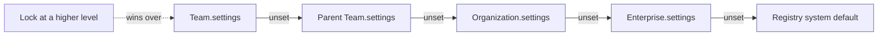

# Hierarchical Settings — Implementation Plan (#607)

Issue: [mieweb/timehuddle#607 — Add Hierarchical Settings With Defaults That Inherit From Enterprise to Organization to Team](https://github.com/mieweb/timehuddle/issues/607)
Branch: `feature/607-hierarchical-settings` (from `main`)
Related: #572 / PR #589 (`requirePlanForClock` default on for new teams)

> **How to use this plan.** Work the milestones in order — each one builds on the
> previous. Tick a box only when the item is done _and_ verified. Each milestone ends
> with a **Done when** check; do not start the next milestone until it passes.
> If something in the code doesn't match what this plan says, stop and ask — don't
> improvise a different design.

---

## Goal in one paragraph

Today each level (Enterprise → Organization → Team → Sub-team) stores its own settings
with no link between them, and a missing value is read as "off". We are adding **one
server-side registry + one resolver** so that an unset value means **"inherit"**, a
higher level can **set a default** and optionally **lock** it, and the client only ever
sees **resolved** values. Nothing more.



## Out of scope — do NOT do these

- Making `AUTO_CLOCKOUT_MS`, `SHIFT_END_MS` ([agenda.js](../meteor-backend/server/agenda.js)) or `MEAL_BREAK_THRESHOLD_SECONDS` ([clock-core.js](../meteor-backend/server/clock-core.js)) configurable. The registry should make this _possible later_ — do not add them.
- User-level preferences (theme, brand, notification prefs).
- Permission-model changes beyond what locks need.
- Audit history of settings changes.
- Adding an i18n library (see Milestone 7 for how to handle strings).

---

## Where things live today (reference)

| What                                                 | File                                                                                                                                                                                                                                                                                                                                                      | Notes                                           |
| ---------------------------------------------------- | --------------------------------------------------------------------------------------------------------------------------------------------------------------------------------------------------------------------------------------------------------------------------------------------------------------------------------------------------------- | ----------------------------------------------- |
| Team public shape + `?? false` defaults              | [teams.js `toPublicTeam`](../meteor-backend/server/teams.js#L113-L132)                                                                                                                                                                                                                                                                                    |                                                 |
| Team DDP publication (raw docs)                      | [teams.js `teams.byUser`](../meteor-backend/server/teams.js#L134-L138)                                                                                                                                                                                                                                                                                    | Client can't see resolved values                |
| Team settings write + plan notification              | [teams.js `teams.updateSettings`](../meteor-backend/server/teams.js#L459-L501)                                                                                                                                                                                                                                                                            | Permission: `isTeamAdminOrOrgOwner`             |
| `autoAcceptJoins` read                               | [teams.js](../meteor-backend/server/teams.js#L277)                                                                                                                                                                                                                                                                                                        |                                                 |
| Org `allowAutoJoin` check before `addOrgMember` (×5) | [teams.js L284](../meteor-backend/server/teams.js#L284), [L409](../meteor-backend/server/teams.js#L409), [L590](../meteor-backend/server/teams.js#L590), [L730](../meteor-backend/server/teams.js#L730), [team-join-requests.js L136](../meteor-backend/server/team-join-requests.js#L136)                                                                | The duplicated "cascade"                        |
| Org `allowAutoJoin` storage/API                      | [organizations.js](../meteor-backend/server/organizations.js#L97) (`toOrgSummary`), [L288 create](../meteor-backend/server/organizations.js#L288), [L340 update](../meteor-backend/server/organizations.js#L340), [L370 updateSettings](../meteor-backend/server/organizations.js#L370), [L395 orgs.join](../meteor-backend/server/organizations.js#L395) | Read as `!== false`                             |
| Default-org `allowAutoJoin`                          | [org-helpers.js L79](../meteor-backend/server/org-helpers.js#L79), [L93](../meteor-backend/server/org-helpers.js#L93), [auth-bridge.js L381](../meteor-backend/server/auth-bridge.js#L381)                                                                                                                                                                | Query on the field — must keep working          |
| Enterprise doc                                       | [enterprises.js](../meteor-backend/server/enterprises.js)                                                                                                                                                                                                                                                                                                 | No settings today                               |
| Permission helpers                                   | [org-helpers.js `isTeamAdminOrOrgOwner`](../meteor-backend/server/org-helpers.js#L217), [organizations.js `buildOrgAccess`](../meteor-backend/server/organizations.js#L79), [permissions.js `isEnterpriseElevatedForTeamOrg`](../meteor-backend/server/permissions.js#L75)                                                                                | Reuse; don't add new roles                      |
| Clock-out wrap-up gate                               | [clock.js L917](../meteor-backend/server/clock.js#L917)                                                                                                                                                                                                                                                                                                   |                                                 |
| Wormhole method exposure                             | [main.js L1914](../meteor-backend/server/main.js#L1914), [L2119](../meteor-backend/server/main.js#L2119)                                                                                                                                                                                                                                                  | New/changed method params must be declared here |
| Startup migration pattern                            | [inline-images.js `migrateInlinePostImages`](../meteor-backend/server/inline-images.js#L160-L185)                                                                                                                                                                                                                                                         | Idempotent, runs in `Meteor.startup`            |
| Client fallbacks to remove                           | [ddp.ts L642](../src/lib/ddp.ts#L642), [TeamsPage.tsx L198](../src/features/teams/TeamsPage.tsx#L198), [useClockToggle.ts L38](../src/lib/useClockToggle.ts#L38)                                                                                                                                                                                          |                                                 |
| Client settings UI                                   | [TeamsPage.tsx L965–L1030](../src/features/teams/TeamsPage.tsx#L965), [OrganizationMembersPage.tsx L431](../src/features/org/OrganizationMembersPage.tsx#L431), [EnterprisePage.tsx](../src/features/enterprise/EnterprisePage.tsx)                                                                                                                       |                                                 |
| API client types                                     | [api.ts](../src/lib/api.ts) (`teamApi.updateSettings`, `orgApi.updateSettings`)                                                                                                                                                                                                                                                                           |                                                 |
| Plan-gate tests                                      | [plan-gate.test.ts](../meteor-backend/tests/plan-gate.test.ts)                                                                                                                                                                                                                                                                                            | `cd meteor-backend && npm run test:integration` |

---

## Design decisions (fixed — follow these)

1. **Storage shape (same on every level):**
   ```js
   settings: { requirePlanForClock?: boolean, autoAcceptJoins?: boolean, allowAutoJoin?: boolean }
   settingsLocks: { requirePlanForClock?: true, autoAcceptJoins?: true, allowAutoJoin?: true }
   ```
   - A key that is **absent** means "inherit". Never write resolved/inherited values to the DB.
   - "Reset to inherited" = `$unset` the key. The API accepts `null` to mean reset.
   - `settingsLocks` only exists on Enterprise and Organization (teams can't lock — they have nothing below them except sub-teams, which is out of scope).
2. **Registry** — one plain JS module with **no Meteor imports** so it is unit-testable:
   `meteor-backend/server/settings/registry.js`
   ```js
   export const SETTINGS = {
     requirePlanForClock: {
       type: 'boolean',
       default: true,
       levels: ['enterprise', 'org', 'team'],
       personalExempt: true,
       exemptValue: false,
     },
     autoAcceptJoins: {
       type: 'boolean',
       default: false,
       levels: ['enterprise', 'org', 'team'],
       personalExempt: false,
     },
     allowAutoJoin: {
       type: 'boolean',
       default: true,
       levels: ['enterprise', 'org'],
       personalExempt: false,
     },
   };
   ```
3. **Resolver** — split in two:
   - `resolveFromChain(chain, { isPersonal })` — **pure** function in `meteor-backend/server/settings/resolve.js`. `chain` is an ordered array, nearest first: `[{ level: 'team', id, settings }, { level: 'team', id, settings } /* parent(s) */, { level: 'org', id, settings, settingsLocks }, { level: 'enterprise', id, settings, settingsLocks }]`.
   - `resolveSettings(team)` — **async** loader in `meteor-backend/server/settings/index.js` that fetches parent teams / org / enterprise and calls the pure function.
   - Output per key: `{ value, source: 'team' | 'parentTeam' | 'org' | 'enterprise' | 'system' | 'personal', sourceId, locked: boolean }`.
   - **Resolution order:** first find the **highest** level that has the key locked (enterprise before org) — if found, that level's value wins and `locked: true`. Otherwise walk nearest → farthest and take the first explicit value; fall back to the registry default.
   - Personal teams: if `personalExempt`, return `{ value: exemptValue, source: 'personal', locked: true }`.
4. **Client contract:** the client receives `settings` as the resolved object above (value + source + locked). No client code applies its own default.

> If any of these turns out to be impossible as written, raise it in the PR before changing it.

---

## Milestone 0 — Setup and baseline

- [x] Check out the working branch, run `nvm use`. _(Work is on `feat/require-plan-default-572`, rebased onto `origin/main`, instead of `feature/607-hierarchical-settings`.)_
- [ ] Start the stack and confirm you can toggle the two team settings on the Teams page today.
- [x] Run and record the baseline: `npm run lint` ✅, `npm run typecheck` ✅, `npm run test:unit` ✅ (54 files, 567 tests), `cd meteor-backend && npm run test:integration` ⚠️ 598 passed, 1 pre-existing failure (`keeps one link per ticket…` — expects a GitHub-specific error, gets a generic one; unrelated to settings). Playwright e2e (`test:all`) not run at baseline.
- [x] Check whether PR #589 has merged into `main`. _(No — the #572 work is the 4 commits on this branch. They set `settings.requirePlanForClock: true` on new teams and backfill existing non-personal teams to `true` in a `teams.js` startup block. This conflicts with Milestone 2; see the note there.)_
- [ ] Read every file in the reference table above once.

**Done when:** all baseline commands pass (or pre-existing failures are written down in the PR description).

---

## Milestone 1 — Registry and pure resolver (no behaviour change yet)

- [x] Create `meteor-backend/server/settings/registry.js` exactly as in Design decision 2.
- [x] Create `meteor-backend/server/settings/resolve.js` with `resolveFromChain(chain, { isPersonal })` (Design decision 3).
- [x] Add a short `meteor-backend/server/settings/README.md` (3–5 lines) saying what the folder is and that the registry is the single source of truth for defaults.
- [x] Unit tests `meteor-backend/tests/settings-resolve.test.ts` covering:
  - [x] Nothing set anywhere → registry default, `source: 'system'`.
  - [x] Team value beats org and enterprise values.
  - [x] Sub-team with no value inherits **parent team** before org.
  - [x] Org value beats enterprise value.
  - [x] Enterprise value used when team and org are unset.
  - [x] Org lock overrides a team's explicit value (`locked: true`, `source: 'org'`).
  - [x] Enterprise lock overrides an org lock.
  - [x] Personal team → `requirePlanForClock` is `false` even if org/enterprise set or lock it to `true`.
  - [x] A key not allowed at a level (e.g. `allowAutoJoin` on a team) is ignored by the resolver.

**Done when:** new tests pass; no existing file was changed except new ones. _(11/11 pass. Resolver decision added: a lock only counts at a level that holds a value for the key — Milestone 4 should reject locking an unset key.)_

---

## Milestone 2 — Storage and migration

- [x] Add `settings: {}` and `settingsLocks: {}` to new enterprises in `enterprises.create` and new orgs in `orgs.create` / [org-helpers.js L79](../meteor-backend/server/org-helpers.js#L79) (also the default enterprise). Do **not** add `settings.requirePlanForClock` to new teams — absent means inherit (which ends at system default `true`, the #572 intent). _(`teams.create` still writes the #572 explicit `true` until Milestone 3 — absent reads as off until the resolver is wired in, so removing it earlier would break the #572 default. Remove it in M3.)_
- [x] Create `meteor-backend/server/settings/migrate.js` — an idempotent startup migration following the [inline-images.js](../meteor-backend/server/inline-images.js#L160-L185) pattern:
  - [x] **Teams:** for every team where `isPersonal !== true` **and** `settings.requirePlanForClock` does not exist → `$set: { 'settings.requirePlanForClock': false }`. (Keeps existing teams exactly as they behave today.) _(Runs once, guarded by a `migrations` marker doc: after M3 an absent value on a new team means inherit, so re-pinning on every startup would switch those teams off. This replaces the #572 backfill-to-`true` block that was in `teams.js`.)_
  - [x] **Orgs:** for every org with a top-level `allowAutoJoin` field → copy it to `settings.allowAutoJoin` and `$unset` the top-level field. Orgs without the field get nothing (absent = inherit = default `true`, same as today's `!== false`).
  - [x] Log a one-line count per collection; log nothing when there is nothing to do.
- [x] Register the migration in `Meteor.startup` and import it from [main.js](../meteor-backend/server/main.js).
- [x] Update everything that reads/writes the top-level org `allowAutoJoin` to use `settings.allowAutoJoin` instead: [org-helpers.js L93](../meteor-backend/server/org-helpers.js#L93), [auth-bridge.js L381](../meteor-backend/server/auth-bridge.js#L381) (query becomes `'settings.allowAutoJoin': { $ne: false }`), the five hand-coded checks and `organizations.js` (M3 replaces them with the resolver), `scripts/fix-org-members.js`, and the tests/e2e fixtures that wrote the field. _(`src/features/seeder/presets/*.yaml` left as is: the seeder's `/v1/seed/import` backend no longer exists in this repo, so nothing reads the presets' `allowAutoJoin` today.)_
- [x] Run the migration twice against a local DB copy; confirm the second run changes nothing. _(Covered by `meteor-backend/tests/settings-migrate.test.ts` against the test DB.)_

**Done when:** after migration, every existing non-personal team has an explicit `requirePlanForClock`, no org has a top-level `allowAutoJoin`, and the app behaves exactly as before. _(Integration suite: only the pre-existing ticket failure remains.)_

---

## Milestone 3 — Server consumers use the resolver

- [ ] Implement `resolveSettings(team)` in `meteor-backend/server/settings/index.js` (loads parent chain via `parentTeamId`, org via `orgId`, enterprise via `org.enterpriseId`). Guard against a `parentTeamId` cycle (stop after a visited id repeats).
- [ ] Add `resolveSettingsForTeams(teams)` that loads each org/enterprise **once** for a list (used by `teams.list` and the publication).
- [ ] Make `toPublicTeam` return resolved settings. Because resolving is async, change it to `async toPublicTeam(team, resolved?)` and update every caller in `teams.js` to `await` it (search for `toPublicTeam(`). Remove the `?? false` lines.
- [ ] [clock.js L917](../meteor-backend/server/clock.js#L917): replace `team?.settings?.requirePlanForClock` with `(await resolveSettings(team)).requirePlanForClock.value`. Also apply it at clock-in if the server gates clock-in on the plan.
- [ ] [teams.js L277](../meteor-backend/server/teams.js#L277): read `autoAcceptJoins` from the resolver.
- [ ] **One place for the org auto-join check:** add `addMemberToTeamOrgIfAllowed(team, userId)` in `settings/index.js` (or `org-helpers.js`) that resolves `allowAutoJoin` and calls `addOrgMember`. Replace all five hand-coded checks: [teams.js L284](../meteor-backend/server/teams.js#L284), [L409](../meteor-backend/server/teams.js#L409), [L590](../meteor-backend/server/teams.js#L590), [L730](../meteor-backend/server/teams.js#L730), [team-join-requests.js L136](../meteor-backend/server/team-join-requests.js#L136).
- [ ] [organizations.js L97](../meteor-backend/server/organizations.js#L97) and [L395](../meteor-backend/server/organizations.js#L395): read `allowAutoJoin` via the resolver (org → enterprise → system).
- [ ] `grep -rn "settings?.requirePlanForClock\|settings?.autoAcceptJoins\|allowAutoJoin !== false\|allowAutoJoin === false" meteor-backend/server` returns only the settings module.

**Done when:** existing integration tests still pass, and the grep above is clean.

---

## Milestone 4 — Write APIs with locks and reset

- [ ] **`teams.updateSettings`** ([teams.js L459](../meteor-backend/server/teams.js#L459)):
  - [ ] Accept `true | false | null` per key (`null` → `$unset`, i.e. reset to inherited).
  - [ ] Reject (`Meteor.Error('forbidden', 'Setting is locked by …')`) any write to a key that the resolver reports as `locked` from above.
  - [ ] Reject keys whose registry `levels` doesn't include `'team'`.
  - [ ] Keep the existing permission check (`isTeamAdminOrOrgOwner`).
- [ ] **`orgs.updateSettings`** ([organizations.js L370](../meteor-backend/server/organizations.js#L370)): accept `{ orgId, settings: {...}, locks: {...} }` with the same `true | false | null` rules; reject writes locked by the enterprise. Keep accepting the old `{ orgId, allowAutoJoin }` shape so the current UI keeps working until Milestone 7. Permission: existing `buildOrgAccess().canManage`.
- [ ] `orgs.create` / `orgs.update`: write `allowAutoJoin` into `settings.allowAutoJoin`.
- [ ] **New `enterprises.updateSettings`** in [enterprises.js](../meteor-backend/server/enterprises.js) with `{ enterpriseId, settings, locks }`. Permission: caller is in enterprise `owners` or `admins` (same check the file already uses).
- [ ] Return the updated entity with **resolved** settings (teams) or raw `settings` + `settingsLocks` (org/enterprise — these are the edit view).
- [ ] Declare new/changed params in the Wormhole `expose` calls in [main.js](../meteor-backend/server/main.js#L1914).
- [ ] Integration tests (new file `meteor-backend/tests/settings-hierarchy.test.ts`):
  - [ ] Org admin sets `requirePlanForClock: true`; a team with no explicit value resolves `true` with `source: 'org'`.
  - [ ] Org locks `autoAcceptJoins: false`; `teams.updateSettings({ autoAcceptJoins: true })` is rejected.
  - [ ] Enterprise default is inherited by an org and its teams.
  - [ ] `teams.updateSettings({ requirePlanForClock: null })` resets the team to the inherited value.
  - [ ] A non-admin cannot call `orgs.updateSettings` / `enterprises.updateSettings`.

**Done when:** all new tests pass; locked writes are rejected server-side.

---

## Milestone 5 — Notifications on effective-value changes

- [ ] Extract the existing notification block from [teams.js L483–L499](../meteor-backend/server/teams.js#L483-L499) into `notifyPlanRequired(team, actorUserId)`. Keep the **same title and body text**. `teams.updateSettings` now calls the helper — but only when the **resolved** value goes `false → true` (compare resolved before vs. after, not the raw field).
- [ ] In `orgs.updateSettings` and `enterprises.updateSettings`: when `requirePlanForClock` or its lock changes, resolve every affected non-personal team **before and after** the write, and call `notifyPlanRequired` for each team whose value went `false → true`. Teams with their own explicit value (and no lock) must not be notified.
- [ ] Integration test: org turns on the default → members of an inheriting team get a notification; members of a team with explicit `false` do not.

**Done when:** the test passes and the existing team-level notification still fires.

---

## Milestone 6 — Client consumes resolved values only

- [ ] Server: change `teams.byUser` ([teams.js L134](../meteor-backend/server/teams.js#L134)) to a transformed publication (`observeChanges` + `this.added/changed/removed`) that publishes `settings` as the resolved object. Org/enterprise changes won't re-trigger this observer — after `orgs.updateSettings`/`enterprises.updateSettings` succeed, the client must refetch teams (via the existing `TeamContext` refresh).
- [ ] Update the `Team` type (`settings`) in [api.ts](../src/lib/api.ts) / [TeamContext.tsx](../src/lib/TeamContext.tsx) to `Record<'requirePlanForClock' | 'autoAcceptJoins', { value: boolean; source: SettingSource; locked: boolean; sourceId?: string }>`. Add `null` to `teamApi.updateSettings` param types.
- [ ] [ddp.ts L642](../src/lib/ddp.ts#L642): pass the resolved settings through — no `Boolean(...)`.
- [ ] [useClockToggle.ts L38](../src/lib/useClockToggle.ts#L38): `gateTeam?.settings.requirePlanForClock.value` — no `!!` fallback beyond a missing team.
- [ ] [TeamsPage.tsx L198–L203](../src/features/teams/TeamsPage.tsx#L198): remove `?? false`.
- [ ] `grep -rn "requirePlanForClock\|autoAcceptJoins" src` — no `?? false`, `Boolean(`, or `!!` defaults remain.
- [ ] Update affected client tests (e.g. [TeamContext.test.tsx](../src/lib/TeamContext.test.tsx)).

**Done when:** `npm run typecheck` and `npm test` pass; clock gate in the UI matches the server gate for an inherited value.

---

## Milestone 7 — Settings UI at each level

Use `@mieweb/ui` only (`Switch`, `Card`/`CardHeader`/`CardContent`, `Badge`, `Button` inside `ButtonGroup`, `Alert`, `Toast`). Follow [mieweb-ui.instructions.md](../.github/instructions/mieweb-ui.instructions.md). No hardcoded colors; use RTL-safe classes (`ms-*`, `ps-*`, `text-start`).

**Strings:** the app has no i18n library yet. Put every new user-facing string in one `const` object at the top of the component file (e.g. `const STRINGS = { inheritedFrom: (name) => … }`) so they can be moved to `t()` later. Do not add an i18n dependency.

- [ ] **Team settings** ([TeamsPage.tsx L965](../src/features/teams/TeamsPage.tsx#L965)):
  - [ ] Each `Switch` shows the effective value.
  - [ ] Under it, a `Text`/`Badge` showing the source: "Set on this team", "Inherited from parent team", "Inherited from Org X", "Inherited from Enterprise Y", "Default". (Use `sourceId` to look up the name; fall back to "organization"/"enterprise" if unavailable.)
  - [ ] "Reset to inherited" button — shown only when `source === 'team'`; calls `updateSettings` with `null`.
  - [ ] When `locked`: `Switch` is `disabled` and the text reads "Locked by Org X" / "Locked by Enterprise Y".
  - [ ] Hide `requirePlanForClock` (or show it disabled with "Not applicable to personal teams") for personal teams.
- [ ] **Organization settings** ([OrganizationMembersPage.tsx L431](../src/features/org/OrganizationMembersPage.tsx#L431)): a `Card` "Team defaults" with, per key, a default `Switch` and a "Lock for all teams" `Switch`. Move the existing `allowAutoJoin` toggle onto the new `{ settings, locks }` API. Show "Locked by Enterprise" where applicable. Refetch teams after save.
- [ ] **Enterprise settings** ([EnterprisePage.tsx](../src/features/enterprise/EnterprisePage.tsx)): same "Defaults" `Card` for enterprise owners/admins. Refetch teams after save.
- [ ] Add `orgApi.updateSettings` (new shape) and `enterpriseApi.updateSettings` in [api.ts](../src/lib/api.ts).
- [ ] Accessibility: every `Switch` has a visible label or `aria-label`; the source/lock text is linked via `aria-describedby`; save errors use `Alert`/`Toast` (aria-live).
- [ ] Manual smoke test in the browser (record results in the PR):
  - [ ] Org default on → inheriting team shows "Inherited from Org X" and clock-in requires a plan.
  - [ ] Org lock on → team switch disabled with "Locked by Org X".
  - [ ] Team override → "Set on this team"; Reset → back to inherited.
  - [ ] Personal team never asks for a plan.

**Done when:** all smoke checks pass and every changed page imports from `@mieweb/ui`.

---

## Milestone 8 — Tests, release note, and hand-off

- [ ] Extend [plan-gate.test.ts](../meteor-backend/tests/plan-gate.test.ts):
  - [ ] Clock-out blocked when `requirePlanForClock` is **inherited** from the org.
  - [ ] Clock-out blocked when **locked** by the org even though the team set `false` before the lock.
  - [ ] Personal team never blocked.
  - [ ] Migrated existing team (explicit `false`) is not blocked.
- [ ] Add a release note per [release-notes/README.md](../release-notes/README.md) (decide the version using its rules; add to an untagged note if one exists). Describe it for users: org/enterprise admins can set team defaults and lock them; teams show where a setting comes from.
- [ ] Final validation:
  - [ ] `npm run test:all`
  - [ ] `npm run lint && npm run typecheck`
  - [ ] `npm run format`
  - [ ] `cd meteor-backend && npm run test:integration`
  - [ ] Browser smoke test at `http://localhost:3000`
- [ ] Open the PR referencing `#607`; paste the acceptance-criteria checklist below into the description with each item ticked and a pointer to the test or screenshot that proves it.

---

## Acceptance criteria (from the issue — the PR is done when all are ticked)

- [ ] Each setting is defined once in a server-side registry with its system default. _(M1)_
- [ ] A single resolver returns the effective value and source for every team setting. _(M1, M3)_
- [ ] An org admin can set a default for `requirePlanForClock` and `autoAcceptJoins`; teams without an explicit value inherit it. _(M4, M7)_
- [ ] An enterprise admin can set defaults that orgs and teams inherit. _(M4, M7)_
- [ ] A higher level can lock a setting; lower levels cannot override it (UI disabled, server rejects writes). _(M4, M7)_
- [ ] Sub-teams inherit from their parent team before the org. _(M1)_
- [ ] Personal teams are never gated by `requirePlanForClock`. _(M1, M8)_
- [ ] Existing teams keep their current behaviour after migration. _(M2, M8)_
- [ ] The `allowAutoJoin` / `autoAcceptJoins` interplay is resolved in one place; the duplicated checks are removed. _(M3)_
- [ ] `clock.js` and `useClockToggle.ts` enforce the same effective value. _(M3, M6)_
- [ ] No client code applies its own default for team settings. _(M6)_
- [ ] Team settings UI shows the source of inherited values and supports resetting to inherited. _(M7)_
- [ ] Members are notified when an inherited change turns the plan requirement on for their team. _(M5)_
- [ ] Resolver and plan-gate tests pass; a release note describes the change. _(M1, M8)_
