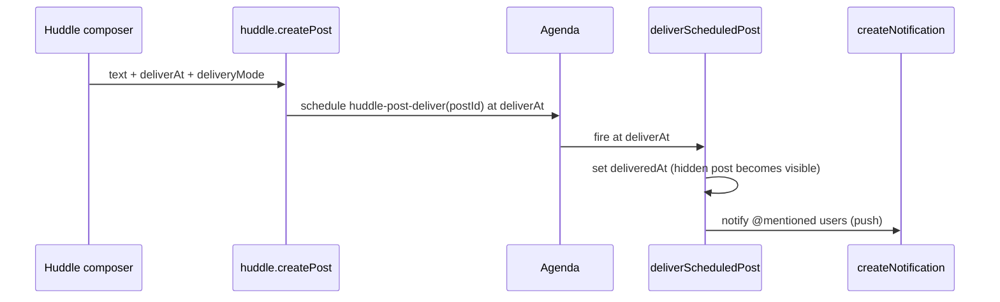

# Huddle Scheduled Posts and Replies — Plan (#596)

Branch: `feat/596-scheduled-posts`

## Goal

Write a Huddle post or reply now and pick a future time for it, in one of two modes:

- **Silent** — appears in the thread immediately, push notification deferred until the time.
- **Hidden** — invisible to everyone but the author until the time, then appears and notifies.

## Findings

- Inbox posts and replies share one write path: `huddle.createPost` from `handleMessageSent`
  in `src/pages/Huddle.tsx`. Scheduling is built once. Legacy `huddleComments` are out of scope.
- Huddle posts sent **no notifications** — not even for @mentions — so post notifications are
  built first (Phase 1). Comments wrote `notifications` directly, so they never pushed.
- Agenda (`meteor-backend/server/agenda.js`) is the scheduler; its processor is on by default
  (`METEOR_AGENDA_ENABLED`).
- SuperChat (`vendor/ui`): `composerProps.leadingSlot` and an awaited `onMessageSent` are enough
  to pick and send a schedule. It has **no** scheduled bubble state, no send-button options and no
  host message actions — those are Phase 4 (upstream).

## Decisions

- Deferred notifications go to **@mentioned users** (minus the author), same as an immediate post.
- Stored on the post (canonical only): `deliverAt`, `deliveryMode: 'silent' | 'hidden'`,
  `deliveredAt`. Posts without `deliverAt` are unchanged.
- Delivery does **not** bump `updatedAt`, so the message doesn't read as "edited" and the
  REST/DDP merge in `syncPosts` keeps preferring the live copy.
- A hidden post sorts in the thread at `deliveredAt ?? deliverAt`; its `postDate` is the
  scheduled local date.
- Plan/wrap-up posts (`clockEventId`, `wrapUp`) can't be scheduled.
- "Recipient has notifications silenced" is out of scope — no per-user notification
  preferences exist yet.

## Phase 1 — Notify on post (prerequisite)

- [ ] `notifyPostRecipients(post)` in a new `huddle-delivery.js`: notify @mentioned users
      (not the author) through `createNotification`, so it pushes
- [ ] Call it from `createHuddlePost` for immediate posts
- [ ] Comment notifications go through `createNotification` too

## Phase 2 — Backend scheduling

- [ ] `huddle-schedule-core.js` (pure): validate `deliverAt`/`deliveryMode`, visibility filter,
      `isHiddenFrom(post, userId)` + unit tests
- [ ] `createHuddlePost` / `huddle.createPost` accept `deliverAt` + `deliveryMode`; reject past, > 1 year, and plan/wrap-up posts; Wormhole schema updated
- [ ] Agenda job `huddle-post-deliver` (unique per post) + `schedulePostDelivery` /
      `cancelPostDelivery`; `deliverScheduledPost` sets `deliveredAt` and notifies, idempotent
- [ ] Hidden filter on `huddlePosts.byTeam` (snapshot + change stream), `huddle.getPosts`,
      `huddle.getMyPosts`
- [ ] `enrichPost` returns `deliverAt`, `deliveryMode`, `deliveredAt`
- [ ] `huddle.sendScheduledNow` and `huddle.reschedulePost` (author only); `deletePost` cancels
      the job; exposed over Wormhole REST
- [ ] Integration tests (create, hidden from others, deliver, reschedule, cancel)

## Phase 3 — Frontend

- [ ] `api.ts`: `HuddlePost` schedule fields; `createPost` params; `sendScheduledNow`,
      `reschedulePost`
- [ ] `superChatFeed.ts`: scheduled label + hidden-post time; `stripInboxDecorations` keeps working;
      unit tests
- [ ] Schedule control in the composer's `leadingSlot` (`Modal` + `DateInput` datetime-local +
      mode `Radio`), chip showing the pending schedule
- [ ] `handleMessageSent` sends the schedule and clears it
- [ ] "Scheduled (n)" `Sheet`: Send now / Reschedule / Cancel for my pending posts
- [ ] Release note

## Phase 4 — Upstream SuperChat (`vendor/ui`, needs approval)

- [ ] Scheduled message state on `SuperChatMessage` (outlined bubble + "Scheduled for …" footer,
      overridable `labels`) — replaces the Phase 3 text label
- [ ] `sendOptions` on `ChatComposer` (chevron by send → "Send later…"), option id passed in
      `onMessageSent` meta
- [ ] Optional `messageActions(message)` slot for Send now / Reschedule / Cancel on the bubble

## Out of Scope (for Now)

- Recipient notification preferences / quiet hours / "silenced" indicator
- Scheduling legacy comments, plan or wrap-up posts
- Recurring scheduled posts
