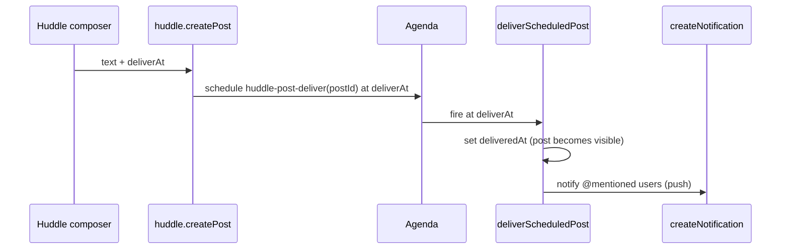

# Huddle Scheduled Posts and Replies — Plan (#596)

Branch: `feat/596-scheduled-posts`

## Goal

Write a Huddle post or reply now and pick a future time for it. Until then only the author sees
it and nobody is notified; at that time it appears for everyone and notifies.

An earlier "show now, notify later" mode was dropped: one behavior is simpler to explain and use.

## Findings

- Inbox posts and replies share one write path: `huddle.createPost` from `handleMessageSent`
  in `src/pages/Huddle.tsx`. Scheduling is built once. Legacy `huddleComments` are out of scope.
- Huddle posts sent **no notifications** — not even for @mentions — so post notifications are
  built first (Phase 1). Comments wrote `notifications` directly, so they never pushed.
- Agenda (`meteor-backend/server/agenda.js`) is the scheduler; its processor is on by default
  (`METEOR_AGENDA_ENABLED`).
- SuperChat (`vendor/ui`): `composerProps.leadingSlot` and an awaited `onMessageSent` are enough
  to pick and send a schedule. It has **no** scheduled bubble state, no send-button options and no
  host message actions — those are Phase 4 (upstream).

## Decisions

- Deferred notifications go to **@mentioned users** (minus the author), same as an immediate post.
- Stored on the post (canonical only): `deliverAt` and `deliveredAt`. Posts without
  `deliverAt` are unchanged.
- Delivery does **not** bump `updatedAt`, so the message doesn't read as "edited" and the
  REST/DDP merge in `syncPosts` keeps preferring the live copy.
- A scheduled post sorts in the thread at `deliveredAt ?? deliverAt`; its `postDate` is the
  scheduled local date.
- Plan/wrap-up posts (`clockEventId`, `wrapUp`) can't be scheduled.
- "Recipient has notifications silenced" is out of scope — no per-user notification
  preferences exist yet.

## Phase 1 — Notify on post (prerequisite)

- [x] `notifyPostRecipients(post)` in a new `huddle-delivery.js`: notify @mentioned users
      (not the author) through `createNotification`, so it pushes
- [x] Call it from `createHuddlePost` for immediate posts
- [x] Comment notifications go through `createNotification` too

## Phase 2 — Backend scheduling

- [x] `huddle-schedule-core.js` (pure): validate `deliverAt`, visibility filter,
      `isHiddenFrom(post, userId)` + unit tests
- [x] `createHuddlePost` / `huddle.createPost` accept `deliverAt`; reject past, > 1 year, and plan/wrap-up posts; Wormhole schema updated
- [x] Agenda job `huddle-post-deliver` (unique per post) + `schedulePostDelivery` /
      `cancelPostDelivery`; `deliverScheduledPost` sets `deliveredAt` and notifies, idempotent
- [x] Hidden filter on `huddlePosts.byTeam` (snapshot + change stream), `huddle.getPosts`,
      `huddle.getMyPosts`
- [x] `enrichPost` returns `deliverAt`, `deliveredAt`
- [x] `huddle.sendScheduledNow` and `huddle.reschedulePost` (author only); `deletePost` cancels
      the job; exposed over Wormhole REST
- [x] Integration tests (create, hidden from others, deliver, reschedule, cancel)

## Phase 3 — Frontend

- [x] `api.ts`: `HuddlePost` schedule fields; `createPost` params; `sendScheduledNow`,
      `reschedulePost`
- [x] `superChatFeed.ts`: scheduled label + hidden-post time; `stripInboxDecorations` keeps working;
      unit tests
- [x] Schedule dialog (`Modal` + `DateInput` datetime-local in the locale's 12/24-hour clock,
      quick picks, live "Sends …" line); first a composer chip, now behind "Send later…" (Phase 4)
- [x] `handleMessageSent` sends the schedule and clears it
- [x] "Scheduled (n)" `Sheet`: Send now / Reschedule / Cancel for my pending posts
- [x] Release note (added to 1.0.7, untagged)

## Phase 4 — Upstream SuperChat (`vendor/ui`, approved)

Committed on the fork branch `feat/superchat-host-extension-points` (not pushed yet).

- [x] Scheduled message state: `SuperChatMessage.scheduledFor` draws a pending (dashed) bubble
      with a "Scheduled · {time}" indicator; prefix via `messageLabels.scheduled`. The inbox now
      sets `scheduledFor` and keeps only the "only you can see this" note as a text label
- [x] `sendOptions` on `ChatComposer` (chevron by send), option id passed to `onSend` and on to
      `onMessageSent` as `meta.sendOption`. Huddle's "Send later…" uses it and replaces the
      Schedule chip; cancelling the dialog rejects, so the typed text comes back
- [x] Tarball rebuilt (`npm run ui:build`) and committed with the submodule pointer
- [ ] Push `vendor/ui` to the fork and open the upstream PR (needs approval)
- [ ] Optional `messageActions(message)` slot for Send now / Reschedule / Cancel on the bubble

## Out of Scope (for Now)

- Recipient notification preferences / quiet hours / "silenced" indicator
- Scheduling legacy comments, plan or wrap-up posts
- Recurring scheduled posts
