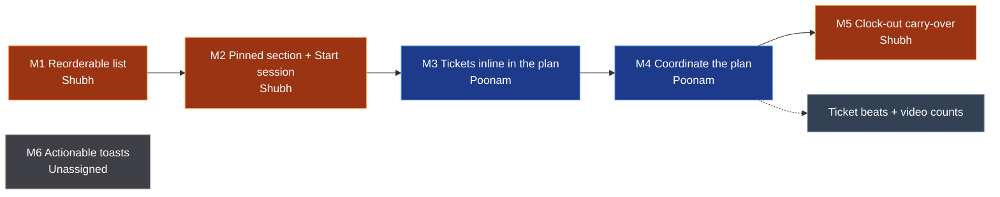

# MVP Gap Plan

## TL;DR

**Goal:** the plan is one checklist that shows on Pinned on My Board and the Clock
page and is posted once to Huddle; progress through the day shows as new Huddle
posts, never as edits to the plan post.

- [ ] `Shubh` **[M1 Reorderable list](#m1--reorderable-list-for-pins)** ([mieweb/ui#782](https://github.com/mieweb/ui/issues/782)) — `ReorderableList` in `@mieweb/ui`, with touch drag
- [ ] `Shubh` **[M2 Pinned section + Start session](#m2--pinned-section-and-start-session-on-my-board)** ([#884](https://github.com/mieweb/timehuddle/issues/884)) — ordered pins, one tap to start the day
- [ ] `Poonam` **[M3 Tickets inline in the plan](#m3--tickets-inline-in-the-plan-composer)** ([#885](https://github.com/mieweb/timehuddle/issues/885)) — tickets become checklist items, pre-filled from pins
- [ ] `Poonam` **[M4 Coordinate the plan](#m4--coordinate-the-plan-across-board-clock-page-and-huddle)** ([#886](https://github.com/mieweb/timehuddle/issues/886)) — Board and Clock page show live progress; Huddle gets new posts, never edits
- [ ] `Shubh` **[M5 Clock-out carry-over](#m5--clock-out-carry-over)** ([#887](https://github.com/mieweb/timehuddle/issues/887)) — checked items unpin, unchecked stay pinned
- [ ] `Unassigned` **[M6 Actionable toasts](#m6--actionable-toasts-issue-later)** _(later)_

**Principle:** [the Huddle timeline is append-only](#principle-the-huddle-timeline-is-append-only).

**Check-off rule for the MVP:** [touch and go](#scene-7--checking-off-touch-and-go) — switching tickets checks the previous one off, coming back unchecks it. What a check-off does to the ticket's status is decided later.
What is deliberately left out is in [What Is In and Out](#what-is-in-and-out).

## Principle: The Huddle Timeline Is Append-Only

Readers must be able to rely on what they have already read in Huddle. A post
does not change underneath them after it's posted, even if its author wishes it
said something else.

- **The plan post is the single source of what was agreed.** It records the
  plan as the team read it that morning, and it is the easy launching point
  when the day goes to plan: each ticket item in it can start that ticket's
  timer.
- **Progress is new posts, not edits.** Starting a clock, switching tickets,
  checking an item off or adding a ticket to the plan creates a new post in the
  timeline. It does not rewrite the plan post.
- **Once posted, the plan is the source of truth.** People aren't expected to
  change it over and over. Edit it only when the plan changes radically and it's
  absolutely necessary.
- **An edit must be communicated, not silent.** Teammates and managers should be
  able to see that the plan changed, when, and by whom — the edit is treated
  like a post in its own right. The original and effective dates, the edited
  time and author, and the edit window are covered by
  [#797](https://github.com/mieweb/timehuddle/issues/797).
- **Keep the chronology.** The timeline reads in the order things happened, so
  someone catching up at scrum sees the plan, then the progress, then the
  wrap-up.
- **Live state lives outside the post.** The Board's Pinned section and the Clock
  page show the plan's current state. The Huddle post records what was posted
  at the time.

Any milestone that would edit a posted message should be checked against this
principle first.

## Overview

The "day in the office" prototype video (`export.mp4`, 2:45) walks through one day with
TimeHuddle: pin today's tickets, start a session, work through them while the plan
keeps itself current, absorb a new ticket mid-day, and clock out with a Pulse
wrap-up. Its tagline: **Plan it. Clock it. Done.**

This document compares the prototype with `main`, separates what is **prototype
styling** from what is **real product work**, maps that work onto existing
`@mieweb/ui` components, and lists the MVP milestones.

**The core gap:** in the video the plan is **one checklist** that lives in three
places — the board's Pinned section, the Clock page and the Huddle post. The
prototype edits the Huddle post to show progress; we won't (see the
[principle](#principle-the-huddle-timeline-is-append-only)). On `main`, tickets are attached to the plan as chips beside a
free-text editor, and editing the plan on the Clock page while clocked in does not
update the Huddle post.

### How This Was Produced

- **Video:** frames sampled every 3 s (0.5 s around "Edit plan") and the audio
  transcribed on-device with Whisper — see the [Appendix](#appendix--transcript).
- **App:** `origin/main` @ `4f5cbb40` captured with Playwright at a 390×844 phone
  viewport, signed in as the dev Member in **Dev Team** with the video's tickets
  recreated, and run through clock in → start ticket → switch → clock out. The
  frontend ran against the local Meteor backend on the `feat/866` branch, so
  Huddle details may partly reflect that branch.
- Names, avatars, ticket prefixes (`DM-` vs `TH-`) and org labels are seed data,
  not gaps.

Legend: ✅ on `main` · 🟡 partial · ❌ missing · 🎨 prototype styling only — no issue · 🧪 experimental — not MVP

---

## What Is In and Out

| Area                                                  | Status | Decision                                                                                          |
| ----------------------------------------------------- | ------ | ------------------------------------------------------------------------------------------------- |
| Dashboard, one board across sources, Take a break     | ✅     | Nothing to do                                                                                     |
| My Board header (My Board / 🔭 / My Week, Select)     | 🎨     | The prototype just hides these. Cosmetic, no issue                                                |
| New ticket form                                       | ✅     | The prototype's bottom sheet is illustrative. **Keep the modal on `main`**                        |
| **Reorderable list (drag to pin and order)**          | 🟡     | **M1** — `ReorderableList` in [mieweb/ui#782](https://github.com/mieweb/ui/issues/782)            |
| **Pinned section + Start session**                    | ❌     | **M2**                                                                                            |
| **Tickets inline in the plan composer**               | 🟡     | **M3**                                                                                            |
| **Coordinating the plan across Board, Clock, Huddle** | 🟡     | **M4**                                                                                            |
| **Clock-out carry-over of unchecked items**           | ❌     | **M5**                                                                                            |
| **Actionable toasts (assigned, mentioned)**           | 🟡     | **M6** (issue later)                                                                              |
| Edit plan with ✕ per item + Done                      | 🎨     | Illustrative only. The plan isn't edited by hand once clocked in; the Huddle post isn't rewritten |
| Pulse recording, progress, Huddle ↔ Pulse switch      | ✅     | Works today. The QR modal is web-only; in the Capacitor app the hand-off to Pulse is native       |
| Ticket beats / video counts on rows                   | 🧪     | Keep in the design; see [Ticket Beats](#ticket-beats-and-videos-experimental)                     |
| Check-off behaviour (touch and go)                    | 🟡     | **M4** — see [Scene 7](#scene-7--checking-off-touch-and-go)                                       |
| What a check-off does to the ticket's status          | ❓     | Later — see [Open Questions](#open-questions)                                                     |

---

## Reusing `@mieweb/ui` (0.11.0)

Checked against the installed `@mieweb/ui` and its Kerebron editor. Most of the MVP
is wiring, not new components; the one new component is `ReorderableList` (M1), built upstream in `@mieweb/ui`.

| Need                                        | Component                                                                                             | Fit                                                                                                                                                                                                                                           |
| ------------------------------------------- | ----------------------------------------------------------------------------------------------------- | --------------------------------------------------------------------------------------------------------------------------------------------------------------------------------------------------------------------------------------------- |
| Plan as an inline checklist in the composer | `RichEditor` (Kerebron, already the composer)                                                         | ✅ `BasicEditorKit` ships `task_list` / `task_item` nodes, the menu has **Wrap in task list**, and markdown round-trips as `- [ ]` / `- [x]`. Ticket items are task items holding a ticket link. Removing an item is just deleting its text.  |
| Plan checklist rendered in Huddle           | `MarkdownContent` (`react-markdown` + `remark-gfm`)                                                   | ✅ GFM task lists already render as checkboxes                                                                                                                                                                                                |
| Today's plan while clocked in               | `RichEditor` (the same editor), with a ticket item that carries ▶/⏸ and its timer                     | 🟡 No separate component: after clock-in the plan stays in the editor, each ticket a checklist item. The editor has no node that draws a timer button and running time inside a task item yet — upstream in `@mieweb/ui` through `vendor/ui`. |
| Pinned / Rest of my board sections          | `Collapsible` around the existing `TicketList`; `CountBadge`                                          | ✅ Collapsible headers with counts. (`ListView` also offers `groupBy` + `defaultCollapsedGroups`, but the Tickets page uses its own `TicketList` / `TicketRow`)                                                                               |
| Start session                               | `Button` (in a `ButtonGroup` if it gains siblings)                                                    | ✅                                                                                                                                                                                                                                            |
| **Drag to pin and reorder**                 | `ReorderableList` (new, [mieweb/ui#782](https://github.com/mieweb/ui/issues/782)) on `useDragReorder` | 🟡 The hook already gives drag, Move up / Move down, Alt+↑/↓ and announcements. #782 adds a ready-made list, sliding rows and touch drag — see [M1](#m1--reorderable-list-for-pins).                                                          |
| Actionable toasts                           | `Toast` (`action: { label, onClick }`)                                                                | ✅ Already used for "Started … · View post"                                                                                                                                                                                                   |
| Running-ticket timer pill, video count      | `Badge`, `CountBadge`                                                                                 | ✅                                                                                                                                                                                                                                            |
| Video playback, upload progress             | `MediaFeed` / `VideoCard`, `Progress`                                                                 | ✅ Already used by `VideoFeedView` and Pulse uploads                                                                                                                                                                                          |

---

## Side-by-Side Walkthrough

### Scene 1 — Morning Dashboard ✅

> "Michael wants the company website updated, so naturally he picked the best man."

Same layout. The prototype's one-line brief ("Pin today's tickets, then start your
session") is copy, not an issue.

### Scene 2 — Pinned Section and Start Session ❌ → M1, M2

> "This is my board with all tickets from GitHub, Redmine and TimeHuddle. I pin the
> catalog page and scrum … just drag and pin it to the rest of my list."

- **Real work:** a **Pinned (n)** section above **Rest of my board (n)**, an
  order the user controls, and a **Start session** button on the Pinned header.
- **Cosmetic only:** the prototype hides the My Board / 🔭 / My Week toggle and the
  Select button, and shows lighter rows. No issue.
- **Data model:** My Board on `main` is an unordered `Set` of
  `${sourceId}:${id}` keys ([useMyBoardKeys.ts](../src/features/tickets/useMyBoardKeys.ts)).
  Pins need an ordered list.

### Scene 3 — New Ticket ✅

The prototype's bottom sheet only illustrates "add one ticket of my own".
**We keep the New ticket modal on `main`.** A new ticket can then be pinned like any
other (M2).

### Scene 4 — Starting a Session and the Plan Composer 🟡 → M3, M4

> "Happy with the list — Start session, or just hit play on the first ticket.
> Same thing … I tap clock in and my pinned tickets are already here. I can add
> anything that isn't in a ticket, even mention someone. One tap: clocked in, plan
> posted in Huddle, first ticket started."

How it works on `main` today:

- ▶ on a ticket starts it directly. When the team has **Require a plan** on, the
  user is sent to the Clock page instead.
- There the started ticket is attached as a **chip**, not written into the plan.
  The editor is still empty, so the user must type something else before
  **Clock in with a plan** is allowed.
- The Ticket and @Mention buttons also add **attachments** beside the text, and
  Huddle shows them as a "Plan · TH-923 · TH-922" line under the post.
- After clocking in, the Clock page shows a wrap-up composer, not today's plan
  and its progress.

What the MVP needs:

- **M3:** tickets go **into** the editor as checklist items, and the
  composer opens pre-filled with the pinned tickets.
- **M4:** coordinate the plan — after clock-in the plan stays in the same
  editor, its tickets now checklist items with ▶/⏸ and their timer; the Board
  shows the same progress; Huddle records it as new posts.

### Scene 5 — The Plan Lives in Huddle 🟡 → M4

> "We can see the time going. I see my teammates are sending messages."

In the prototype the plan post is the checklist, with a live timer on the active
item and "Plan · edited 11:35 AM" after changes. **We won't follow that part.**
Per the [principle](#principle-the-huddle-timeline-is-append-only), the plan
post stays as posted, and `main`'s separate "Started …" / "Switched to …" posts
are the right model: progress is appended to the timeline.

### Scene 6 — Ticket Beats and Videos 🧪

> "I record a beat — a few seconds of Pulse saved right on the ticket."

See [Ticket Beats and Videos (Experimental)](#ticket-beats-and-videos-experimental).
Not an immediate requirement, but the display is part of the design and should be
kept.

### Scene 7 — Checking Off: Touch and Go

> "I start this from the ticket and the catalog ticket ticks itself off with its
> hour and ten minutes."

For the MVP, checking off is kept simple: **touch and go**. Someone can move back
and forth between tickets all day.

- **Switching checks off.** Start TH-1, then switch to TH-2: TH-1's timer stops
  and TH-1 is checked off.
- **Coming back unchecks.** Start TH-1 again: it's unchecked and its timer resumes,
  adding to the time already logged.
- **Manual check and uncheck** work on the Clock page's plan editor and the
  Pinned section too. A tick takes effect at once and is posted to Huddle.
- **At clock-out,** checked items leave Pinned and unchecked items stay pinned for
  the next session (M5).
- **Ticket status doesn't change.** Whether a checked-off ticket is closed or
  moves to another status is decided later
  ([Open Questions](#open-questions)).
- **Huddle:** each switch already appends a post; it now also says what was
  checked off, e.g. "Switched to TH-2 · TH-1 checked off at 1h 10m". The plan
  post is not changed
  ([principle](#principle-the-huddle-timeline-is-append-only)).

### Scene 8 — A Teammate's Ticket Joins the Plan; Editing the Plan 🟡 → M2, M4, M6

> "Pam comes back about the photos and she's made me a ticket. It landed on my
> board. I pin it and it joins my plan, here and in Huddle. … three dots, Edit
> plan, gone — gone from my clock page too."

- **Editing:** the prototype's ✕ per item and **Done** button are illustrative.
  **We don't want that UI, and we don't edit the Huddle post to drop an item.**
  The plan is written before clocking in. **Once clocked in it isn't edited by
  hand:** the only change mid-session is a ticket pinned then joining it (M2),
  and the wrap-up at clock-out is its own post, starting from the plan (M5). Huddle's ⋯ → **Edit message**
  stays for radical rewrites only (see the
  [principle](#principle-the-huddle-timeline-is-append-only)).
- **Pinning mid-session adds the ticket to today's plan** on the Board and Clock
  page, and appends a post such as "Added TH-307 to today's plan" (M2, M4).
- **Toasts:** "Pam assigned you DM-307 · **View**" and "Pinned DM-307 · added to
  your plan in Huddle" show toasts as a way to navigate to what changed and to
  notice mentions. **M6** — issue to be created later.

### Scene 9 — Clock Out ✅ (+ carry-over → M5)

> "I clock out with a Pulse so Michael gets my update at scrum … my wrap-up is in
> Huddle for tomorrow's scrum and Pam's photos stay pinned for the morning."

- **Nothing to build for recording.** Pulse already handles screen and camera
  capture, upload progress and the hand-off back to Huddle. The QR modal on
  `main` is the **web** path; in the **Capacitor** app the switch to Pulse and
  back is native and quick.
- **Carry-over (M5):** at clock-out, with a plan or with Pulse:
  - **checked** items unpin and move back to **Rest of my board**;
  - **unchecked** items — not started, or manually unchecked — **stay pinned** as
    tomorrow's plan.

### Scene 10 — Scrum Review ✅

> "At scrum Michael scrolls through yesterday's updates instead of making everyone
> talk."

Videos play in Huddle today, and the day list is moving to Conversations in #866.
A per-day video count and a stories player are not in the MVP.

---

## Milestones

Each milestone has its own issue, all sub-issues of #880. The checklist under it is
its definition of done. **Stacked PRs:** branch from and target
`docs/880-mvp-gap-plan` (PR #883), not `main`.



### M1 — Reorderable List for Pins

**Owner:** Shubh · **Issue:** [mieweb/ui#782](https://github.com/mieweb/ui/issues/782)

The prototype's "hold one and drag it into Pinned, in the order you'll do them"
needs a reorderable list. It's being built in `@mieweb/ui` as **`ReorderableList`**
([mieweb/ui#782](https://github.com/mieweb/ui/issues/782)), on top of the existing
`useDragReorder` hook: `@dnd-kit/sortable` dragging with rows that slide aside,
**touch drag**, keyboard and move-button moves, and announcements. TimeHuddle uses
it in M2; there's no hand-rolled drag-and-drop here.

- [ ] `ReorderableList` lands in `@mieweb/ui` and TimeHuddle's `vendor/ui` picks it up
- [ ] Confirm it can move a row from Rest of my board into Pinned (two sections);
      if not, raise it on mieweb/ui#782
- [ ] Done when: pins reorder by drag on desktop and phone, and by keyboard /
      move buttons, with the new position announced

### M2 — Pinned Section and Start Session on My Board

**Owner:** Shubh · **Issue:** [#884](https://github.com/mieweb/timehuddle/issues/884)

- [ ] Model: an ordered per-user pin list next to My Board — ticket keys and
      position only (Core Model Data Discipline); pin, unpin and reorder methods
- [ ] UI: **Pinned (n)** above **Rest of my board (n)**, each a `Collapsible` with
      a `CountBadge`, reusing `TicketList` / `TicketRow`, ordered with M1
- [ ] **Start session** `Button` on the Pinned header: clock in with the pinned
      plan (M3) and start the first unchecked ticket
- [ ] While clocked in, pinning a ticket adds it to today's plan (M4)
- [ ] Done when: pins persist across reloads and devices in the user's order, for
      Huddle, Redmine and GitHub tickets alike
- [ ] Done when: with pins set, one tap goes from a clocked-out board to a running
      first ticket and a posted plan

### M3 — Tickets Inline in the Plan Composer

**Owner:** Poonam · **Issue:** [#885](https://github.com/mieweb/timehuddle/issues/885)

The plan's text is the one source of its tickets and mentions: the ids a plan
posts are read back out of it (`src/features/huddle/planItems.ts`), so there are
no ticket or mention chips on the Clock page.

- [x] The composer's **Ticket** action adds the ticket on its own line as a
      chip, with no checkbox (`[TH-923: …](/app/tickets/…)`); people can still
      write their own checklist items
- [x] The composer has two buttons, **Media** (photo, video or document) and
      **Ticket**; there is no @Mention button
- [x] In the plan composer, `@` suggests teammates and `#` the team's open
      tickets (My Board first); a pick is an atomic chip that Backspace removes
      whole, saved as a link, so the post links that ticket. In Huddle, `@`
      still lists teammates and `@team`/`@here`, and `#` inserts a ticket link;
      posted links to teammates and tickets show as chips that open in the app.
      Built on `@mieweb/ui` `ReferenceTrigger`s (`src/features/huddle/referenceTriggers.ts`)
- [ ] Upstream: [mieweb/ui#797](https://github.com/mieweb/ui/issues/797) —
      [#798](https://github.com/mieweb/ui/pull/798) chip and trigger types,
      [#799](https://github.com/mieweb/ui/pull/799) `RichEditor` `triggers`,
      [#800](https://github.com/mieweb/ui/pull/800) SuperChat chips,
      [#801](https://github.com/mieweb/ui/pull/801) `ChatComposer` triggers (draft).
      Vendored on `timehuddle/next` until they merge
- [ ] Follow-up: chips while typing in the Huddle composer too — its textarea
      shows the link's Markdown until the rich input in #801 supports uploads
      and group mentions
- [x] In the plan composer a picked teammate goes in as a link to their profile
      (`[@Name](/app/profile/<id>)`), so the mention names exactly that person
      even when teammates share a first name; a typed `@Name` still resolves by
      first name
- [ ] Follow-up: a **Mention** button that types `@` and opens the same list,
      for phones, where `@` sits on a secondary keyboard. Check on iOS and
      Android that the list isn't hidden behind the keyboard and that tapping a
      suggestion picks it
- [ ] The clock-in composer opens pre-filled with one item per pinned ticket, in
      pin order — waits on M2 ([#884](https://github.com/mieweb/timehuddle/issues/884))
- [x] A plan of ticket items alone satisfies **Require a plan**
- [x] Removing an item is deleting its text — no ✕ buttons
- [x] Huddle shows the plan as a checklist, and its label no longer repeats
      tickets the text already links
- [ ] Follow-up: Huddle's message markdown (`@mieweb/ui`) draws a bullet beside
      each checkbox — fix upstream through `vendor/ui`
- [x] Done when: starting a ticket under "Require a plan" lands on a composer that
      already contains it, and clock-in works without typing more
- [ ] Done when: mentions notify once (ids are sent once; notification count not
      yet checked end to end), and older plan posts render unchanged

### M4 — Coordinate the Plan Across Board, Clock Page and Huddle

**Owner:** Poonam · **Issue:** [#886](https://github.com/mieweb/timehuddle/issues/886)

Follows the [principle](#principle-the-huddle-timeline-is-append-only): the plan
post is not edited to show progress.

- [x] Store the session's plan items and their checked state as session data,
      separate from the posted message (`clockevents.planItems`, read and
      changed through `clock.plan` / `clock.setPlan` / `clock.checkPlanItem`;
      `meteor-backend/server/session-plan.js`)
- [x] Clock page while clocked in: today's plan stays in the **same
      `RichEditor`** the plan was written in — no separate component.
      **Clock in with a plan** turns every ticket in it into a **checklist
      item**, with its **▶/⏸ button** in front and its time this session in a
      **pill under the ticket** — ticking while it runs, paused otherwise (`planTicketsAsChecklist` in `@timehuddle/plan-items`,
      `src/features/clock/usePlanTaskEditor.tsx`). Teams with no wrap-up
      composer get the same editor read-only (`src/features/clock/TodayPlan.tsx`)
- [x] A tick or a timer button saves at once and posts to Huddle; the
      checklist's text isn't how the plan changes mid-session
- [x] Mid-session the plan changes only by pinning: a ticket pinned while
      clocked in is added as a new checklist item (M2) and posts "Added … to
      today's plan" (`addTickets` in `useSessionPlan`; the wrap-up editor
      writes its line)
- [x] Every ticket a plan gets — a Start session pin, the **Ticket** button, a
      `#` pick in a checklist — is an unchecked checklist item
      (`- [ ] [TH-12: …](/app/tickets/…)`, `planTicketItem`)
- [x] At clock-out the wrap-up starts from the plan, in the same editor: the
      wrap-up composer is that checklist, and it saves with the session's checks
      (`withChecks`). How the wrap-up is posted: M5
- [x] The ticket task item that draws ▶/⏸ and the running time needs no
      upstream change: TimeHuddle passes its own task item to `RichEditor`
      through `editorKits` (`src/features/clock/planTaskKit.ts`)
- [ ] Follow-up: Kerebron's markdown reader drops `[x]` on a task item, so a
      checklist always loads unchecked; the plan editor takes its checks from the
      session plan instead. Fix upstream (Kerebron) and drop the workaround
- [x] The server starts the session's plan from its plan post the first time a
      page or timer needs it (`@timehuddle/plan-items`)
- [x] The `ActionPlan` card and its **Edit plan** button are gone, replaced by
      the editor above
- [x] The Pinned section reflects the same state: its rows are My Board's
      `TicketRow`, which read it (`useSessionPlan`, `src/features/tickets/todayPlanRows.ts`)
- [x] Ticket items in the plan post (and on the Clock page) start that ticket's
      timer through `useTicketStart`, so the posted plan is the launching point
- [x] Check-off follows [touch and go](#scene-7--checking-off-touch-and-go):
      switching checks the previous ticket off, returning unchecks it and resumes
      its timer, and items can be checked or unchecked by hand
- [x] Starting, switching, checking off and adding to the plan each append a
      Huddle post (keep `main`'s "Started …" / "Switched to …", noting what was
      checked off; add "Added … to today's plan")
- [ ] The plan post is edited only for a radical plan rewrite, and the edit is
      shown with its time and author per
      [#797](https://github.com/mieweb/timehuddle/issues/797) — progress no
      longer edits it; showing the edit's time and author waits on #797
- [x] Live timer `Badge` on the running ticket's row and under the Clock page's
      timer. On a ticket's page, the running ticket shows its time under its
      timer button (`TimerControl`). Today's plan on the Clock page and My Board's
      rows show a ticket's time as the same `TimePill` (`src/ui/TimePill.tsx`, a
      `Badge`): green and ticking while it runs, outlined and frozen while a plan
      ticket waits; in Huddle, the plan post has buttons only, and the
      "Started …" / "Switched to …" updates are plain text
- [x] Starting a ticket from the plan post that was taken out of today's plan
      asks first whether to add it back
- [x] After REST writes, refresh the feed rather than waiting for DDP (mobile may
      have no socket) — `requestHuddleRefresh`, served when Huddle resumes
- [x] Done when: switching TH-1 → TH-2 → TH-1 leaves TH-1 unchecked with its
      timer resumed and TH-2 checked off, on both the Clock page and the Board
      (My Board's rows; the Pinned section with M2)
- [x] Done when: each switch or check appears in Huddle as a new post, with the
      plan post unchanged (`meteor-backend/tests/session-plan.test.ts`)
- [x] Done when: timers don't announce every second

### M5 — Clock-Out Carry-Over

**Owner:** Shubh · **Issue:** [#887](https://github.com/mieweb/timehuddle/issues/887)

- [x] On clock-out — with a plan or with Pulse — **checked** items unpin and return
      to Rest of my board. Both end the session through `clockStop`, which runs
      the carry-over (`server/carry-over.js`); an automatic clock-out leaves the
      pins alone
- [x] **Unchecked** items (never started, or manually unchecked) stay pinned, in
      order, for the next session
- [x] Clocking out while a plan ticket is still running asks first: **Check it
      off** (it leaves Pinned) or **Keep for next session** (it stays,
      unchecked). The Clock out button, the wrap-up and Pulse all ask
      (`useRunningPlanTicketCheck`); the server then follows the plan's checks
- [x] Read the plan state from the session data (M4's `clockevents.planItems`),
      not from the posted message. A session without it unpins nothing, so this
      takes effect once M4 merges
- [x] Post the wrap-up as its own message instead of replacing the plan text (see
      [Incidental Findings](#incidental-findings-on-main)): today's checklist with
      its final checks, plus what was written at clock-out. It notifies only the
      people mentioned in it who the plan didn't already mention. A Pulse wrap-up
      is its own post too, or joins the session's wrap-up post when there is one
      (`appendWrapUp`)
- [ ] Done when: clocking out with 3 of 4 items checked leaves only the unchecked
      item pinned, for both clock-out paths. Covered for the wrap-up by
      `tests/e2e/tickets/carry-over.spec.ts`; Pulse shares the server path
      (`meteor-backend/tests/carry-over.test.ts`) but isn't driven in a browser yet

### M6 — Actionable Toasts (Issue Later)

**Owner:** Unassigned

- [ ] "{name} assigned you TH-307 · **View**"
- [ ] "{name} mentioned you · **View**" for plan and Huddle mentions
- [ ] Confirmations that say where a change went, e.g. "Pinned TH-307 · added to
      your plan in Huddle"
- [ ] Use `Toast` with `action`, as "Started … · View post" already does

---

## Ticket Beats and Videos (Experimental)

Not an immediate requirement — the Pulse side is still being worked on — but this
is how ticket videos are meant to show, and the design should keep it.

- **Beat:** a short Pulse clip recorded on a ticket ("a few seconds of Pulse
  saved right on the ticket").
- Each ticket row shows a count of its videos — uploaded, recorded, or saved as a
  draft in Pulse — as a `Badge` such as **▶ 2 videos**, with drafts shown apart
  from uploaded ones.
- While a beat uploads, the row shows its progress (`Progress`) and then a
  "Beat added to TH-123" toast.
- A Pulse button on each row records a beat for that ticket. Today Pulse-on-a-
  ticket lives on the ticket page's Videos card
  ([TicketAttachmentsCard.tsx](../src/features/tickets/detail/TicketAttachmentsCard.tsx)).
- Ticket videos already flow into the next Huddle post about the ticket
  ([useTicketVideos.ts](../src/features/huddle/useTicketVideos.ts)).

---

## Open Questions

1. **What happens to a checked-off ticket's status** — closed, or moved to another
   status? The MVP leaves status alone
   ([touch and go](#scene-7--checking-off-touch-and-go)).
2. ~~Is the ticket that is still running at clock-out checked off, like a switch,
   or left unchecked and pinned?~~ **Resolved (M5):** clocking out asks — check it
   off, or keep it unchecked and pinned for the next session.
3. Is **"beat"** user-facing wording?

## Incidental Findings on `main`

- **Seeder import is broken locally:** `/app/settings?section=seeder` posts to
  `http://localhost:4000/v1/seed/import/parse` (the retired Fastify API) and fails
  with "Failed to fetch".
- **The wrap-up replaces the plan.** Clocking out with a wrap-up overwrites the
  plan text in the session post ("(edited)", relabelled "Wrap-up"). This breaks
  the [principle](#principle-the-huddle-timeline-is-append-only): readers lose
  the plan they read in the morning. Fixed in M5: the wrap-up is its own post.
- **Wrap-up composer opens with the plan text.** After clocking in, "What did you
  work on?" already contains the plan.

---

## Appendix — Transcript

Whisper output with obvious mis-hearings corrected (e.g. "Sandler … cross board" → "Stanley … crossword").

```text
[0:00] [Narrator], Assistant Regional Manager. Michael wants the company website updated, so naturally
[0:05] he picked the best man. Here's how I run my day. Today's goal: get the new paper catalog live
[0:12] on our website. This is my board with all tickets from GitHub, Redmine and TimeHuddle. I pin the
[0:17] catalog page and scrum, and then one ticket of my own, and just drag and pin it to the rest of my list.
[0:30] Happy with the list — Start session, or just hit play on the first ticket. Same thing. One last
[0:34] step: I'm on the clock before Stanley finishes his crossword. Or to change the plan first,
[0:40] I tap clock in and my pinned tickets are already here. I can add anything that isn't in a ticket,
[0:46] even mention someone. One tap: clocked in, plan posted in Huddle, first ticket started, and
[0:53] we can see the time going. I see my teammates are sending messages.
[0:59] An hour later the catalog has this year's prices. I record a beat — a few seconds of Pulse saved right
[1:05] on the ticket. Michael calls scrum. I start this from the ticket and the catalog ticket ticks itself
[1:13] off with its hour and ten minutes. At scrum, Michael scrolls through yesterday's updates
[1:20] instead of making everyone talk. Then he talks for 10 minutes anyway.
[1:31] Scrum's done. I tick it off and I move on to the next ticket.
[1:35] I fix the ticket and I record a beat for it.
[1:41] Pam comes back about the photos and she's made me a ticket. It landed on my board.
[1:46] I pin it and it joins my plan, here and in Huddle.
[1:52] Pam's ticket covers the photos now, so my note about them goes: three dots, Edit plan, gone. Gone
[1:58] from my clock page too. No loose ends. Loose ends are how they get you. And a quick thanks to Pam.
[2:05] That's my morning. It's five o'clock. The catalog is live and my title is fixed. Pam's photos can
[2:13] wait until tomorrow. I clock out with a Pulse so Michael gets my update at scrum. My wrap-up:
[2:19] this year's prices live and my correct title, all of it in eight seconds. Michael's attention span is nine.
[2:26] Anyways, eight hours. My wrap-up is in Huddle for tomorrow's scrum and Pam's photos stay pinned for
[2:34] the morning. Time tracking is not a joke, Jim. That's how my day goes with TimeHuddle.
[2:40] Plan it. Clock it. Done.
```
