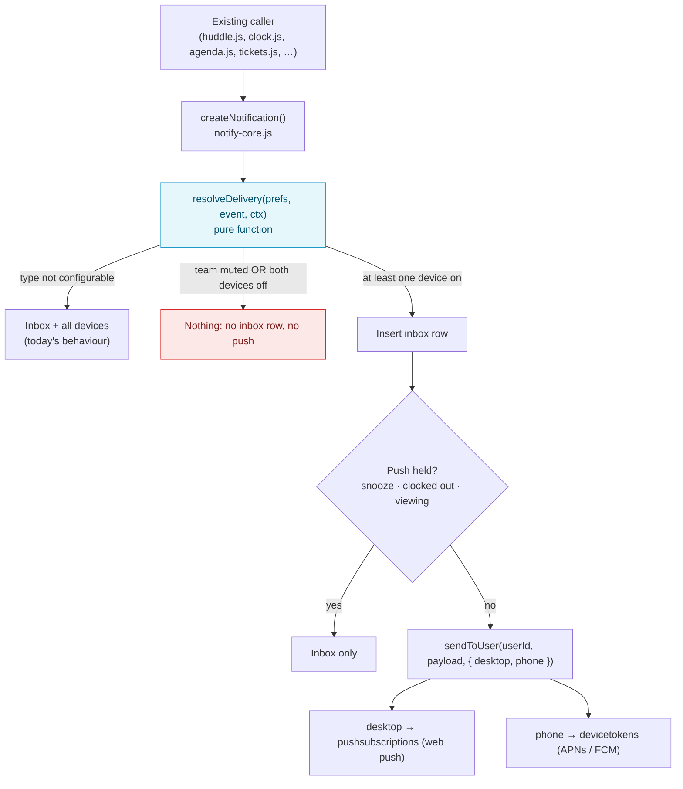
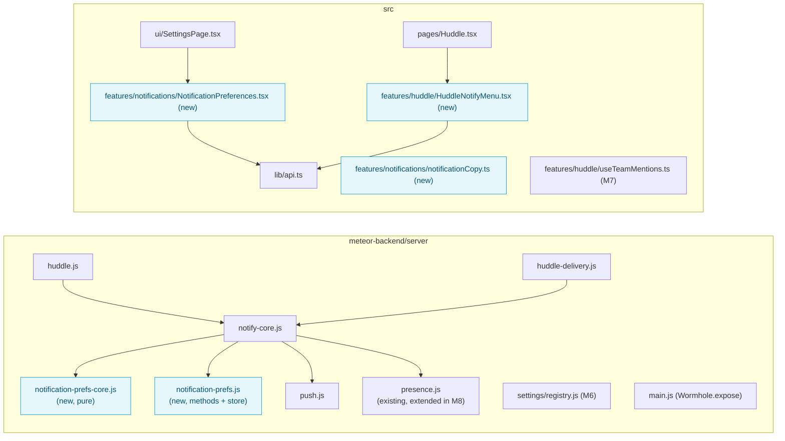

# Notification Preferences: Implementation Plan (#784)

Issue: [mieweb/timehuddle#784: Add Notification Preferences for Desktop and Phone, Starting With Huddle](https://github.com/mieweb/timehuddle/issues/784)
Branch: `feat/784-notification-preferences` (from `main`)
Prototype: [Notification Preferences Prototype](https://claude.ai/artifact/GeKnnYi53Aa6YYC3Uhjd9A). It has five screens; build the UI to match them.

> **How to use this plan.** Work the milestones in order, because each one builds on
> the one before. Each milestone is **one PR**. Tick a box only when the item is done
> _and_ verified. Each milestone ends with a **Done when** check; don't start the next
> milestone until it passes. If the code doesn't match what this plan says, stop and
> ask. Don't improvise a different design.

---

## Goal in One Paragraph

Today every notification goes to the bell inbox **and** to every device the user has
registered. The only control is one push on/off switch per device. We are adding **one
server-side decision function**, used inside `createNotification`, that decides for each
notification whether it is logged and which devices it pops up on. Users choose per
event between **Desktop** and **Phone**. Huddle adds a level per team (All posts /
Mentions & replies / Mute) and Follow per thread. Org admins get defaults and locks for
clock alerts. Existing callers of `createNotification` don't change.

## Why

- **All or nothing.** Someone who wants @mentions on their phone but not ticket-link
  changes has no way to say so, so they turn push off entirely.
- **Huddle gaps.**
  - You can't follow a busy team, quiet a noisy one, or hear about replies in a
    thread you joined but didn't start.
  - You can't address the whole team (`@team`) or the people on shift (`@here`).
- **Desktop and phone need different rules.** At a desk the app is often open, while
  a phone buzz interrupts.
- **Off-shift respect.** TimeHuddle knows when someone is clocked out, so we can hold
  Huddle pushes after hours.
- **Admin control.** Orgs decide whether admins hear about clock in/out, and can lock
  that setting.

---

## The Rules



1. **Desktop** means web push subscriptions. **Phone** means native device tokens. A
   phone browser using web push counts as Desktop.
2. **The bell inbox is a log.** An event is logged when at least one device is on for
   it. If both devices are off, the event is off entirely.
3. **Held pushes are still logged.** Snooze, hold-while-clocked-out and
   skip-while-viewing only stop the pop-up; the inbox row is still written.
4. **Precedence, most specific first:** thread follow → team level → event setting →
   default. An **org lock** overrides all of them for the events it covers.
5. **Team Mute** drops every Huddle event for that team, mentions included.
6. **No visible change until a user saves.** An unsaved event uses its default. Every
   event that existed before #784 defaults to **on for both devices**, so a user who
   never opens the settings gets exactly today's behaviour. Only the brand-new events
   (thread replies, all posts, group mentions) default Phone to off.

### Event Map

Each notification `type` maps to one preference key. A type that isn't listed is
**not configurable** and keeps today's behaviour.

| Pref key             | Notification `type`(s)                             | Desktop | Phone | Group in UI    |
| -------------------- | -------------------------------------------------- | ------- | ----- | -------------- |
| `huddleMention`      | `huddle-mention`, **new** `huddle-comment-mention` | on      | on    | Huddle         |
| `huddleReply`        | `huddle-comment` (to the post author)              | on      | on    | Huddle         |
| `huddleFollow`       | **new** `huddle-thread-reply`                      | on      | off   | Huddle         |
| `huddlePost`         | **new** `huddle-post`                              | on      | off   | Huddle         |
| `huddleGroupMention` | **new** `huddle-group-mention` (M7)                | on      | off   | Huddle         |
| `ticketAssigned`     | `ticket-assigned`                                  | on      | on    | Tickets        |
| `ticketLink`         | `ticket-link-changed`                              | on      | on    | Tickets        |
| `shiftEnd`           | `shift-end-reminder`                               | on      | on    | Time           |
| `timesheetRequest`   | `timesheet-change-request`                         | on      | on    | Time           |
| `teamClock`          | `clock-in`, `clock-out`, `clock-session-changed`   | on      | on    | Time (admins)  |
| `joinRequest`        | `team-join-request`                                | on      | on    | Teams (admins) |
| `unreadReminder`     | **new** `unread-reminder` (M9, push only)          | off     | off   | Reminders      |

Not configurable: `test`, `team-setting-change`, `team-invite`, `auto-clock-out`,
`team-join-request-approved`, `team-join-request-declined`, `redmine`,
`timesheet-entry-changed`, `clock-out-self`.

### Huddle Team Levels

| Level                | `huddleMention` / `huddleGroupMention` | `huddleReply` / `huddleFollow` | `huddlePost` |
| -------------------- | -------------------------------------- | ------------------------------ | ------------ |
| `all`                | ✓                                      | ✓                              | ✓            |
| `mentions` (default) | ✓                                      | ✓                              | ✗            |
| `mute`               | ✗                                      | ✗                              | ✗            |

✓ means the event goes through to the event setting (the user's Desktop/Phone columns); ✗ means it is dropped.

### Data Model

One document per user in a new **`notificationPrefs`** collection. Use the native
driver, not Mongoose: there are no lifecycle hooks or business rules on the document
itself. Store only what the user changed.

```js
{
  userId: 'abc',                                          // unique index
  events: { huddlePost: { desktop: true, phone: false } }, // changed keys only
  teams: { '<teamId>': 'all' | 'mentions' | 'mute' },     // absent = 'mentions'
  followedPosts: ['<postId>'],    // explicit follow, not a participant
  unfollowedPosts: ['<postId>'],  // explicit unfollow, was a participant
  quiet: {
    holdOffShift: false,
    snoozeUntil: null,            // Date or null
    snoozeUntilClockIn: false,
    skipWhileViewing: false,      // M8: off until the person turns it on
  },
  updatedAt: Date,
}
```

Don't store follower lists on posts, or display names here. Work them out when the
notification is sent (see "Core Model Data Discipline" in CLAUDE.md).

---

## Files at a Glance



---

## Milestone 1: Preference Store and Delivery Routing (Backend Only)

No UI. Users notice nothing. This milestone lays the plumbing everything else uses.

> **Naming follows the repo.** Per-user preferences here are a pure `*-core.js` file
> plus a Mongo `*.js` file (see `redmine-prefs-core.js` / `redmine-prefs.js`), so the
> new files are `notification-prefs-core.js` and `notification-prefs.js`. Later
> milestones say "the core" for the first and "the prefs module" for the second.

- [x] **1.1 New `meteor-backend/server/notification-prefs-core.js`.** Pure: no Meteor
      or Mongo imports, like `settings/registry.js`.
  - [x] `EVENTS`: the event map table above, as data. Only events that exist today;
        each later milestone adds its own.
  - [x] `prefKeyForType(type)`: returns the pref key, or `null` when the type isn't configurable.
  - [x] `resolveDelivery(prefs, ctx)` returns `{ inbox, desktop, phone }`. `ctx` is
        `{ type }` for now; later milestones add the fields they need.
  - [x] `prefsPatchToSet(patch)` validates a client patch and flattens it to dotted
        `$set` paths. `allEventSettings(prefs)` gives the Settings page every event.
- [x] **1.2 New `meteor-backend/server/notification-prefs.js`.**
  - [x] `getPrefs(userId)` and `savePrefs(userId, patch)` on the `notificationPrefs`
        collection (native driver). A unique index on `userId` is created in
        `Meteor.startup`, the same way `redmine-suggestions.js` does it.
  - [x] Meteor methods `notificationPrefs.get` and `notificationPrefs.update`. Both
        return every event's effective setting. Unknown events or devices and
        non-boolean values throw `bad-request`. Team levels arrive in M3.
- [x] **1.3 `notify-core.js` `createNotification`:**
  - [x] Load the prefs (only for configurable types) and call `resolveDelivery`.
  - [x] If `inbox` is false, return `null`.
  - [x] Otherwise insert the row, then call `sendToUser(userId, payload, { desktop, phone })`,
        but only when at least one of the two is true.
  - [x] Grep every caller and confirm none of them uses the return value in a way that
        breaks on `null`. The two that return it, `agenda.js` `notifyUser` and
        `notifyRequesterOfDecision`, are awaited and their result is ignored.
- [x] **1.4 `push.js` `sendToUser(userId, payload, devices = { desktop: true, phone: true })`:**
      skip `webSubs` when `!devices.desktop`, and skip native `tokens` when `!devices.phone`.
      Thanks to the default, other callers don't change.
- [x] **1.5 `huddle.js` `huddle.addComment`:**
  - [x] Notify mentioned users with type `huddle-comment-mention` in place of `huddle-comment`.
  - [x] Replace the `for … await` loop with `Promise.allSettled`, the same pattern as
        `notifyPostRecipients` in `huddle-delivery.js`.
  - [x] Confirm the `huddle-mention-retry` job (which dedupes on `huddle-mention` +
        `postId`) is unaffected. It only handles post mentions, and the new type keeps
        comment mentions out of its dedupe query.
- [x] **1.6 `main.js`:** `Wormhole.expose` both new methods next to the `notifications.*`
      block, and `import './notification-prefs'`. A method missing from the expose
      list returns 404 over REST.
- [x] **1.7 Tests:**
  - [x] `tests/notification-prefs-core.test.ts` (14 tests): every rule, the "no prefs
        document" case, and patch validation.
  - [x] `tests/notification-prefs.test.ts` (6 tests): get/update over REST, and a
        comment on someone's post is logged with no prefs, dropped with both devices
        off, and still logged with one device off.

**Done when:** all of these hold.

- A user with no prefs gets the same inbox rows and pushes as on `main`.
- A user who turns an event off gets no inbox row for it.
- A Desktop-only event reaches only web subscriptions.
- Lint, typecheck and format are clean.

---

## Milestone 2: Settings › Notifications Page

Match the prototype's **Settings › Notifications** and **Phone › Notifications** screens.
Use `@mieweb/ui` only:

- `Card` / `CardHeader` / `CardContent` for the cards
- `Switch` for the device toggles
- `Checkbox` for the table cells
- `ButtonGroup` + `Button` for segmented choices
- `Tabs` for the phone layout

- [x] **2.1 `src/lib/api.ts`:** add `notificationPrefsApi.get()` and `.update(events)`,
      using the same `wormholeCall` pattern as `notificationApi`.
- [x] **2.2 New `src/features/notifications/notificationCopy.ts`:** every user-facing
      string goes here, following `src/features/settings/settingsCopy.ts`. It also
      holds the event groups, labels and display order.
- [x] **2.3 New `src/features/notifications/NotificationEventSettings.tsx`:** the
      **What notifies you** card's body.
  - [x] A `Table` (`@mieweb/ui`) with Event, Desktop and Phone columns, grouped by the
        "Group in UI" column of the event map.
  - [x] Each `Checkbox` has an `aria-label` such as "Someone @mentions me, Phone".
  - [x] Changes save immediately; a failed save flips the box back and shows an error
        in an `aria-live` region.
  - [x] Columns stay editable even when this device's push is off. You can set your
        phone's alerts from a computer, and the switch only says whether _this_
        device is registered.
- [x] **2.4 `src/ui/SettingsPage.tsx`:** the `notifications` section is two `Section`
      cards. **Where you get alerts** keeps the existing `PushNotificationsSettings`
      (this device's switch + test button), relabelled "Desktop push in this browser" or
      "Phone push on this device". **What notifies you** renders
      `<NotificationEventSettings />`. There's no logic to move: a browser can only
      register itself, so one switch for this device is the honest control.
- [x] **2.5 Phone layout:** below `md`, the table becomes **Desktop | Phone** `Tabs`,
      with one `Switch` per event.
- [x] **2.6 Release note:** a "Choose what notifies you" section in
      `release-notes/1.2.0.md` (the version is untagged). The section subtitle in
      `settingsSections.ts` no longer says "teammates clock in or out".

**Done when:** all of these hold.

- The page matches the prototype at desktop and phone widths.
- Every control works with the keyboard and has an accessible name.
- A reload shows the saved state.

---

## Milestone 3: Huddle Team Level and "All Posts"

- [x] **3.1 `huddle-delivery.js`:** add `notifyTeamFollowers(post, team)`.
  - [x] It sends `huddle-post` to members and admins of the team who set it to All
        posts, except the author and anyone already @mentioned in the post.
  - [x] **Changed from the first draft:** it _does_ pre-filter, with one query
        (`usersFollowingTeam` in `notification-prefs.js`). Without it, every post
        would read every member's preferences just to drop most of them.
        `resolveDelivery` still applies the level and the event setting to whoever is left.
  - [x] Uses `Promise.allSettled`. Misses are logged, not retried: the post is in the
        feed either way.
- [x] **3.2 Called from inside `notifyPostRecipients`**, after the mention sends. Both
      places that deliver a post (the immediate-post path in `huddle.js` and
      `deliverScheduledPost`) already call that, so neither caller changed, and the
      mention retry's return value is untouched.
- [x] **3.3 `notification-prefs-core.js`:** the **Huddle Team Levels** table, using
      `ctx.teamId` (which `createNotification` reads from `data.teamId`). Team levels are
      validated in `prefsPatchToSet` and returned as `teams` by both methods. The new
      `huddlePost` event defaults to desktop on, phone off.
- [x] **3.4 New `src/features/huddle/HuddleNotifyMenu.tsx`:**
  - [x] **Desktop:** an icon-only bell `Button` (with an `aria-label` naming the team and
        level) in the **conversation header**. It opens a `Dropdown` with "Notify me in
        {team} about", All posts / Mentions & replies / Mute (`menuitemradio`), and a
        "Notification settings…" item.
  - [x] **Phone:** the same choices as a `RadioGroup` in a bottom `Sheet`.
  - [x] Bell in the primary colour, or `BellOffIcon` in muted grey on Mute.
  - [x] SuperChat has no header slot, so the bell is portaled into
        `[data-slot="superchat-header"]` with `useInboxSlot` + `findConversationHeader`,
        the same stopgap as the list-header filters. The selector is pinned by
        `useInboxSlot.test.tsx`, and the gap (2.7, `headerActions`) is logged in
        `docs/superchat-inbox-gaps.md`.
  - [x] Shown only when a team is selected. The Personal view mixes teams, so it has no bell.
- [x] **3.5 Settings page:** a **Huddle, per team** card (`HuddleTeamLevelSettings.tsx`)
      listing the user's non-personal teams, each with a `ButtonGroup` of the three
      levels (`role="radiogroup"`).
  - [x] The bell and the card share `useNotificationPrefs`, a hook that loads the prefs,
        updates the screen first and undoes the change on a failed save. "What notifies
        you" uses it too now, and `PrefsStatus` shows each card's spinner and error.
- [x] **3.6 Release note:** a bullet under "Choose what notifies you" in `release-notes/1.2.0.md`.
- [x] **Tests:** 7 more unit tests (levels and patch validation). Integration tests check
      that the default level sends nothing about new posts, All posts notifies the
      follower with the right post id, and Mute drops a reply.

**Done when:** all of these hold.

- A member on All posts gets a notification for each new post, including scheduled
  posts when they go out, but not their own posts.
- A muted member gets nothing from that team.
- The level matches between the bell and Settings.

---

## Milestone 4: Thread Follow

> **Blocked (2026-10-29).** Huddle has no comments any more: the comment UI went with
> the card view (`dd7f9f38`), `huddle.addComment` isn't exposed over REST, and nothing
> in `src/` calls it. With no replies to follow, this milestone is on hold until comments
> come back. Meanwhile the **Replies to my posts** (`huddleReply`) row is hidden in
> Settings (left out of `notificationCopy.ts`). The backend event stays, so nothing
> breaks if a comment does arrive. The steps below are unchanged, for when it resumes.

- [ ] **4.1 `huddle.js` `huddle.addComment`:** after the author and mention
      notifications, send `huddle-thread-reply` to every follower.
  - **Followers** are: the post author, everyone who commented, everyone mentioned in
    the post or a comment, and `followedPosts`.
  - Remove anyone in `unfollowedPosts`, the commenter, and anyone already notified for
    this comment.
  - Work out the list when sending, from `huddlePosts` and `huddleComments`.
- [ ] **4.2 Method `notificationPrefs.setFollow({ postId, follow })`:** it edits
      `followedPosts` and `unfollowedPosts` (add to one, remove from the other). Expose
      it in `main.js`.
- [ ] **4.3 Add a `This thread` section to the top of `HuddleNotifyMenu`:**
  - [ ] A **Follow replies** `Switch`.
  - [ ] When the user follows as a participant, show the reason ("On because you posted
        here"). Strings go in `notificationCopy.ts`.
- [ ] **4.4 Release note.**

**Done when:** all of these hold.

- A commenter hears about later comments.
- Unfollowing stops that, and following a thread you never joined starts it.
- Nobody gets two notifications for the same comment.

---

## Milestone 5: Quiet Time

- [x] **5.1 `notification-prefs-core.js`:** quiet rules turn `desktop` and `phone` off but leave `inbox` on.
  - [x] `snoozeUntil > now`: hold every push.
  - [x] `snoozeUntilClockIn && !clockedIn`: hold every push.
  - [x] `holdOffShift && !clockedIn`: hold Huddle pushes, **except** `huddleMention`.
  - [x] `prefsPatchToSet` validates `quiet` (booleans; `snoozeUntil` an ISO date or
        `null`, stored as a `Date`). `quietSettings(prefs)` fills the defaults.
- [x] **5.2 `notify-core.js`:** `needsClockState(prefs)` decides whether to look up
      `clockedIn` (a `ClockEvents` row with `endTime: null`), so users without
      clock-based quiet settings cost no extra query.
- [x] **5.3 `clock.js` `clockStart`:** calls `endSnoozeUntilClockIn(userId)` (in
      `notification-prefs.js`), fire-and-forget.
- [x] **5.4 Settings page:** a **Quiet time** card (`QuietTimeSettings.tsx`).
  - A `Switch` for "Hold Huddle pop-ups while I'm clocked out".
  - A snooze `ButtonGroup`: Off / 1 hour / Until tomorrow / Until I clock in, with a
    live status line ("Paused until Thu 3:23 PM."). The client works out the end time
    (`snoozeChange`, unit-tested; "tomorrow" is 8:00 local) and sends an ISO date. A
    snooze that has ended reads as Off.
  - `useNotificationPrefs` gained `setQuiet`, with the same undo on a failed save.
- [x] **5.5 Release note:** a "Quiet time" bullet in `release-notes/1.2.0.md`.
- [x] **Tests:** 9 more unit tests (quiet rules, `needsClockState`, patch validation),
      2 integration tests (a snooze saves as an ISO date; a reply is still logged while
      snoozed), and `QuietTimeSettings.test.ts` for `snoozeChange`.

**Done when:** all of these hold.

- While clocked out with the hold on, posts are logged without a push, and mentions still push.
- Snooze holds pushes for its duration.
- Users without quiet settings cause no extra query.

---

## Milestone 6: Org Defaults and Locks for Clock Alerts

- [x] **6.1 `settings/registry.js`:** two booleans, set at `['enterprise', 'org', 'team']`,
      both `personalExempt: false`:
  - `notifyAdminsOnClock` (default `true`)
  - `shiftEndReminders` (default `true`)
- [x] **6.2 Checked centrally, not in each caller.** `ORG_SETTING_FOR_EVENT` in the core
      maps `teamClock` → `notifyAdminsOnClock` and `shiftEnd` → `shiftEndReminders`.
      `createNotification` resolves that team setting (`orgPolicyFor`, through
      `resolveSettings`) for those types only, and `resolveDelivery` drops the
      notification when it's off. `clock.js`, `notifyClockAdmins` and `agenda.js` are
      untouched.
- [x] **6.3 Lock:**
  - [x] Locked and on: `resolveDelivery` uses the event's defaults and ignores the
        person's saved columns.
  - [x] `notificationPrefs.get` returns `locked` (events locked on for any of the user's
        teams) and shows those events at their defaults. The Settings table disables
        the row and shows a **Set by your organization** `Badge`.
- [x] **6.4 Organization and Enterprise settings:** no new tab. Both rows are added to
      the existing **Team defaults** card (`DefaultsCard`), which already handles
      "Inherited from …", "Reset to inherited" and the lock switch. The rows live once,
      in `NOTIFICATION_DEFAULT_ROWS` (`notificationCopy.ts`), spread into both lists.
      `DefaultSettingKey` in `api.ts` gained the two keys. The team page has no row:
      teams inherit, and adding a team-level control is out of scope.
- [x] **6.5 Release note:** an "Organizations set the clock alerts" bullet in `release-notes/1.2.0.md`.
- [x] **Tests:** 4 more unit tests (`orgSettingForType`, off / unlocked / locked), and an
      integration test that an org lock shows up in `locked`. The settings, clock, org and
      enterprise integration suites still pass.

**Done when:** all of these hold.

- An org admin can turn either alert off and lock it.
- Teams show the inherited value.
- A locked row can't be changed on the member's Settings page.

---

## Milestone 7: `@team` and `@here` in Huddle

This needs no `vendor/ui` change. SuperChat takes its mention list from us through
`composerProps.mentionOptions`.

- [x] **7.1 `src/features/huddle/useTeamMentions.ts`:**
  - [x] `GROUP_MENTION_OPTIONS`: `team` ("Everyone in this team") and `here` ("Everyone
        clocked in now"), using the composer's `value` and `description` fields.
        `useTeamMentions().options` stays the roster, so its tests are unchanged.
        `Huddle.tsx` puts the group options first in `mentionOptions`, in a team's view
        only (not Personal).
  - [x] `detectGroupMentions(text)` returns them separately, by the same word-boundary
        rule as a person's. `isGroupMentionId` keeps the option ids out of the user-id
        `mentions`.
- [x] **7.2 `huddle.createPost` and `huddle.updatePost`:**
  - [x] Accept `content.groupMentions` (`'team' | 'here'`), validated by
        `validGroupMentions` before anything is written. It sits apart from the user-id
        check, so `team` never hits "User not found".
  - [x] Stored on the post only when non-empty. Editing a scheduled post recomputes it
        from the text, as mentions are. The REST `huddlePostContentSchema` documents it.
- [x] **7.3 `huddle-delivery.js` `notifyPostRecipients`:** after direct mentions,
      `notifyGroupMentions` sends `huddle-group-mention`, and only then
      `notifyTeamFollowers` runs. Each person gets one notification per post: a direct
      mention, else a group mention, else a new-post alert.
  - `team` covers all members and admins.
  - `here` covers members with an open `clockevents` row for **this team**.
  - `sendPostNotifications` is shared by group mentions and new-post alerts.
- [x] **7.4 `notification-prefs-core.js`:** `huddleGroupMention` (desktop on, phone off by
      default). Dropped on Mute, allowed on Mentions & replies, and held by
      `holdOffShift`, since it isn't a personal mention.
- [x] **7.5 Rendering:** SuperChat doesn't highlight `@person` mentions either; both are
      plain text in the bubble. `@team` reads the same as a person, so vendor/ui
      doesn't need a change.
- [x] **7.6 Release note:** an "@team and @here in Huddle" bullet in `release-notes/1.2.0.md`.
- [x] **Settings:** an "@team and @here" row in **What notifies you**.
- [x] **Tests:**
  - 3 unit tests in the core.
  - 3 in `useTeamMentions.test.ts`.
  - 5 integration tests: `@team` reaches a teammate; `@here` skips someone not clocked
    in and reaches someone who is; a follower gets one notification, not two; an
    unknown group is rejected.
  - Smoke-tested in the browser: suggestion list, send, and fan-out to 4 teammates.

**Done when:** all of these hold.

- `@here` reaches only teammates clocked in to that team.
- `@team` reaches everyone in the team.
- Nobody gets both a group mention and a direct mention for the same post.

---

## Milestone 8: Skip Push While Viewing That Huddle

This doesn't need `vendor/ui` either. The server has to know that a user has a team's
Huddle open in a visible tab.

- [x] **8.1 Extended the existing `meteor-backend/server/presence.js`** (it already had a
      `presence.watch` online/offline heartbeat):
  - [x] `Meteor.publish('huddle.viewing', function (teamId) { … })` publishes no
        documents. It records `userId → teamId` in an in-memory
        `Map<userId, Map<teamId, count>>`, calls `this.ready()`, and on `this.onStop`
        decrements the count and deletes it at zero. Counting handles several open tabs.
  - [x] It checks team membership (`requireTeamMembership`) before recording anything; a
        non-member's subscription is just ready and records nothing.
  - [x] It exports `isViewingTeam(userId, teamId)`.
- [x] **8.2 New `src/features/huddle/useHuddleViewing.ts`, called from `src/pages/Huddle.tsx`:**
      holds `getDdpClient().subscribe('huddle.viewing', [teamId])` while a team is
      selected (not the Personal view) **and** the tab is visible. It unsubscribes on
      hide, team change and unmount. The DDP client resubscribes after a reconnect.
- [x] **8.3 `notify-core.js`:** passes `viewingTeam: isViewingTeam(userId, data.teamId)`.
      It's an in-memory lookup, so it needs no gate.
- [x] **8.4 `notification-prefs-core.js`:** `quiet.skipWhileViewing && viewingTeam` holds
      the push for Huddle events (mentions included, since you're looking at it) and
      keeps `inbox`. `skipWhileViewing` defaults to **off** (changed after review, see below) and is validated as a boolean.
- [x] **8.5 Settings Quiet time card:** a "Skip pop-ups for a Huddle I have open"
      `Switch`, off until the person turns it on. Both quiet switches share a small `QuietSwitchRow`.
- [x] **8.6 Release note:** one sentence added to the "Quiet time" bullet.
- [x] **Tests:** 2 more unit tests (held while viewing; pushes when turned off).
      Verified end to end on the dev server: with dev-member viewing Bench Team 1, an
      `@team` post gave all four teammates an inbox row, and `sendToUser` ran for the
      three who weren't viewing but not for the viewer.

**Known limit:** the map lives in one server process. If an app ever runs more than one
instance behind a load balancer, move it to a Mongo collection with a TTL index. Note
this in a comment at the top of `presence.js`.

**Done when:** all of these hold.

- With the team's Huddle open and visible on desktop, a post in that team causes no
  phone buzz, but the item is in the bell.
- Hiding the tab restores pushes within a few seconds.

---

## Milestone 9: Remind Me About Unread Notifications

A stacked PR on #793. Someone who doesn't see a notification gets a push reminding them
to check the bell, with each wait double the last.

- [x] **9.1 `notification-prefs-core.js`:** a new `unreadReminder` event (type
      `unread-reminder`), **off** for both devices until the person turns it on. It is
      **push only**: `resolveDelivery` returns `inbox: false` for it, since a row about
      unread rows would keep the reminders going forever. Quiet time holds it like any
      pop-up. `UNREAD_REMINDER_HOURS = [2, 4, 8, 16, 32]` and `unreadReminderDelayMs(step)`
      give the waits; `wantsUnreadReminders(prefs)` says whether either device is on.
- [x] **9.2 New `meteor-backend/server/unread-reminders.js`:** one Agenda job per user
      (`unread-reminder`, data `{ userId, step }`).
  - [x] `createNotification` calls `startUnreadReminders(userId)` after its insert. It
        schedules step 0 two hours out with `.unique(…, { insertOnly: true })`, so a
        notification arriving mid-run doesn't restart the waits.
  - [x] When the job runs it counts every unread row. With none, or with reminders
        turned off since, it removes itself. Otherwise it pushes "You have N unread
        notifications" (tag `unread-reminder`, `url: /app/notifications`) and queues the
        next step. After the 32-hour reminder it removes itself; the next notification
        starts again at 2 hours.
  - [x] `markOneRead`, `markAllRead`, `deleteMany` and `respondToInvite` call
        `stopUnreadRemindersIfAllRead(userId)`, which cancels the job once nothing is
        unread.
- [x] **9.3 Settings:** a **Reminders** group in `notificationCopy.ts`. The existing
      What notifies you table shows it with no new component.
- [x] **9.4 Tapping it** opens `/app/notifications` through the existing `url` handling in
      `public/sw.js` and `AppLayout`. It carries no `notificationId`, so nothing is
      marked read.
- [x] **9.5 Release note:** a bullet under "Choose what notifies you".
- [x] **Tests:** 4 unit tests (off by default, push only, held by a snooze, the waits),
      3 integration tests (nothing while off; one job 2 hours out that a second
      notification doesn't move; cancelled by Mark all read). Checked on the test backend
      that a due job pushes and moves itself to step 1, 4 hours out.

**Known limit:** turning reminders on doesn't start them for notifications that are
already unread; the next new notification does.

---

## Review Follow-ups (PR #793)

Fixed after the Copilot review and the browser and phone walkthrough (2026-10-29).
Each one was confirmed before it was fixed.

- [x] **Silent auto clock-out (Copilot #1).** With the shift-end reminder off, the
      8-hour job still clocked people out with no prompt and nothing in the inbox.
  - [x] The reminder is now an _actionable_ event (`ACTIONABLE_EVENTS` in the core):
        unticking both devices stops the pop-ups but keeps it in the inbox.
  - [x] An organization turning reminders off drops the reminder, and `agenda.js`
        then schedules no automatic clock-out.
  - [x] Re-checked on the dev server with backdated sessions: both cases behave.
- [x] **Shift reminder opened from a closed app (Copilot #10).** A tapped shift-end
      push is no longer marked read before the prompt opens (`markPushRead`, `sw.js`).
- [x] **"Until I clock in" picked mid-shift (Copilot #4).** It now holds pop-ups
      whenever it's set. Clocking in clears it.
- [x] **The open app's own desktop alert ignored preferences (Copilot #6).** Each
      inbox row records `pushed: { desktop, phone }`, and `main.tsx` only alerts when
      `pushed.desktop` is true.
- [x] **Locked off shown as editable (Copilot #5).** `notificationPrefs.get` reports
      locks at either value, and shows locked-off events as off and disabled.
- [x] **Bell save failures were silent (Copilot #8).** The bell shows a toast.
- [x] **Overlapping saves (Copilot #9).** `useNotificationPrefs` sends saves one at a
      time, and a failed older save can't undo a newer choice (tested).
- [x] **Repeat pop-ups replaced each other.** Pushes were tagged with their type, so a
      second "new post" silently replaced the first on desktop and phone. Each push
      is now tagged with its own notification id, and the open app's alert uses the
      same tag so the two collapse into one.
- [ ] **Left as is:**
  - Copilot #2 (a comment mentioning the post author): comments can't be written today.
  - Copilot #7 (legacy team ids in the shared permission check): belongs in a separate PR.
- [x] **Skip-while-viewing was on by default (Copilot #3).** That changed pushes
      for people who never opened Settings, breaking "nothing changes until you
      change it". It now defaults to **off**; each person turns it on in Quiet time.
      No other default changed: people set their own preferences.

## Every Milestone

- [x] `npm run test:all`: 793 Vitest tests pass. In Playwright, 438 passed, 3 failed, 3 flaky
      (2026-10-29). None of the three failures comes from this branch:
  - `video-upload.spec.ts:40` (WebM served as MP4) fails on `main` as well. It's an
    environment problem: the local transcoding check doesn't pass here.
  - `my-board.spec.ts:104` and `clock-in-then-start.spec.ts:84` are flaky: they
    failed and passed on `main` from one run to the next, and both pass on this branch
    when rerun.
- [x] The new backend tests pass locally: 492 backend unit tests, 17 in
      `notification-prefs.test.ts`, plus the huddle, clock, settings, org and enterprise
      integration suites.
- [x] `npm run lint && npm run typecheck` pass, and `npm run format` is clean.
- [x] Smoke-tested on the dev server (`:3000` → `:3100`) at desktop and phone widths:
      the Settings cards, the Huddle bell (dropdown and bottom sheet), `@team`
      suggestions and fan-out, org locks, quiet time, and skip-while-viewing (checked in
      the server's `sendToUser` log). A real push to a device wasn't checked: there's no
      browser with notifications allowed, and no phone, in this setup.
- [x] Every new control comes from `@mieweb/ui` (`Table`, `Checkbox`, `Switch`, `Tabs`,
      `ButtonGroup`, `Button`, `Dropdown`, `Sheet`, `RadioGroup`, `Badge`), has an
      accessible name, and takes its strings from `notificationCopy.ts`.

## Out of Scope (for Now)

- Email notifications, digests or batching
- A different setting for each individual device (it's one Desktop setting and one Phone setting per account)
- An org default for the Huddle team level (the settings hierarchy only holds booleans today)
- Custom quiet hours by clock time (v1 offers holds tied to the clock-in state, plus snooze)
- `@team` / `@here` in comments (M7 covers posts only)
- Restricting who may use `@team`
- Notification sounds, highlight keywords, unread-badge controls
- Migrating or backfilling existing notifications
