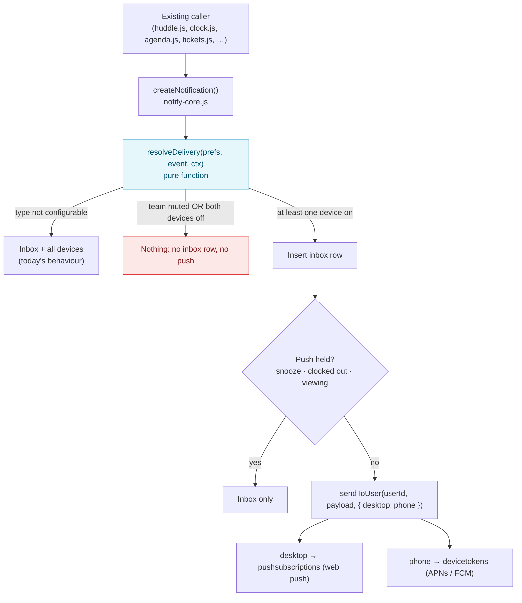
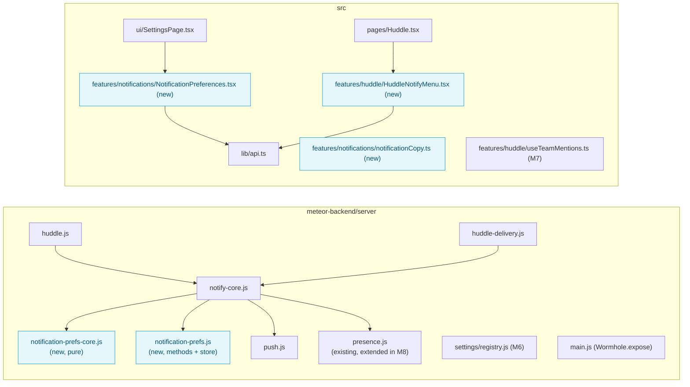

# Notification Preferences: Implementation Plan (#784)

Issue: [mieweb/timehuddle#784: Add Notification Preferences for Desktop and Phone, Starting With Huddle](https://github.com/mieweb/timehuddle/issues/784)
Branch: `feat/784-notification-preferences` (from `main`)
Prototype: [Notification Preferences Prototype](https://claude.ai/artifact/GeKnnYi53Aa6YYC3Uhjd9A). It has five screens; build the UI to match them.

> **How to use this plan.** Work the milestones in order, because each one builds on
> the one before. Each milestone is **one PR**. Tick a box only when the item is done
> _and_ verified. Each milestone ends with a **Done when** check; don't start the next
> milestone until it passes. If the code doesn't match what this plan says, stop and
> ask. Don't improvise a different design.

---

## Goal in One Paragraph

Today every notification goes to the bell inbox **and** to every device the user has
registered. The only control is one push on/off switch per device. We are adding **one
server-side decision function**, used inside `createNotification`, that decides for each
notification whether it is logged and which devices it pops up on. Users choose per
event between **Desktop** and **Phone**. Huddle adds a level per team (All posts /
Mentions & replies / Mute) and Follow per thread. Org admins get defaults and locks for
clock alerts. Existing callers of `createNotification` don't change.

## Why

- **All or nothing.** Someone who wants @mentions on their phone but not ticket-link
  changes has no way to say so, so they turn push off entirely.
- **Huddle gaps.**
  - You can't follow a busy team, quiet a noisy one, or hear about replies in a
    thread you joined but didn't start.
  - You can't address the whole team (`@team`) or the people on shift (`@here`).
- **Desktop and phone need different rules.** At a desk the app is often open, while
  a phone buzz interrupts.
- **Off-shift respect.** TimeHuddle knows when someone is clocked out, so we can hold
  Huddle pushes after hours.
- **Admin control.** Orgs decide whether admins hear about clock in/out, and can lock
  that setting.

---

## The Rules



1. **Desktop** means web push subscriptions. **Phone** means native device tokens. A
   phone browser using web push counts as Desktop.
2. **The bell inbox is a log.** An event is logged when at least one device is on for
   it. If both devices are off, the event is off entirely.
3. **Held pushes are still logged.** Snooze, hold-while-clocked-out and
   skip-while-viewing only stop the pop-up; the inbox row is still written.
4. **Precedence, most specific first:** thread follow → team level → event setting →
   default. An **org lock** overrides all of them for the events it covers.
5. **Team Mute** drops every Huddle event for that team, mentions included.
6. **No visible change until a user saves.** An unsaved event uses its default. Every
   event that existed before #784 defaults to **on for both devices**, so a user who
   never opens the settings gets exactly today's behaviour. Only the brand-new events
   (thread replies, all posts, group mentions) default Phone to off.

### Event Map

Each notification `type` maps to one preference key. A type that isn't listed is
**not configurable** and keeps today's behaviour.

| Pref key             | Notification `type`(s)                             | Desktop | Phone | Group in UI    |
| -------------------- | -------------------------------------------------- | ------- | ----- | -------------- |
| `huddleMention`      | `huddle-mention`, **new** `huddle-comment-mention` | on      | on    | Huddle         |
| `huddleReply`        | `huddle-comment` (to the post author)              | on      | on    | Huddle         |
| `huddleFollow`       | **new** `huddle-thread-reply`                      | on      | off   | Huddle         |
| `huddlePost`         | **new** `huddle-post`                              | on      | off   | Huddle         |
| `huddleGroupMention` | **new** `huddle-group-mention` (M7)                | on      | off   | Huddle         |
| `ticketAssigned`     | `ticket-assigned`                                  | on      | on    | Tickets        |
| `ticketLink`         | `ticket-link-changed`                              | on      | on    | Tickets        |
| `shiftEnd`           | `shift-end-reminder`                               | on      | on    | Time           |
| `timesheetRequest`   | `timesheet-change-request`                         | on      | on    | Time           |
| `teamClock`          | `clock-in`, `clock-out`, `clock-session-changed`   | on      | on    | Time (admins)  |
| `joinRequest`        | `team-join-request`                                | on      | on    | Teams (admins) |

Not configurable: `test`, `team-setting-change`, `team-invite`, `auto-clock-out`,
`team-join-request-approved`, `team-join-request-declined`, `redmine`,
`timesheet-entry-changed`, `clock-out-self`.

### Huddle Team Levels

| Level                | `huddleMention` / `huddleGroupMention` | `huddleReply` / `huddleFollow` | `huddlePost` |
| -------------------- | -------------------------------------- | ------------------------------ | ------------ |
| `all`                | ✓                                      | ✓                              | ✓            |
| `mentions` (default) | ✓                                      | ✓                              | ✗            |
| `mute`               | ✗                                      | ✗                              | ✗            |

✓ means the event goes through to the event setting (the user's Desktop/Phone columns); ✗ means it is dropped.

### Data Model

One document per user in a new **`notificationPrefs`** collection. Use the native
driver, not Mongoose: there are no lifecycle hooks or business rules on the document
itself. Store only what the user changed.

```js
{
  userId: 'abc',                                          // unique index
  events: { huddlePost: { desktop: true, phone: false } }, // changed keys only
  teams: { '<teamId>': 'all' | 'mentions' | 'mute' },     // absent = 'mentions'
  followedPosts: ['<postId>'],    // explicit follow, not a participant
  unfollowedPosts: ['<postId>'],  // explicit unfollow, was a participant
  quiet: {
    holdOffShift: false,
    snoozeUntil: null,            // Date or null
    snoozeUntilClockIn: false,
    skipWhileViewing: true,       // M8
  },
  updatedAt: Date,
}
```

Don't store follower lists on posts, or display names here. Work them out when the
notification is sent (see "Core Model Data Discipline" in CLAUDE.md).

---

## Files at a Glance



---

## Milestone 1: Preference Store and Delivery Routing (Backend Only)

No UI. Users notice nothing. This milestone lays the plumbing everything else uses.

> **Naming follows the repo.** Per-user preferences here are a pure `*-core.js` file
> plus a Mongo `*.js` file (see `redmine-prefs-core.js` / `redmine-prefs.js`), so the
> new files are `notification-prefs-core.js` and `notification-prefs.js`. Later
> milestones say "the core" for the first and "the prefs module" for the second.

- [x] **1.1 New `meteor-backend/server/notification-prefs-core.js`.** Pure: no Meteor
      or Mongo imports, like `settings/registry.js`.
  - [x] `EVENTS`: the event map table above, as data. Only events that exist today;
        each later milestone adds its own.
  - [x] `prefKeyForType(type)`: returns the pref key, or `null` when the type isn't configurable.
  - [x] `resolveDelivery(prefs, ctx)` returns `{ inbox, desktop, phone }`. `ctx` is
        `{ type }` for now; later milestones add the fields they need.
  - [x] `prefsPatchToSet(patch)` validates a client patch and flattens it to dotted
        `$set` paths. `allEventSettings(prefs)` gives the Settings page every event.
- [x] **1.2 New `meteor-backend/server/notification-prefs.js`.**
  - [x] `getPrefs(userId)` and `savePrefs(userId, patch)` on the `notificationPrefs`
        collection (native driver). A unique index on `userId` is created in
        `Meteor.startup`, the same way `redmine-suggestions.js` does it.
  - [x] Meteor methods `notificationPrefs.get` and `notificationPrefs.update`. Both
        return every event's effective setting. Unknown events or devices and
        non-boolean values throw `bad-request`. Team levels arrive in M3.
- [x] **1.3 `notify-core.js` `createNotification`:**
  - [x] Load the prefs (only for configurable types) and call `resolveDelivery`.
  - [x] If `inbox` is false, return `null`.
  - [x] Otherwise insert the row, then call `sendToUser(userId, payload, { desktop, phone })`,
        but only when at least one of the two is true.
  - [x] Grep every caller and confirm none of them uses the return value in a way that
        breaks on `null`. The two that return it, `agenda.js` `notifyUser` and
        `notifyRequesterOfDecision`, are awaited and their result is ignored.
- [x] **1.4 `push.js` `sendToUser(userId, payload, devices = { desktop: true, phone: true })`:**
      skip `webSubs` when `!devices.desktop`, and skip native `tokens` when `!devices.phone`.
      Thanks to the default, other callers don't change.
- [x] **1.5 `huddle.js` `huddle.addComment`:**
  - [x] Notify mentioned users with type `huddle-comment-mention` in place of `huddle-comment`.
  - [x] Replace the `for … await` loop with `Promise.allSettled`, the same pattern as
        `notifyPostRecipients` in `huddle-delivery.js`.
  - [x] Confirm the `huddle-mention-retry` job (which dedupes on `huddle-mention` +
        `postId`) is unaffected. It only handles post mentions, and the new type keeps
        comment mentions out of its dedupe query.
- [x] **1.6 `main.js`:** `Wormhole.expose` both new methods next to the `notifications.*`
      block, and `import './notification-prefs'`. A method missing from the expose
      list returns 404 over REST.
- [x] **1.7 Tests:**
  - [x] `tests/notification-prefs-core.test.ts` (14 tests): every rule, the "no prefs
        document" case, and patch validation.
  - [x] `tests/notification-prefs.test.ts` (6 tests): get/update over REST, and a
        comment on someone's post is logged with no prefs, dropped with both devices
        off, and still logged with one device off.

**Done when:** all of these hold.

- A user with no prefs gets the same inbox rows and pushes as on `main`.
- A user who turns an event off gets no inbox row for it.
- A Desktop-only event reaches only web subscriptions.
- Lint, typecheck and format are clean.

---

## Milestone 2: Settings › Notifications Page

Match the prototype's **Settings › Notifications** and **Phone › Notifications** screens.
Use `@mieweb/ui` only:

- `Card` / `CardHeader` / `CardContent` for the cards
- `Switch` for the device toggles
- `Checkbox` for the table cells
- `ButtonGroup` + `Button` for segmented choices
- `Tabs` for the phone layout

- [x] **2.1 `src/lib/api.ts`:** add `notificationPrefsApi.get()` and `.update(events)`,
      using the same `wormholeCall` pattern as `notificationApi`.
- [x] **2.2 New `src/features/notifications/notificationCopy.ts`:** every user-facing
      string goes here, following `src/features/settings/settingsCopy.ts`. It also
      holds the event groups, labels and display order.
- [x] **2.3 New `src/features/notifications/NotificationEventSettings.tsx`:** the
      **What notifies you** card's body.
  - [x] A `Table` (`@mieweb/ui`) with Event, Desktop and Phone columns, grouped by the
        "Group in UI" column of the event map.
  - [x] Each `Checkbox` has an `aria-label` such as "Someone @mentions me, Phone".
  - [x] Changes save immediately; a failed save flips the box back and shows an error
        in an `aria-live` region.
  - [x] Columns stay editable even when this device's push is off. You can set your
        phone's alerts from a computer, and the switch only says whether _this_
        device is registered.
- [x] **2.4 `src/ui/SettingsPage.tsx`:** the `notifications` section is two `Section`
      cards. **Where you get alerts** keeps the existing `PushNotificationsSettings`
      (this device's switch + test button), relabelled "Desktop push in this browser" or
      "Phone push on this device". **What notifies you** renders
      `<NotificationEventSettings />`. There's no logic to move: a browser can only
      register itself, so one switch for this device is the honest control.
- [x] **2.5 Phone layout:** below `md`, the table becomes **Desktop | Phone** `Tabs`,
      with one `Switch` per event.
- [x] **2.6 Release note:** a "Choose what notifies you" section in
      `release-notes/1.2.0.md` (the version is untagged). The section subtitle in
      `settingsSections.ts` no longer says "teammates clock in or out".

**Done when:** all of these hold.

- The page matches the prototype at desktop and phone widths.
- Every control works with the keyboard and has an accessible name.
- A reload shows the saved state.

---

## Milestone 3: Huddle Team Level and "All Posts"

- [ ] **3.1 `huddle-delivery.js`:** add `notifyTeamFollowers(post, team)`.
  - It sends `huddle-post` to every member and admin of the team, except the author and
    anyone already @mentioned in the post.
  - Don't pre-filter by level; `resolveDelivery` drops members who aren't on `all`.
  - Use `Promise.allSettled`.
- [ ] **3.2 Call it where `notifyPostRecipients` is already called:** the immediate-post
      path in `huddle.js` and `deliverScheduledPost`.
- [ ] **3.3 `notification-prefs-core.js`:** turn on the **Huddle Team Levels** table.
- [ ] **3.4 New `src/features/huddle/HuddleNotifyMenu.tsx`:**
  - [ ] **Desktop:** an icon-only bell `Button` (with an `aria-label`) in the
        **conversation header**, just left of the ⋯ menu. It opens a `Dropdown` with a
        **{Team name}** section (All posts / Mentions & replies / Mute) and a
        "Notification settings…" link to `/app/settings?section=notifications`.
  - [ ] **Phone:** the same content in a `Sheet` (bottom sheet).
  - [ ] Show the bell as active while the team isn't on Mute.
- [ ] **3.5 Settings page:** add a **Huddle, per team** card listing the user's teams,
      with a `ButtonGroup` per team.
- [ ] **3.6 Release note.**

**Done when:** all of these hold.

- A member on All posts gets a notification for each new post, including scheduled
  posts when they go out, but not their own posts.
- A muted member gets nothing from that team.
- The level matches between the bell and Settings.

---

## Milestone 4: Thread Follow

- [ ] **4.1 `huddle.js` `huddle.addComment`:** after the author and mention
      notifications, send `huddle-thread-reply` to every follower.
  - **Followers** are: the post author, everyone who commented, everyone mentioned in
    the post or a comment, and `followedPosts`.
  - Remove anyone in `unfollowedPosts`, the commenter, and anyone already notified for
    this comment.
  - Work out the list when sending, from `huddlePosts` and `huddleComments`.
- [ ] **4.2 Method `notificationPrefs.setFollow({ postId, follow })`:** it edits
      `followedPosts` and `unfollowedPosts` (add to one, remove from the other). Expose
      it in `main.js`.
- [ ] **4.3 Add a `This thread` section to the top of `HuddleNotifyMenu`:**
  - [ ] A **Follow replies** `Switch`.
  - [ ] When the user follows as a participant, show the reason ("On because you posted
        here"). Strings go in `notificationCopy.ts`.
- [ ] **4.4 Release note.**

**Done when:** all of these hold.

- A commenter hears about later comments.
- Unfollowing stops that, and following a thread you never joined starts it.
- Nobody gets two notifications for the same comment.

---

## Milestone 5: Quiet Time

- [ ] **5.1 `notification-prefs-core.js`:** quiet rules turn `desktop` and `phone` off but leave `inbox` on.
  - `snoozeUntil > now`: hold every push.
  - `snoozeUntilClockIn && !clockedIn`: hold every push.
  - `holdOffShift && !clockedIn`: hold Huddle pushes, **except** `huddleMention`.
- [ ] **5.2 `notify-core.js`:** look up `clockedIn` only when the user has one of these
      quiet settings on, so the common path makes no extra query. A user counts as
      clocked in when they have a `ClockEvents` row with `endTime: null`.
- [ ] **5.3 `clock.js` clock-in:** clear `snoozeUntilClockIn`.
- [ ] **5.4 Settings page:** add a **Quiet time** card.
  - A `Switch` for "Hold Huddle pushes while I'm clocked out".
  - A snooze `ButtonGroup`: Off / 1 hour / Until tomorrow / Until I clock in. "Until
    tomorrow" means 8:00 the next morning in the user's local time; the client works
    it out and sends a `Date`.
- [ ] **5.5 Release note.**

**Done when:** all of these hold.

- While clocked out with the hold on, posts are logged without a push, and mentions still push.
- Snooze holds pushes for its duration.
- Users without quiet settings cause no extra query.

---

## Milestone 6: Org Defaults and Locks for Clock Alerts

- [ ] **6.1 `settings/registry.js`:** add two booleans, set at
      `['enterprise', 'org', 'team']`. Both are `personalExempt: false`.
  - `notifyAdminsOnClock` (default `true`)
  - `shiftEndReminders` (default `true`)
- [ ] **6.2 Callers:** check the resolved setting before sending. Off means the
      notification isn't created at all.
  - In `clock.js`: the admin clock-in and clock-out notifications.
  - In `notify-core.js`: `notifyClockAdmins`.
  - In `agenda.js`: the `shift-end-reminder` job.
- [ ] **6.3 Lock:**
  - [ ] When the setting is **locked and on**, `resolveDelivery` uses the defaults for
        `teamClock` / `shiftEnd` and ignores the user's saved columns.
  - [ ] Return the lock state from `notificationPrefs.get`, so the Settings table can
        disable the row and show a **Locked by org** `Badge`.
- [ ] **6.4 Organization settings:** add a **Notifications** tab with the two rows.
      Reuse `TeamSettingRow` and `describeSetting` for "Inherited from …" and
      "Reset to inherited".
- [ ] **6.5 Release note.**

**Done when:** all of these hold.

- An org admin can turn either alert off and lock it.
- Teams show the inherited value.
- A locked row can't be changed on the member's Settings page.

---

## Milestone 7: `@team` and `@here` in Huddle

This needs no `vendor/ui` change. SuperChat takes its mention list from us through
`composerProps.mentionOptions`.

- [ ] **7.1 `src/features/huddle/useTeamMentions.ts`:**
  - [ ] Put two group options at the front of `options`: `team` ("Everyone in this
        team") and `here` ("Everyone clocked in now").
  - [ ] Teach `detect()` to return them separately as `groupMentions`, so they never
        end up in the user-id `mentions` list.
- [ ] **7.2 `huddle.createPost`:**
  - [ ] Accept `content.groupMentions`, an array of `'team' | 'here'`.
  - [ ] Validate it before the existing user-id mention check, which would otherwise
        throw "User not found" on `team`.
  - [ ] Store it on the post. It is domain data: who was addressed.
- [ ] **7.3 `huddle-delivery.js` `notifyPostRecipients`:** expand the group mentions and
      send type `huddle-group-mention`, skipping the author and anyone mentioned directly.
  - `team` covers all team members and admins.
  - `here` covers members with an open `ClockEvents` row for **this team**
    (`teamId`, `endTime: null`).
- [ ] **7.4 `notification-prefs-core.js`:** `huddleGroupMention` follows the team-level table above.
      `holdOffShift` **does** hold it, because it isn't a personal mention.
- [ ] **7.5 Check rendering:** confirm `@team` and `@here` are highlighted like
      `@person` in `MarkdownContent`. If they aren't, stop and ask before changing
      `vendor/ui`.
- [ ] **7.6 Release note.**

**Done when:** all of these hold.

- `@here` reaches only teammates clocked in to that team.
- `@team` reaches everyone in the team.
- Nobody gets both a group mention and a direct mention for the same post.

---

## Milestone 8: Skip Push While Viewing That Huddle

This doesn't need `vendor/ui` either. The server has to know that a user has a team's
Huddle open in a visible tab.

- [ ] **8.1 Extend the existing `meteor-backend/server/presence.js`.** It already has a
      `presence.watch` online/offline heartbeat; add the following next to it:
  - [ ] `Meteor.publish('huddle.viewing', function (teamId) { … })` publishes no
        documents. It records `this.userId → teamId` in an in-memory
        `Map<userId, Map<teamId, count>>`, calls `this.ready()`, and on `this.onStop`
        decrements the count and deletes it at zero. Counting handles several open tabs.
  - [ ] It checks team membership (`requireTeamMember`) before recording anything.
  - [ ] It exports `isViewingTeam(userId, teamId)`.
- [ ] **8.2 `src/pages/Huddle.tsx`:** while a team is selected **and**
      `document.visibilityState === 'visible'`, hold
      `getDdpClient().subscribe('huddle.viewing', [teamId])`. Unsubscribe when the tab
      is hidden, when the team changes, and on unmount. Follow the existing
      `huddlePosts.byTeam` subscription around line 542.
- [ ] **8.3 `notify-core.js`:** for Huddle types with a `teamId`, pass
      `viewingTeam: isViewingTeam(userId, teamId)`.
- [ ] **8.4 `notification-prefs-core.js`:** `quiet.skipWhileViewing && viewingTeam` turns `desktop` and
      `phone` off and keeps `inbox`.
- [ ] **8.5 Settings Quiet time card:** add a `Switch` labelled "Skip push while I have
      that Huddle open", defaulting to on.
- [ ] **8.6 Release note.**

**Known limit:** the map lives in one server process. If an app ever runs more than one
instance behind a load balancer, move it to a Mongo collection with a TTL index. Note
this in a comment at the top of `presence.js`.

**Done when:** all of these hold.

- With the team's Huddle open and visible on desktop, a post in that team causes no
  phone buzz, but the item is in the bell.
- Hiding the tab restores pushes within a few seconds.

---

## Every Milestone

- [ ] `npm run test:all` passes, and the new backend tests pass locally
- [ ] `npm run lint && npm run typecheck` pass, and `npm run format` is clean
- [ ] Smoke-tested at `http://localhost:3000`, with one real desktop push and, if a
      device is available, one phone push
- [ ] Every new control comes from `@mieweb/ui`, has an accessible name, and takes its
      strings from `notificationCopy.ts`

## Out of Scope (for Now)

- Email notifications, digests or batching
- A different setting for each individual device (it's one Desktop setting and one Phone setting per account)
- An org default for the Huddle team level (the settings hierarchy only holds booleans today)
- Custom quiet hours by clock time (v1 offers holds tied to the clock-in state, plus snooze)
- `@team` / `@here` in comments (M7 covers posts only)
- Restricting who may use `@team`
- Notification sounds, highlight keywords, unread-badge controls
- Migrating or backfilling existing notifications
