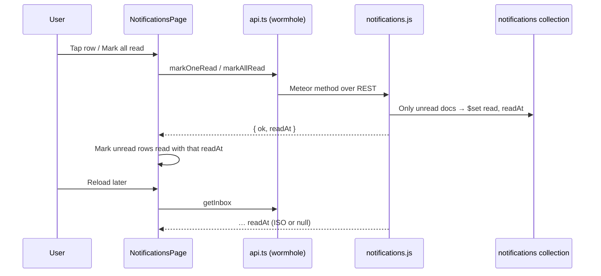

# Notification Read Time — Implementation Plan (#804)

Issue: [mieweb/timehuddle#804 — Show When a Notification Was Last Read in the Notifications Inbox](https://github.com/mieweb/timehuddle/issues/804)
Branch: `fix/804-notification-read-time` (from `main`)
Chosen design: **Option C, "Grouped by day"** in the
[layout options prototype](https://claude.ai/artifact/AJR18tFixSfUfLoSdtQFie)
(desktop and phone shown side by side).

> **How to use this plan.** Work the milestones in order. Tick a box only when the
> item is done _and_ verified, and commit at the end of each milestone. If the code
> doesn't match what this plan says, stop and ask — don't improvise a different design.
> **Keep the change small:** no new collections, no new endpoints, no new libraries.

---

## Goal in one paragraph

Marking a notification read only flips `read: true` today, and the inbox only shows
"5 min ago" (a bare date after 7 days). We save **`readAt`** the first time a
notification is read, send it to the client, and change the inbox to **group rows
under day headings** ("Today · Mon, Nov 2"). Each row shows the **exact time it
arrived** ("3:14 PM") and, once read, **when it was read** ("✓ Read 3:20 PM").



## What it looks like

| Desktop and phone (same layout)                              |
| ------------------------------------------------------------ |
| **TODAY · MON, NOV 2**                                       |
| Shift reminder — Your shift starts in 15 min · `9:41 AM` 🔵  |
| **YESTERDAY · SUN, NOV 1**                                   |
| Ticket assigned: #412 · `4:05 PM` / `✓ Read 4:49 PM`         |
| Team invite: Clinic Ops · `9:12 AM` / `✓ Read Today 8:03 AM` |
| **SAT, OCT 24**                                              |
| Weekly summary ready · `7:00 AM` / `Read` (read before #804) |

Rules for the read line:

- Unread → no read line; the blue dot stays.
- Read on the **same day** it arrived → `✓ Read 4:49 PM`.
- Read on a **later day** → `✓ Read Today 8:03 AM`, `✓ Read Yesterday 6:10 PM`, or `✓ Read Oct 30, 6:10 PM`.
- Read **before this change shipped** (`read: true`, no `readAt`) → `Read` with no time.

## Decisions already made (don't revisit)

- **First read wins.** `readAt` is written only when a notification goes from unread to
  read. Opening it again later doesn't move the time.
- **No "mark unread"** exists, so nothing ever clears `readAt`. (The issue mentions
  clearing it; that step is dropped.)
- **No backfill.** Old read notifications have no read time and say just `Read`.
- **The server's clock is the only source of `readAt`.** The mark-read methods return
  the time they saved, and the page shows that value. The page never stamps its own
  time, because a phone with a wrong clock would show a read time that changes on reload.
- **Only a person reading sets `readAt`.** The auto clock-out job in
  [`agenda.js`](../meteor-backend/server/agenda.js) also sets `read: true` when it
  rewrites an unanswered shift reminder. Nobody read that one, so it gets no `readAt`
  and shows plain `Read`.
- **Every way of reading counts:** tapping the row, "Mark all read", answering a team
  invite, and tapping the notification's push pop-up (added in #793). They all go
  through `markRead` on the server.
- **Received time is `createdAt`**, when the notification was sent. Times stored inside a
  notification's `data` (a shift's start, for example) are not used.
- **Times use the browser's locale** via `toLocaleTimeString` / `toLocaleDateString`.
  There is no translation framework yet, so new strings go in one `LABELS` constant.

---

## Milestone 1 — Backend: save `readAt`

File: [`meteor-backend/server/notifications.js`](../meteor-backend/server/notifications.js)

- [x] Add one helper above `Meteor.methods` so all three "mark read" paths behave the same.
      The `read: { $ne: true }` filter is what makes the first read win; it also catches
      old docs with no `read` field, which the inbox already shows as unread.
  ```js
  // Stamps readAt only on the first read, so reopening a notification keeps its read time.
  async function markRead(filter) {
    const readAt = new Date();
    await rawDb()
      .collection('notifications')
      .updateMany({ ...filter, read: { $ne: true } }, { $set: { read: true, readAt } });
    return readAt;
  }
  ```
- [x] `notifications.markOneRead` and `notifications.markAllRead` → call `markRead` with
      their existing filter (minus `read: false`) and return
      `{ ok: true, readAt: readAt.toISOString() }`.
- [x] `notifications.respondToInvite` → replace its `updateOne(... { read: true })` with
      `await markRead({ _id: toId(notificationId) });`. In the inbox the row is already
      read by then, so this does nothing; it matters when the invite is answered without
      opening the row first, and it must not move an existing read time.
- [x] `notifications.getInbox` mapping → add
      `readAt: n.readAt instanceof Date ? n.readAt.toISOString() : null,`

No Wormhole changes: these methods are already exposed in `main.js`.

**Done when:** marking a notification read in the app writes `readAt` in Mongo
(`db.notifications.findOne({ readAt: { $exists: true } })`), and reopening it doesn't
change the value.

## Milestone 2 — Client types

- [x] [`src/lib/api.ts`](../src/lib/api.ts) `Notification` → add
      `readAt: string | null; // ISO, set the first time it is read`
- [x] `notificationApi.markOneRead` / `markAllRead` return type →
      `{ ok: boolean; readAt: string }`
- [x] [`src/lib/ddp.ts`](../src/lib/ddp.ts) `ddpDocToNotification` → add
      `readAt: doc.readAt ? String(doc.readAt) : null,`

- [x] [`notificationEvents.test.ts`](../src/features/notifications/notificationEvents.test.ts)
      mocks `markOneRead`; give its resolved value a `readAt` too, or typecheck fails.

**Done when:** `npm run typecheck` passes.

## Milestone 3 — Time formatting helpers (with unit tests)

New file: `src/features/notifications/notificationTimes.ts` — pure functions, no React.

- [ ] `formatDayHeading(iso, now?)` → `Today · Mon, Nov 2`, `Yesterday · Sun, Nov 1`, `Sat, Oct 24` (year added when not this year)
- [ ] `formatReceivedTime(iso)` → `3:14 PM`
- [ ] `formatReadTime(createdAt, readAt, now?)` → `4:49 PM` (same day), `Today 8:03 AM`, `Yesterday 6:10 PM`, `Oct 30, 6:10 PM`
- [ ] `groupByDay(notifications, now?)` → `{ heading, items }[]`, keeping the existing order
- [ ] `notificationTimes.test.ts` covers each case above, including a different year
- [ ] Delete the old `timeAgo` from `NotificationsPage.tsx` once nothing uses it

**Done when:** `npm run test:unit -- notificationTimes` passes.

## Milestone 4 — Inbox UI

File: [`src/features/notifications/NotificationsPage.tsx`](../src/features/notifications/NotificationsPage.tsx)

- [ ] Replace the four copies of "mark this row read" in `handleRowClick` and the one in
      `handleMarkAllRead` with one helper that uses the server's `readAt` and leaves
      already-read rows alone:
  ```ts
  const withRead = (n: Notification, readAt: string): Notification =>
    n.read ? n : { ...n, read: true, readAt };
  ```
- [ ] The push-tap path from #793 tells an open inbox that a row was read with the
      `NOTIFICATION_READ_EVENT` window event. Add `readAt` from `markOneRead`'s reply
      to its `detail` in
      [`notificationEvents.ts`](../src/features/notifications/notificationEvents.ts), and
      use `withRead` in the page's listener for that event.
- [ ] Render one `<section>` per day: an `<h2>` heading, then the existing `<ul>` of rows.
      Don't change the row markup otherwise (select mode, `data-notification-id`, click
      handling stay as they are).
- [ ] Right side of each row: received time, and under it the read line with
      `CheckIcon` from `@mieweb/ui` (not FontAwesome).
- [ ] Unread rows keep the blue dot; read rows don't get one.
- [ ] Give each time a `<time dateTime={iso}>` so screen readers and tests get the exact value.
- [ ] Check the phone width (375px): times stay on the right and don't wrap.

**Done when:** in the browser, tapping a row shows `✓ Read <time>` immediately and the
same after a reload; "Mark all read" does the same for every unread row.

## Milestone 5 — e2e test and release note

- [ ] [`tests/e2e/notifications/notifications.spec.ts`](../tests/e2e/notifications/notifications.spec.ts):
      seed an unread notification, open it, assert its row shows `Read` and a day heading is visible.
- [ ] Add a short section to [`release-notes/1.2.0.md`](../release-notes/1.2.0.md) (not tagged yet,
      so we add to it — see [`release-notes/README.md`](../release-notes/README.md)).

**Done when:** the new e2e test passes locally and the note renders at `/app/release-notes`.

## Milestone 6 — Final checks

- [ ] `npm run lint && npm run typecheck`
- [ ] `npm run format`
- [ ] `npm run test:all`
- [ ] Smoke test at `http://localhost:3000/app/notifications`, desktop and phone width

## Out of scope

- Showing read times to anyone but the recipient.
- Per-device read tracking.
- The notification bell dropdown and push notifications.
- A translation framework.
