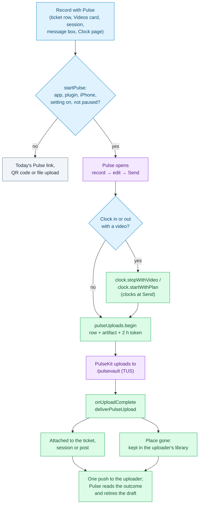
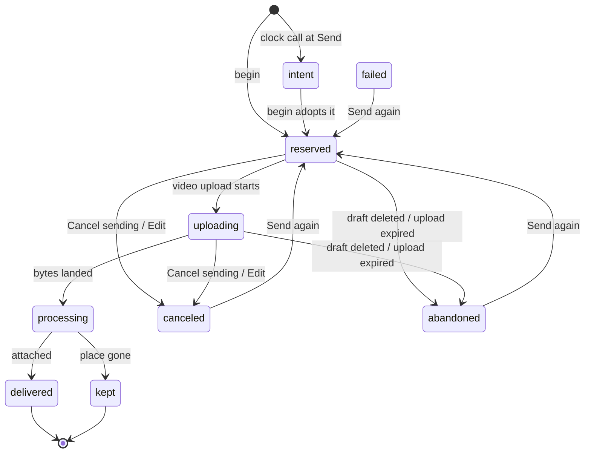

# Pulse in the App

TimeHuddle's iPhone app can open Pulse inside itself: a person taps **Record with Pulse** on a
ticket, a clock session, the Huddle message box or the Clock page, records and edits in Pulse,
and taps Send. Pulse closes, the video uploads in the background, and the server attaches it to
the place it was sent to. Nobody scans a QR code or switches apps.

This page is for developers and for whoever runs a TimeHuddle deployment. It covers how a video
travels, what the server stores, how to turn the feature on team by team, how to ship it, and
what to do when someone says "my video never attached". How Pulse itself is embedded (the
plugin, the contract, PulseKit releases) is in Pulse's
[docs/embedding](https://github.com/mieweb/pulse/tree/main/docs/embedding); this page links there
instead of repeating it.

## Limits

- **iPhone only.** On Android the plugin is a stub that reports Pulse unavailable, so every
  button keeps today's Pulse link. An iPad also keeps the link.
- **Inside the app only.** In a browser nothing changes: a QR code or a file upload on a
  computer, the Pulse-app link on a phone. TimeHuddle never calls Pulse from a browser.
- **500 MB per video**, the same cap as a video posted from the Huddle message box. Pulse shows
  "Too large to send to TimeHuddle" before Send, and the server refuses anything larger.
- **Off by default.** Every team starts with the feature off; see
  [Turn it on, team by team](#turn-it-on-team-by-team).
- **Send needs a PulseKit with the upload outbox.** The pinned PulseKit, `0.1.0-rc.4`, is built
  from mieweb/pulse#304, which answers `uploadMode: 'pulse'` as unsupported. Sending through
  TimeHuddle needs a PulseKit release that includes mieweb/pulse#305 (drafts, the data API and
  the upload outbox).

## How a Video Travels



1. **The tap.** `startPulse` (`src/features/pulse-embed/startPulse.ts`) decides between Pulse in
   the app and today's link flow. Pulse opens only in the native app, with the plugin present
   and on the same contract major, on an iPhone, while Pulse isn't paused for everyone, with the
   team's setting on and the server offering that kind of video. Any other answer falls back to
   the link, QR code or file upload, unchanged.
2. **Recording.** Pulse keeps the take on the phone as a draft for that place. A second tap on
   the same place offers "1 unsent video here · Open".
3. **Send.** Pulse asks TimeHuddle for an upload target (`grants.ts` →
   `pulseUploads.begin`). For the two clock types, Pulse first waits for TimeHuddle's clock call
   (see [Clock in and out at Send](#clock-in-and-out-at-send)) and closes only when it succeeded.
4. **Upload.** PulseKit uploads the captions, thumbnail and video to this server's
   `/pulsevault` with the row's token, after Pulse has closed.
5. **Delivery.** When the video lands, `meteor-backend/server/pulse-upload-delivery.js` attaches
   it where it was sent, or keeps it in the uploader's library when that place is gone, and
   records the outcome. Pulse reads the outcome and marks the draft sent.

The app shows each video on its way where it was sent: an "On this phone" row on the ticket's
and the session's Videos, a note on a clock post ("Video on its way"), and the **Unsent videos**
section at the top of the Media page (`/app/media`).

### What each record button sends

| Button                                        | Upload type     | Place (target)                   | Key                              | Lands as                                              |
| --------------------------------------------- | --------------- | -------------------------------- | -------------------------------- | ----------------------------------------------------- |
| A ticket's row, the ticket page's Videos      | `ticket.video`  | `{kind:'ticket', id}`            | `ticket:<id>`                    | An attachment on the ticket                           |
| An open session's videos                      | `clock.session` | `{kind:'clock', id}`             | `clock:<clockEventId>`           | An attachment on the session                          |
| **Clock out with a Pulse video**              | `clock.wrapup`  | `{kind:'clock', id}`             | `clock:<clockEventId>`           | On the wrap-up line of the session post, made at Send |
| **Clock in with a Pulse video**               | `clock.plan`    | `{kind:'clock-plan', teamId, …}` | `clock-plan:<teamId>:<postDate>` | On the plan post, made at Send                        |
| The Huddle message box                        | `huddle.post`   | `{kind:'huddle', teamId}`        | `huddle:<teamId>`                | A new post in the team's Huddle                       |
| None (Move to… → My library, and kept videos) | `library.video` | `{kind:'library'}`               | `library:<userId>`               | A video in the uploader's media library               |

The key groups a place's drafts on the phone and its rows on the server. The server builds it in
`meteor-backend/server/pulse-upload-types.js` and the app in `src/features/pulse-embed/place.ts`;
tests on both sides pin one table of keys.

## What Is Decided at Send

Where a video lands is fixed when the person taps Send, not when the upload finishes. A video
sent at 4:55 PM that uploads at 9:00 AM the next day still belongs to the 4:55 PM session.

- **Send time.** The phone sends `sentAt`. The server keeps it within the last 7 days, and reads
  a time in the future as its own now.
- **The session a post joins.** A message-box video sent while clocked in joins that session
  as an update post, like a typed post. If `begin` comes within 5 minutes of Send, the server uses
  the session open now; later (the phone was offline), it uses the session whose interval holds
  `sentAt`, and never a later one. A video sent while clocked out joins no session.
- **The conversation.** TimeHuddle has no conversations until #871 lands, so `conversationId` is
  stored as `null` and a message-box video posts to the team's Huddle as a typed post would.
  After #871, the conversation open at Send is recorded instead, and group and direct
  conversations are valid places for it. That work waits on #871.
- **Clock types** do their clock action at Send, as described next.

### Clock in and out at Send

The Clock page's two Pulse buttons show only when the team has both **Record with Pulse in the
iPhone app** and **Clock in and out with a Pulse video** on, and they need a connection.

- **Clock out & send** calls `clock.stopWithVideo`. It appends the wrap-up line to the session
  post with a "Video on its way" mark, makes the `intent` row, then clocks out **at Send's time**
  (`endTime = at`), not at upload time.
- **Clock in & send** calls `clock.startWithPlan`. It makes the plan post with the same mark,
  then clocks in at Send's time.
- A Send time more than 30 minutes old reads as the server's now, as for a plain clock press.
  The app's toast shows the time the server recorded.
- Both are idempotent per draft: a retry finishes only the steps that hadn't run and answers with
  what the first call recorded. A video over 500 MB is refused before anything changes.
- If the clock call fails, nothing is clocked and the draft stays unsent in Pulse. Closing a
  wrap-up with **Keep draft** leaves the person clocked in, and the toast offers **Clock out
  now**.
- The video later lands on that post. 24 hours after Send without it, the post says "Wrap-up video
  hasn't arrived yet" (or "Plan video…") and the uploader gets one push. A video deleted or
  cancelled after Send turns the note into "…didn't arrive". A late video still attaches.

## What the Server Stores

| Collection     | What changes                                                                                                                                                                                                                                                                                                         |
| -------------- | -------------------------------------------------------------------------------------------------------------------------------------------------------------------------------------------------------------------------------------------------------------------------------------------------------------------- |
| `pulseUploads` | **New.** One row per draft (`draftKey` = `<installationId>:<draftId>`), each Send attempt a `clientKey`. Holds the type, target, `targetKey`, `sentAt`, `sessionId`, `conversationId`, `postId`, the artifact, `state`, `reason`, `overdueAt`, and what it became (`mediaId`, `attachmentId`, `captionsArtifactId`). |
| `attachments`  | A video lands on a target once: a unique partial index `attachments_video_target_unique` on `{url, attachedTo.kind, attachedTo.id}` for `type: 'video'`. Pulse deliveries also store `source: 'pulse'`, `videoid`, `pulseUploadId` and `uploadType`.                                                                 |
| `mediaitems`   | `captionsId` (the video's captions artifact, or `null`), and `keptReason` on a video kept in the library.                                                                                                                                                                                                            |
| `huddlePosts`  | `pendingVideos` and `missingVideos` on a clock post whose video is on its way or won't come.                                                                                                                                                                                                                         |
| `appFlags`     | `{_id: 'pulse', runtimePaused}`: the switch in [Pause Pulse for everyone](#pause-pulse-for-everyone).                                                                                                                                                                                                                |

`pulseUploads` indexes, created at startup: `{userId, clientKey}` unique where `clientKey` is a
string (an `intent` row has none yet), `{artifactId}` unique where set, `{replacedArtifactIds}`,
`{userId, draftKey, state}`, `{targetKey, state, updatedAt}` and `{userId, state, updatedAt}`.

A row's states:



`failed` is a refusal recorded for support (too large, a place the person can't reach). A row is
never abandoned for being slow: a video that arrives late still attaches.

Deleting an account cancels that person's unfinished rows and removes their Pulse videos, their
video attachments and their `pulseUploads` rows.

## Methods and Routes

Every method is a Meteor method and is also exposed over REST at `POST /api/<name, . as _>`,
with its schema and rate limit, on `/api/docs`.

| Method                   | Who calls it                            | What it does                                                                                                   |
| ------------------------ | --------------------------------------- | -------------------------------------------------------------------------------------------------------------- |
| `pulseUploadTypes.list`  | The app, on start and each return to it | The upload types offered to this person, `runtimePaused`, and each team's three Pulse settings                 |
| `pulseUploads.begin`     | Pulse, through the app, at Send         | Starts or resumes one video: the row, an artifact and a 2-hour PulseVault token. Idempotent per `clientKey`    |
| `pulseUploads.token`     | Pulse, every 2 hours of an upload       | A fresh token for the row's current artifact                                                                   |
| `pulseUploads.cancel`    | Pulse: Cancel sending, Edit, Delete     | Stops a row whose video hasn't landed                                                                          |
| `pulseUploads.list`      | The app                                 | The caller's rows, newest first                                                                                |
| `pulseUploads.retarget`  | The app: Move to… on a kept video       | Sends a kept video somewhere else                                                                              |
| `pulseUploads.adminList` | Settings → Team                         | Rows of the teams the caller administers, for support                                                          |
| `pulseUploads.metrics`   | Settings → Team                         | A team's last 30 days (at most 90): success rate, time to attach, kept, failed, abandoned, overdue, duplicates |
| `clock.stopWithVideo`    | The app, at a wrap-up's Send            | Wrap-up line, `intent` row, clock out at `at`                                                                  |
| `clock.startWithPlan`    | The app, at a plan's Send               | Plan post, `intent` row, clock in at `at`                                                                      |

Publications: `pulseUploads.mine` (the caller's rows on their way, and those that landed in the
last 7 days) and `pulseUploads.forTarget` (a place's rows on their way, for people who can see
the place).

Raw HTTP routes, documented on `/pulsevault/docs`:

- **`/pulsevault/*`**: PulseVault's TUS upload and artifact routes. A token from
  `pulseUploads.begin` names its row, and the server refuses uploads under it once the row is
  cancelled or abandoned (403 "That upload is no longer open").
- **`GET /pulse/captions/:videoId`**: redirects (302) to a video's captions, 400 for a malformed
  id, 404 when the video has none. Public, like playback.

## Captions

Pulse uploads a captions file (WebVTT) with each video it captioned. The server stores its id
on the media item when the video lands, and fills it in for older videos in the background at
startup. `captionsUrl` comes back on attachments, posts, `media.list`, the PulseVault video
methods and a video's public page, and every TimeHuddle player adds a captions track when it is
set. A video without captions plays as before.

TimeHuddle asks Pulse to download its captions model automatically on Wi-Fi only.

## Turn It On, Team by Team

Three settings, each at enterprise, organization and team level, all off by default. A team
follows its organization's choice unless it has its own, and an organization or enterprise can
lock a choice.

| Setting (as Settings shows it)          | Key                 | Effect                                                                                           |
| --------------------------------------- | ------------------- | ------------------------------------------------------------------------------------------------ |
| **Record with Pulse in the iPhone app** | `pulseInApp`        | The record buttons open Pulse in the app. Off hides the buttons only: recorded videos still send |
| **Clock in and out with a Pulse video** | `pulseClockInOut`   | The Clock page's two Pulse buttons (needs `pulseInApp` too)                                      |
| **This team uses shared phones**        | `pulseSharedDevice` | Signing out deletes unsent videos instead of keeping them for the next sign-in                   |

Turning `pulseInApp` off never strands a video. The Media entry, the Unsent videos section and
the sign-out warning stay while the phone holds an unsent video, and queued videos keep sending.

Suggested order:

1. One pilot team: **Record with Pulse in the iPhone app** on. Tickets, sessions and posts.
2. The same team: **Clock in and out with a Pulse video**, once videos land reliably (watch
   Settings → Team → **Pulse videos from the app**).
3. Teams that hand phones around: **This team uses shared phones** before their first recording.
4. More teams, or the organization default.

## Pause Pulse for Everyone

`runtimePaused` is a server switch for a PulseKit problem a setting can't stop, such as a crash
in its background work. While it is on, the app opens no Pulse, shows every record button's
fallback (the link), and stops calling `resumeOutbox`, `prewarm` and the stale-account cleanup.
It still reads what is on the phone, so Unsent videos stay visible. Apps pick it up the next time
they start or return to the foreground.

Turn it on (Mongo shell, no deploy):

```js
db.appFlags.updateOne({ _id: 'pulse' }, { $set: { runtimePaused: true } }, { upsert: true });
```

Turn it off with `runtimePaused: false`. A missing document means off.

## Deploy

1. **Duplicate video attachments.** On startup the server removes duplicate video attachments
   (keeping the oldest of each `{url, attachedTo.kind, attachedTo.id}`) and then creates the
   unique index, once across all instances. Start once with `DRY_RUN=1` to see only the counts in
   the log (`[attachments] video dedupe (DRY_RUN, nothing changed)`), then without it.
2. **`ROOT_URL`** must be the address phones reach: `pulseUploads.begin` hands Pulse
   `<ROOT_URL>/pulsevault` as the upload endpoint.
3. **The Docker image** copies the vendored tarballs (`vendor/mieweb-pulse-embed.tgz`,
   `vendor/mieweb-capacitor-pulse.tgz`) before each `npm install`.
4. **Settings** are off everywhere, so a deploy changes nothing for users until a team turns
   Pulse on.

`PULSE_UPLOADS_SWEEP_MS` makes the overdue sweep run more often than hourly. It is for test
backends only.

### The Pulse pins

The app pins Pulse in two packages, at the same version:

- `@mieweb/capacitor-pulse` (the native plugin): `vendor/mieweb-capacitor-pulse.tgz`, packed from
  the `pulsekit-v0.1.0-rc.4` tag on mieweb/pulse. Its `Package.swift` downloads PulseKit's
  xcframeworks from that tag's GitHub prerelease, each checked against its SHA-256.
- `@mieweb/pulse-embed` (the JS client): `vendor/mieweb-pulse-embed.tgz`, the same version.

They are vendored because the packages aren't on npm yet: their first publish needs an @mieweb
npm org member (see Pulse's
[releasing.md](https://github.com/mieweb/pulse/blob/main/docs/embedding/releasing.md)). Once
they are published, pin the exact npm version and delete the tarballs. `vendor/README.md` says
how to refresh a tarball.

`scripts/check-native-sync.sh --static` checks the pins without a sync: the plugin's entries in
the generated native files, the lockfile against each tarball, an exact pin, real checksums, and
downloads from the plugin's own release. The full check (no flag) also runs `cap sync` and the
SwiftPM patch; run it after `npm run build`. Wiring PulseKit into the iOS project is in Pulse's
[timehuddle-ios.md](https://github.com/mieweb/pulse/blob/main/docs/embedding/timehuddle-ios.md).

### OTA bundles and native floors

Pulse's code is inside PulseKit, in the native build, so a Pulse fix never rides an OTA bundle.
The web code that opens Pulse checks for the plugin and falls back to the link on a shell without
it, so this feature needs no native floor: an older shell keeps the link.

Raise a floor only when a web change can't run on older shells (it calls a plugin method they
lack, with no fallback):

```sh
node scripts/publish-ota.mjs --channel testflight --native-floor 1.2.0
```

Shells below the floor keep the newest bundle published at a floor they meet; the floor carries
over to later publishes. To fix a bad bundle an older floor still serves, publish the fix with
`--native-floor` set to that older floor, then pass the higher floor again on the next publish.

## Release Train

A Pulse fix reaches TimeHuddle users only through a TimeHuddle store build:

1. The fix merges in mieweb/pulse.
2. A PulseKit release (`pulsekit-v<version>`; see Pulse's
   [releasing.md](https://github.com/mieweb/pulse/blob/main/docs/embedding/releasing.md)).
3. A TimeHuddle PR bumps both pins to that version, with `check-native-sync.sh` passing.
4. Maintainer review and merge.
5. Maintainers dispatch the store builds (`testflight.yml`), then App Review.

App Store builds can't be rolled back. The remedies are halting a phased release, pausing Pulse
for everyone, and a roll-forward build.

**Pilot hotfix rule:** a fix for a lost video or a crash skips the weekly batch and goes out the
same day it is reviewed. [Pause Pulse for everyone](#pause-pulse-for-everyone) covers the gap
until the build is live.

## My Video Never Attached

Work from what the person's phone shows, then what the server has.

### 1. What the phone shows

Ask them to open **Media** and look under **Unsent videos**, or look at the "On this phone" row
on the ticket or session.

| The row says                                           | What it means                                                   | What to do                                                |
| ------------------------------------------------------ | --------------------------------------------------------------- | --------------------------------------------------------- |
| **Draft** or **Ready to send**                         | Never sent                                                      | Open it and tap Send                                      |
| **Waiting to send** or **Waiting for network**         | Queued on the phone                                             | Open TimeHuddle on a connection                           |
| **Paused · resumes automatically** / **Tap to resume** | The upload needs a fresh sign-in                                | Sign in again and open TimeHuddle                         |
| **Uploading 37%** or **Processing…**                   | On its way                                                      | Wait                                                      |
| **Didn't send**                                        | The server refused it                                           | Open it for the reason; tap Retry                         |
| **Too large to send · Trim**                           | Over 500 MB                                                     | Trim it in Pulse, then Send                               |
| **Saved to your library**                              | The place was gone when it landed; it is in their media library | **Move to…** another ticket, session or post              |
| **Attached ✓**                                         | It landed                                                       | Look on the place; check it's the right ticket or session |
| Nothing                                                | Not on this phone                                               | See below                                                 |

Nothing on the phone means one of:

- it was recorded in the standalone Pulse app, which keeps its own videos (it went through the
  link flow, which has no `pulseUploads` row; look on the place and in their media library);
- it was deleted, or a shared phone deleted it at sign-out;
- it was sent and attached, and the phone's receipt has expired (7 days).

### 2. What the server has

A team admin or organization owner opens **Settings → Team → Pulse videos from the app** and
finds the upload by **Person**, **Ticket** (paste its link) or **Clock session** (its id).

| State                     | What it means                                                         | Next step                                                                                    |
| ------------------------- | --------------------------------------------------------------------- | -------------------------------------------------------------------------------------------- |
| **Waiting to start**      | A clock action ran at Send; the phone hasn't started the upload       | The person opens TimeHuddle online. After 24 h it is flagged **Overdue** and they got a push |
| **Waiting for the phone** | Send reached the server; no bytes yet                                 | As above                                                                                     |
| **Uploading**             | Bytes are arriving                                                    | Wait. Stuck for hours: the phone is offline or TimeHuddle hasn't been opened                 |
| **Processing**            | All bytes are in; the video is being made playable                    | Stuck: check the server log for the artifact id (`[pulsevault]` lines)                       |
| **Attached**              | Delivered                                                             | It's on the place shown under **Sent to**                                                    |
| **Kept in library**       | The place was gone (reason shown)                                     | The person uses **Move to…** on the Media page                                               |
| **Cancelled**             | Cancel sending, an Edit or a Delete stopped it                        | The next Send of the draft restarts the same row                                             |
| **Failed**                | Refused (reason shown)                                                | Fix the reason (too large, not on the team), then Send again                                 |
| **Abandoned**             | The draft was deleted, or the unfinished upload expired on the server | Send again if the draft is still on the phone; a late video still attaches                   |
| No row                    | Send never reached the server                                         | Back to step 1. Also check whether Pulse is paused for everyone                              |

Not everything shows in Settings:

- A refusal for a place the person isn't a member of is filed without a team, so team admins
  don't see it. The person sees **Didn't send** on the phone.
- The metrics have no count for videos paused for a sign-in (**Paused** on the phone): on the
  server they still read **Waiting for the phone** or **Uploading**.

### 3. The Pulse log

On the phone, **Report an Issue → Share the Pulse log** produces a file of what Pulse did on that
phone. Attach it to the report. With the artifact id from Settings, search the server log for
`[pulsevault]` lines: the upload's create, its patches, `web-ready`, and `done <artifactId> …`
with where it was attached.

### 4. Many people at once

If videos stop landing for many people after a PulseKit release, turn on
[Pause Pulse for everyone](#pause-pulse-for-everyone) and follow the
[pilot hotfix rule](#release-train).

## Develop and Test

Pure rules live in `meteor-backend/server/pulse-*-core.js` and `src/features/pulse-embed/`, each
with unit tests next to it:

```sh
npm run test:unit                     # app (Vitest)
cd meteor-backend && npm run test:unit # server rules, no database
```

### Server integration suites

They need a test backend on `:3101` with its own database. Some tests run `deleteMany({})`, so
never point them at a shared database.

1. MongoDB 7.0 as a single-node replica set on `127.0.0.1:27017` (`mongod --replSet rs0`, then
   `rs.initiate()` once).
2. Meteor on `:3101` from `meteor-backend`, with `PORT=3101`, `ROOT_URL=http://localhost:3101`,
   `MONGO_URL=mongodb://127.0.0.1:27017/timehuddle_test?replicaSet=rs0`,
   `MONGO_OPLOG_URL=mongodb://127.0.0.1:27017/local?replicaSet=rs0`,
   `PULSE_UPLOADS_SWEEP_MS=2000`, `VIDEOS_DIR`, `UPLOADS_DIR` and `OTA_DIR` pointing at a scratch
   folder, any throwaway `REDMINE_ENCRYPTION_KEY`, `METEOR_PACKAGE_DIRS` pointing at the checked-out
   `vendor/meteor-wormhole/packages`, then `meteor run --port 3101`. FFmpeg must be on `PATH`.
3. Run the Pulse suites:

   ```sh
   cd meteor-backend
   PULSE_UPLOADS_SWEEP_MS=2000 npm run test:integration -- tests/attachments.test.ts \
     tests/pulse-uploads.test.ts tests/pulse-delivery.test.ts tests/pulse-clock.test.ts \
     tests/plan-gate.test.ts tests/clock.test.ts tests/huddle-post-rest.test.ts \
     tests/timer-updates.test.ts tests/users.test.ts
   ```

A PR labelled `backend-integration` runs the same suites in CI (`checks.yml`).

Wormhole answers every refused method with HTTP 500 and the error code in the body's `error`
(`conflict`, `too-large`, `forbidden`, `not-found`), so the suites assert the code, not the
status.

### Playwright with the fake Pulse

`VITE_PULSE_FAKE=1` builds the app with the fake Pulse from `@mieweb/pulse-embed/testing`, so the
specs in `tests/e2e/pulse-embed/` run in a desktop browser. Its server mode does a real `begin` and
a real TUS upload to the test backend's `/pulsevault`.

```sh
API_TARGET=http://localhost:3101 VITE_TIMECORE_URL=http://localhost:3101 VITE_PULSE_FAKE=1 \
  npx vite --port 3003 --strictPort
VITE_PULSE_FAKE=1 npx playwright test -c tests/playwright.config.ts tests/e2e/pulse-embed
```

- The fake runs use Google Chrome (`channel: 'chrome'`), because Playwright's Chromium plays no
  H.264.
- Failure videos need Playwright's FFmpeg: `npx playwright install ffmpeg`.
- One case, "a browser keeps the link" in `fallback.spec.ts`, skips in a fake build. Run it
  against a Vite started without `VITE_PULSE_FAKE` (set `E2E_PORT` to its port).

### On a phone

Device runs need a TimeHuddle iOS build with the plugin; the steps are in Pulse's
[timehuddle-ios.md](https://github.com/mieweb/pulse/blob/main/docs/embedding/timehuddle-ios.md)
and, for a PulseKit you built yourself, [dev-loop.md](https://github.com/mieweb/pulse/blob/main/docs/embedding/dev-loop.md).
