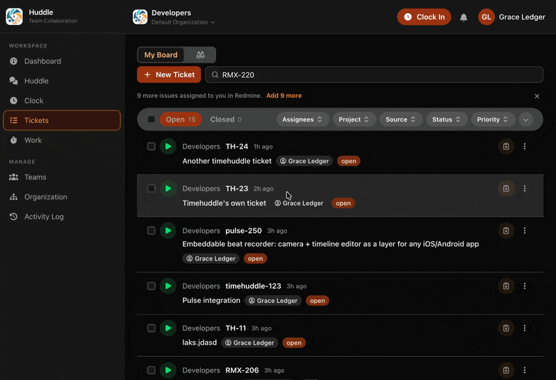
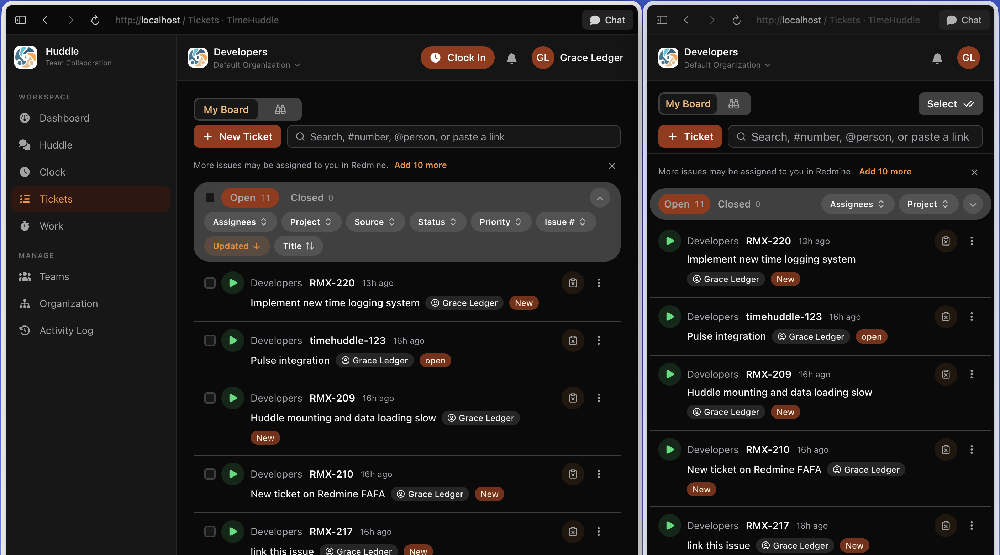
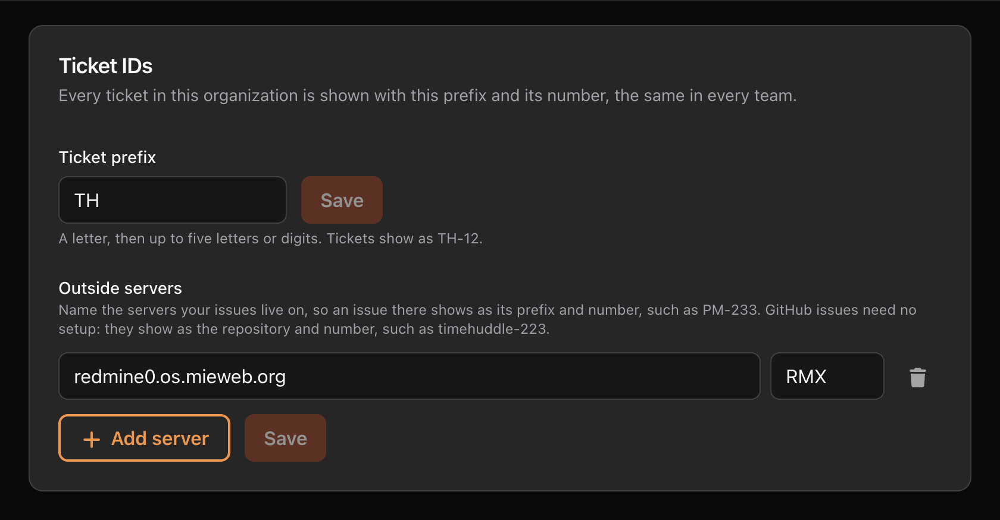
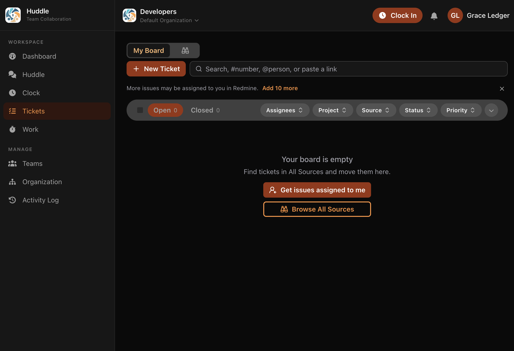

Every ticket now has a short ID you can say out loud, Redmine and GitHub issues
show by theirs, and the search bar finds any ticket by any of them, by words in
its title, or by who it's assigned to.

## Tickets as rows

The Tickets table is a list of rows. Each row reads left to right: the ticket's
ID and team, its title, and its labels — status, assignee — right beside the
title. When the window is narrow, the title and labels wrap onto the next line
instead of being cut off.

## Every ticket has an ID

Each ticket has a short ID: your organization's prefix and a number, such as
**TH-12**. The number is the same in every team, so TH-12 always means the same
ticket.

- **Your organization picks the prefix**, in **Organization → Ticket IDs**.
- **Outside issues show by their own ID.** An issue on your Redmine shows as its
  prefix and number, such as **RMX-233**, and a GitHub issue as its repository
  and number, such as **pulse-250**.
- **A ticket for an outside issue leads with that issue's ID**, with its own ID
  under it, so you see the number your team already uses for it.

## A Redmine issue becomes a ticket when you work on it

Redmine issues are no longer rows of their own. Start a timer on one, or add it
to My Board, and it becomes a ticket in your current team, shown as
**RMX-233**, with its status and assignee from Redmine. If your team already has
a ticket for that issue, you land on that one instead.

**If you had Redmine issues on My Board,** they were cleared in the change. On
an empty My Board, **Get issues assigned to me** brings yours back as tickets in
one click.

## One search bar for every ticket

Everything the search bar finds is in its dropdown, and the table under it stays
as it is while you type. Above the Redmine suggestions, a **Tickets** group lists
the tickets that match, across all your teams. You can type:

- **Words from a title**, such as `pulse integration`
- **An ID**, such as `TH-12`, `RMX-233` or `pulse-250`
- **A prefix and a dash**, such as `TH-`, `RMX-` or `pulse-`, to list every
  ticket under it; keep typing (`TH-1`) to narrow it
- **A number on its own**, such as `233`, to find every ticket it appears on
- **@name** for the tickets assigned to a teammate
- **A link** to a GitHub or Redmine issue, pasted straight in

Each result shows its main ID in bold, its own ID under it, and its title.
Tickets in your current team come first; one from another team says which.
**Enter** opens it, and the green **▶** (or **Shift+Enter**) starts or stops a
timer on it without leaving the search.

## Pull requests in this release

- Tickets shown as rows, with labels beside the title ([#670](https://github.com/mieweb/timehuddle/pull/670))
- Short ticket IDs, and outside issues shown by theirs ([#732](https://github.com/mieweb/timehuddle/pull/732))
- A Redmine issue becomes a ticket the first time you work on it ([#740](https://github.com/mieweb/timehuddle/pull/740), [#752](https://github.com/mieweb/timehuddle/pull/752))
- One search bar that finds every ticket by ID, prefix, title, person or link ([#753](https://github.com/mieweb/timehuddle/pull/753))
