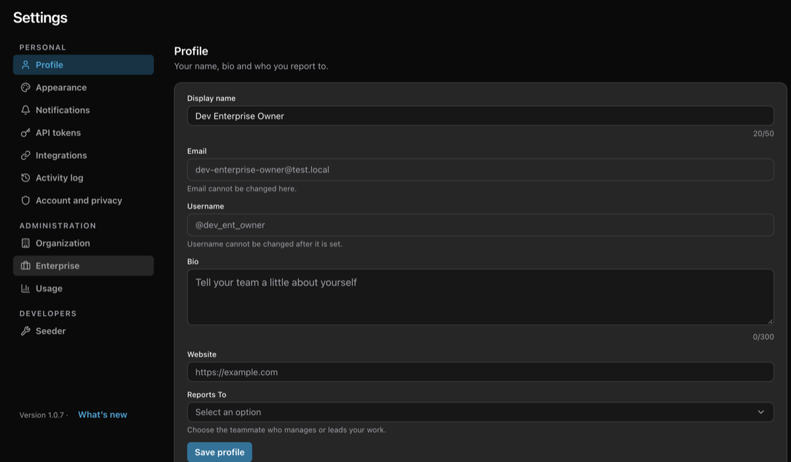
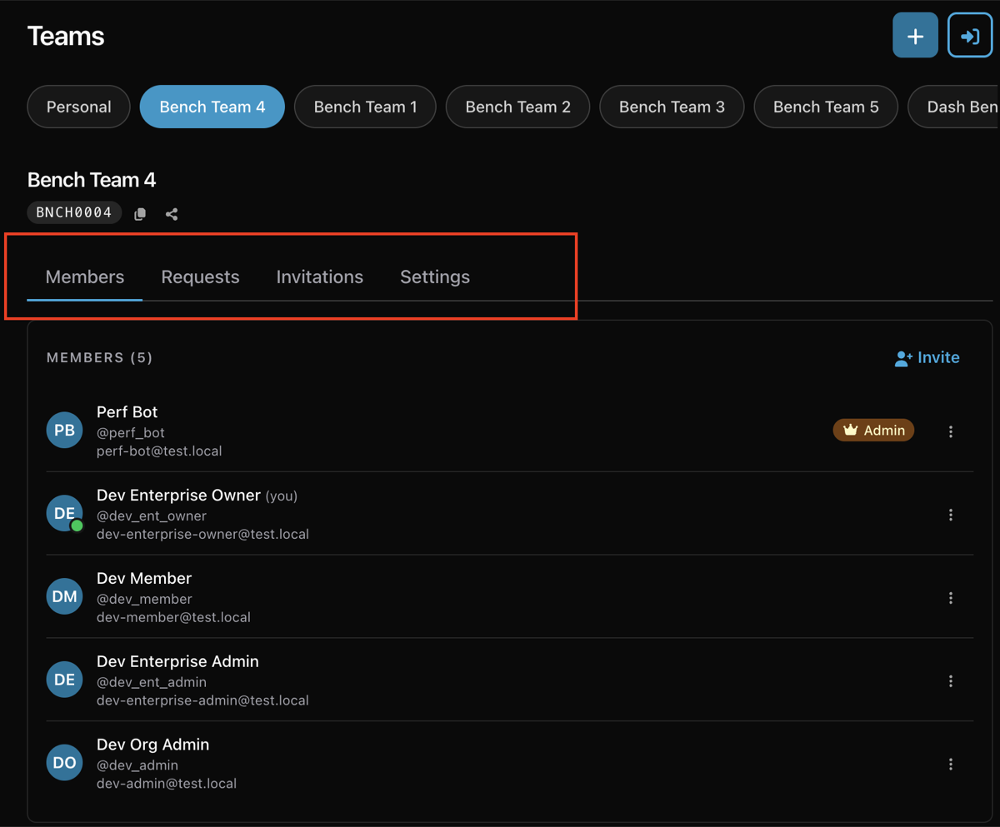
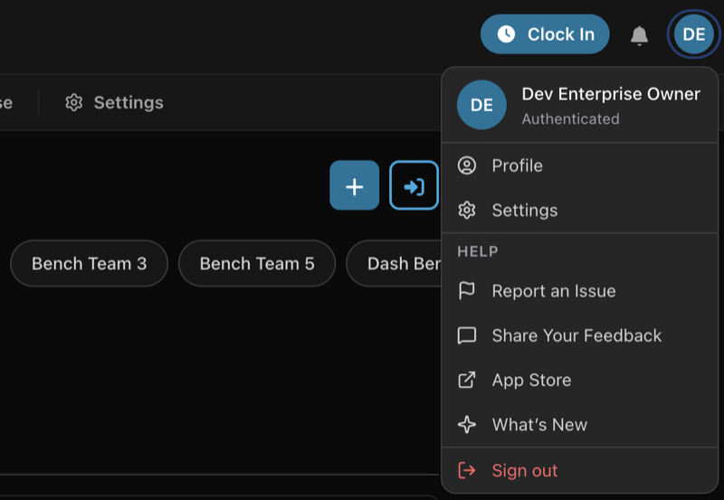

Settings, People, Enterprise and Teams have been redesigned so that each page
does one job, every setting has one place to live, and members and admins see
the same layout, with admins' tools added.

[Watch a walkthrough of the redesign on YouTube](https://youtube.com/shorts/YwLLpD56eMg)

## Settings, one section at a time

Settings used to be one long column of cards. It now has a menu of sections —
Profile, Appearance, Notifications, API tokens, Integrations, and Account and
privacy — and shows one at a time. On a computer the menu sits down the side.
On a phone, Settings opens on the menu; pick a section to open it, and the
**‹** beside the Settings heading takes you back. It stays at the top while you
scroll.

[Watch the new Settings in action (video in #763)](https://github.com/mieweb/timehuddle/pull/763)

- **Links go straight to a section.** "Connect Redmine" from a ticket opens
  Integrations, and coming back from GitHub opens Account and privacy.
- **Push notifications are a switch**, like Dark mode, in Notifications —
  next to **Send test notification**, which has moved there from the bottom of
  the sidebar.
- **Settings is in the menu bar**, and on a phone in the More menu.
- **The version and What's new** sit under the menu, in place of the old list
  of the tools the app is built with.
- **On a phone, Settings is lighter:** sections are plain lists instead of boxes
  inside the page.

## Long pages scroll to the end on phones

On a touchscreen, the last part of a long page could stay hidden behind the
bottom bar. Every page now scrolls all the way to its end.

## Ticket and Redmine dialogs as popups on phones

Creating, editing, changing the status of or deleting a ticket, starting a
ticket's timer, and sending time to Redmine used to open full-screen on a
phone. They now open as a centered popup, like every other dialog in the app.

## The menu moves to the top

On a computer, Dashboard, Huddle, Clock, Tickets and the rest of the menu now
sit in a bar under the header instead of down the left side, so every page gets
the full width of the window. It is shorter too:

- **Organization is now People**, the org chart of everyone you work with.
- **Activity Log has moved into Settings**, as the Activity log section. Old
  links to it still work and open it there.

On a phone the bottom bar works as before, with the same two changes in its
More menu.

[Watch the menu bar under the header (video in #765)](https://github.com/mieweb/timehuddle/pull/765)

## People: the org chart and Members in one place

**People** in the menu opens the org chart for everyone. Organization owners and
admins also see **Members** and **Pending invitations** tabs there, so the
roster, invitations and the chart share one page instead of two.

[Watch People, with Members and the org chart (video in #768)](https://github.com/mieweb/timehuddle/pull/768)

- **Members is one table.** Search by name, username or email, filter by role
  (with how many of each), and change someone's role or manager right in their
  row. Each row shows their photo, and a Blocked badge when they are blocked.
- **Fewer buttons per row.** View profile, Block access and Remove from
  organization are in the row's **⋯** menu.
- **Add existing user** and **Invite by email** are buttons at the top, each
  opening its own small dialog.
- **Pending invitations** is a tab instead of a pop-up.
- **Team defaults and ticket IDs have moved to Settings → Organization**, under
  a new Administration heading that only owners and admins see. The
  **Organization settings** button on People takes you there. Old links to the
  Members page still work and open the Members tab.

## Enterprise, for everyone

**Enterprise** is now in the menu for everyone.

[Watch the Enterprise page for owners and members (video in #769)](https://github.com/mieweb/timehuddle/pull/769)

- **Everyone** sees which enterprise they belong to, and the organizations
  they are in there, with their role in each.
- **Enterprise owners and admins** see its organizations (create, edit, or open
  one on People), a summary of the defaults it sets for organizations and teams,
  and its owners and admins. Removing an owner or admin now asks first.
- **The enterprise name and its defaults have moved to Settings → Enterprise**,
  next to Organization under Administration. **Enterprise settings** and **Edit
  in Settings** take you there.

## Teams in four tabs

A team's page now has **Members**, **Requests**, **Invitations** and **Settings**
tabs for the team's admins. Everyone else sees Members, as before.

- **Requests** is always there for admins (with a count when someone is waiting),
  not only when a request comes in.
- **Invitations** and **Settings** used to be inside the gear pop-up; they are tabs
  now, and the gear is gone.
- **Team settings are in Settings too**, as **Settings → Team** under
  Administration, beside Organization and Enterprise. If you manage more than
  one team, pick which one at the top. It changes the same settings as the
  team's Settings tab, and links there to rename or delete the team.

## A shorter account menu

The menu under your avatar now has Profile, Settings, Help, What's New and Sign
out. The rest moved to where it belongs:

- **Enterprise** and **Members** are in the menu bar: Enterprise, and People →
  Members.
- **Usage** is in **Settings → Usage**, under Administration, for organization
  owners and admins. Old links to it still work.

## Work is now My Week, in Tickets

The Work page has moved into **Tickets**, as **My Week**, beside My Board and
All Sources. It is the same week strip, daily totals and day of timers as
before. Work is no longer in the menu, and old links to it open My Week on the
same day.

## Pulse opens from its own link

Pulse links are now Pulse's own. On a computer, scan the QR code with your
phone's camera; on a phone, Pulse opens straight away. If Pulse isn't on your
phone yet, you go to the App Store or Google Play first, and it connects once
it's installed. TimeHuddle no longer shows its own store badges.

- **A Pulse button on every ticket's row.** Each Huddle ticket on **My Board**
  and in the ticket lists has its own Pulse button, so you can record a video
  for any of them without opening the ticket. It is the Pulse logo alone:
  hover over it, or move to it with the keyboard, and it says **Record with
  Pulse**.
- **A larger QR code**, easier for a phone's camera to pick up.

## Videos play where they're posted

A Pulse video in a Huddle post shows its thumbnail with a play button, instead
of a link to a file. Tap it to watch it in the conversation's media view, then
swipe, or use the arrows, to go through the conversation's other videos;
**Back to conversation** returns you to the post. On a phone the media view
fills the screen above the message box, so you can reply while you watch,
upright or on its side, and each video keeps its own shape. A long post shows
**Show more** to read it all.

Videos on tickets and clock sessions, and the walkthrough on a timesheet
change, open the same way: tap one to watch it full screen, and scroll to the
other videos there. **Back** returns you to where you were.

Every video has the same controls, made for a phone: tap the video to pause or
play it, drag the bar to skip ahead or back, and use the buttons to change the
speed (1×, 1.5×, 2×), mute it or watch it full screen. On an iPhone, full screen opens the iPhone's own player.

Where your browser offers it, a **picture in picture** button floats the video
in a small window over everything else, so you can keep watching while you
read and reply. Go back to the conversation and it keeps playing until you
close the window.

Every video shows a thumbnail: a Pulse recording its cover, a video uploaded
from a file a frame from the video. Videos posted before this update get one
too.

## Name your videos

Every video shows its name on the video itself: on a ticket's Videos, a clock
session's videos, a timesheet walkthrough and in Huddle. A Pulse recording
starts with its draft's name, and a video you upload starts with its file's
name.

To rename one of your own videos, tap **⋯** on the video, choose **Rename** (or
**Add a name**), type the name and tap **Save**. The new name shows everywhere
that video appears. On a ticket's or a clock session's videos, the person who
added a video also has **Remove** in that menu, which takes the video off.

Every video also has a page of its own. Tap **⋯** on a video and choose **Open
video page** to watch it there, full screen, with its name. To share it,
choose **Copy link** and paste the link wherever you like: anyone you send it
to can watch the video on that page without signing in to TimeHuddle. Only
people who are signed in see who added it. Pasted into Slack, Teams, iMessage
or WhatsApp, the link shows a card with the video's name and its cover.

- Only the person who added a video can rename it.
- Renaming a video in Huddle doesn't change the post's text.
- Clear the name and save to remove it.
- Videos added before this release have no name until you add one.

## Pulse videos arrive right away

A Pulse video could take a few minutes to show up in Huddle, clock you in or
out, or land on a ticket, even though Pulse already showed it as sent. This
happened with videos recorded on an iPhone held upright and on some Android
phones. It now shows up as soon as it finishes uploading.

## Photos, videos and files in Huddle, like a messaging app

A post's attachments now show under its text, on the same side as the post, the
way iMessage and WhatsApp show them.

- Tap a photo or a video to open it in the conversation's media view, and
  scroll through all its photos and videos. The message box stays below, so
  you can reply while you look.
- Two or more photos in one post share one tile: two side by side, three as
  one large and two small, and four or more in a grid whose last square shows
  how many more. Tap one to open it.
- Documents (PDF, Word, Excel and text files) are listed under the post with
  their name, type and size. Tap one to open it in a new tab.
- If sending fails, your text and files come back to try again, without
  uploading the files a second time.
- Post a video up to 500 MB straight from the message box, the same as on a
  ticket; photos and documents take up to 100 MB each. A file the message box
  can't take says why: over its size limit, a type it doesn't take, or a HEIC
  photo (an iPhone converts it when you pick it from your photo library).
- Edit and Copy sit beside the message they belong to. Editing a post lists its
  attachments, so you can take one off, and the team or plan label under a
  post no longer shows up in the edit box.
- A post's photos, videos and files belong to the post and its team: they no
  longer show in your media library on your profile, and deleting the post (or
  cancelling a scheduled one) doesn't put them there.
- Images pasted into a plan's text also show under the text, with the post's
  other photos.
- Links in a photo's or video's caption open from the media view, however
  they're written: a plain address, one in angle brackets, or a link with a
  label.
- A post in a right-to-left language, such as Arabic or Hebrew, keeps its text,
  name and time in that direction in a left-to-right conversation.
- In the post editor, the Heading and List menus open under their buttons on a
  scrolled page, and tools that no longer fit move into the toolbar's ⋯ menu.

## Attachments upload as soon as you add them

A photo, video or document you add to a Huddle message, or to a plan or
wrap-up on the Clock page, starts uploading right away, in place: its tile
shows how far it has got, then "Processing…" while a video is made ready to
play. You can keep writing meanwhile, and add several files at once by
picking, pasting or dragging them in.

- **Press Send, Clock in or Clock out whenever you like.** If files are still
  uploading, it finishes them first, then posts — with what you typed in the
  meantime. On the Clock page the button says how far they've got.
- **Clocked in or out when you pressed.** Waiting for a video doesn't move
  your clock-in or clock-out time.
- **Change your mind.** Take a file off before sending and its upload stops,
  and whatever was uploaded is deleted. It never shows up in your media
  library.
- **If a file doesn't upload,** its tile says so, with Retry; the post waits
  until you retry it or take it off. A file the box doesn't take is turned
  away with the reason, as before.
- **Screenshots in a plan or wrap-up** work like any other file now: pasted
  or dragged in, each gets its own tile instead of appearing in the text, and
  shows under the text once posted, as in Huddle.

Videos are ready to play sooner, too. A video in H.264, the format most
Android phones and cameras record in, is now only repackaged, which takes
seconds. A 4K or high-frame-rate HDR video from an iPhone still has to be
converted, but that's several times faster than before.

### Videos on a ticket

On a ticket's Videos, pick or drag in one or more videos: each shows as a card
with its progress, then "Processing…", and becomes the video's card when it's
ready. Pulse stays available while they upload. Cancel one while it's still
uploading; once it's processing, it will be added. Leaving the page doesn't
stop an upload: the video is added when it lands.

## Choose what notifies you

**Settings → Notifications** has a new **What notifies you** list. For each
kind of alert, such as an @mention, a ticket assigned to you or the shift-end
reminder, tick whether it pops up on your **Desktop**, your
**Phone**, or both. Anything you tick is still kept under the bell, and
unticking both turns that alert off. On a phone, Desktop and Phone are two tabs.
Nothing changes until you change it: every alert starts on for both.

- **Choose how much of each team's Huddle reaches you.** Tap the bell in a Huddle
  conversation, or use **Huddle, per team** in Settings, to pick **All posts**
  (hear about every new update), **Mentions & replies** (the default) or
  **Mute** (nothing from that team, not even under the bell).
- **@team and @here in Huddle.** Type **@team** to reach everyone in the team,
  or **@here** for everyone clocked in to it right now. Both show at the top of
  the @ suggestions, and have their own row in **What notifies you**.
- **Quiet time.** Hold Huddle pop-ups while you're clocked out (mentions still
  come through), or snooze every pop-up for an hour, until tomorrow morning or
  until you next clock in. Turn on **Skip pop-ups for a Huddle I have open** and
  your other devices stay quiet about a team you're already looking at.
  Anything held is still waiting under the bell.
- **Organizations set the clock alerts.** In **Settings → Organization** (and
  **Enterprise**), admins can turn off the alert team admins get when someone
  clocks in or out, and the shift-end reminder, or lock either one on so nobody
  turns it off. A locked alert shows **Set by your organization** in your own
  notification settings. With shift-end reminders off, nobody is clocked out
  automatically at 8 hours, since there was no reminder to answer.
- **The shift-end reminder always reaches you.** Unticking it for both Desktop
  and Phone stops the pop-ups, but the reminder still waits under the bell so
  you can choose to keep working.

## See when you read a notification

The notifications list is now grouped by day, under headings like
**Today · Mon, Nov 2**, and each notification shows the exact time it arrived
instead of "5 min ago". Once you've read one, it also says when, for example
**✓ Read 4:49 PM**, or **✓ Read Today 8:03 AM** if you read it on a later day.
Opening it again doesn't change that time. Notifications you read before this
update just say **Read**, because their read time wasn't recorded.

## Rounded Redmine time

Redmine users usually log time in round figures (0.25, 1.5, 4.75), and so do
the timesheets that go to HR. An organization owner can now have TimeHuddle
round up the time it sends to a Redmine server. In **Settings → Organization →
Ticket IDs**, each server under **Outside servers** has a rounding beside its
prefix: **Exact time**, or round up to **5**, **10** or **15 minutes**.
It applies to every team in the organization, and TimeHuddle still keeps the
exact time. Even a timer that ran for a few seconds can now be sent: it goes up
as the whole step, or as 1 minute with **Exact time**.

Each entry shows both numbers before you send it, such as "4:42 worked,
rounded up to 15 min". Rounding applies to each issue's total for the day, so
stopping and starting a timer several times never rounds the same time up
twice.

## See what a Redmine entry adds up

Time on one Redmine issue goes up as a single entry per day, while Sessions lists
every timer run. Both send dialogs now say when an entry adds up several runs,
for example "Adds up 5 timer runs". Open it to see each run and its time.

## Sign in with Google on your phone

The iPhone and Android apps now offer **Continue with Google** alongside GitHub
and Apple. On Android, signing in with Google or GitHub used to stop on a blank
page instead of returning to the app; it now brings you straight back, signed
in.

## Usage shows who is working right now

**Settings → Usage** now shows who is online and who is clocked in. Before this,
someone who clocked in before the period began, or who was only reading, showed
as Idle. Now they count as **Active**.

- An **Online now** card shows how many members are online and how many are
  clocked in
- **Online** and **Clocked in** columns in the table, the second showing how
  long ago they clocked in
- Someone who is online has their **Last active** shown as now
- **Redmine** and **GitHub** columns show who has linked each account, and an
  **Integrations connected** card counts them
- The page updates on its own as people come online, clock in or out, or post,
  so you no longer need to reload it

## Organization owners see every team

If you own an organization, every team in it now shows up for you — in the
team switcher, on the Teams page and in Settings → Team — even if you never
joined it. Open one to see its members, requests and invitations and to change
its settings. Teams you haven't joined are marked **Not joined**, and a
**Join team** button on the team's page adds you when you want to take part. You join as the team's admin.

## Pull requests in this release

- Settings split into sections with a side menu ([#763](https://github.com/mieweb/timehuddle/pull/763))
- The app menu, moved from the left side to a bar under the header ([#765](https://github.com/mieweb/timehuddle/pull/765))
- People: the org chart and Members on one page, with organization settings in Settings ([#768](https://github.com/mieweb/timehuddle/pull/768))
- Enterprise in the menu for everyone, with its name and defaults in Settings ([#769](https://github.com/mieweb/timehuddle/pull/769))
- Teams in four tabs: Members, Requests, Invitations and Settings ([#770](https://github.com/mieweb/timehuddle/pull/770))
- A shorter account menu, with Usage and Seeder in Settings ([#771](https://github.com/mieweb/timehuddle/pull/771))
- Work moved into Tickets as My Week ([#772](https://github.com/mieweb/timehuddle/pull/772))
- Pulse opens from its own link, in one tap on a phone ([#748](https://github.com/mieweb/timehuddle/pull/748))
- Notification preferences: desktop and phone per alert, Huddle per team, quiet time, @team and @here ([#793](https://github.com/mieweb/timehuddle/pull/793))
- Notifications grouped by day, with when each was read ([#805](https://github.com/mieweb/timehuddle/pull/805))
- Redmine time rounded up per server, set beside its prefix ([#783](https://github.com/mieweb/timehuddle/pull/783))
- Redmine entries say how many timer runs they add up ([#802](https://github.com/mieweb/timehuddle/pull/802))
- Pulse videos show with their thumbnail and name in Huddle and wherever else they show; rename your own from the video's ⋯ menu ([#749](https://github.com/mieweb/timehuddle/pull/749))
- Ticket and Redmine dialogs open as centered popups on phones ([#818](https://github.com/mieweb/timehuddle/pull/818))
- Team settings in Settings, beside Organization and Enterprise ([#808](https://github.com/mieweb/timehuddle/pull/808))
- Pulse videos arrive as soon as they finish uploading ([#816](https://github.com/mieweb/timehuddle/pull/816))
- Caption links, right-to-left posts and the post editor's toolbar menus fixed ([#834](https://github.com/mieweb/timehuddle/pull/834))
- Videos up to 500 MB from Huddle's message box ([#835](https://github.com/mieweb/timehuddle/pull/835))
- Sign in with Google on your phone, and Android sign-in returns to the app ([#836](https://github.com/mieweb/timehuddle/pull/836))
- Usage shows who is online and clocked in ([#833](https://github.com/mieweb/timehuddle/pull/833))
- Organization owners see and manage every team in their organization, joined or not ([#838](https://github.com/mieweb/timehuddle/pull/838))
- Attachments upload as soon as they're added, and videos are ready to play sooner ([#843](https://github.com/mieweb/timehuddle/pull/843))
- A Pulse button on every Huddle ticket's row, and a larger QR code ([#861](https://github.com/mieweb/timehuddle/pull/861))
