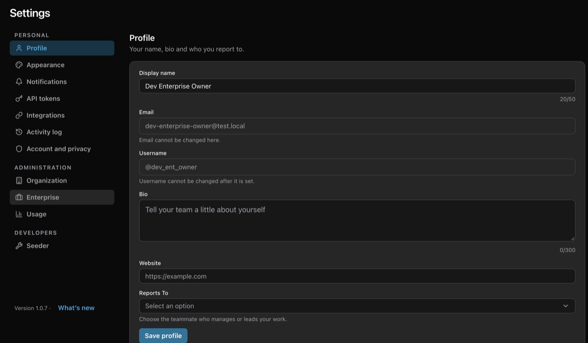
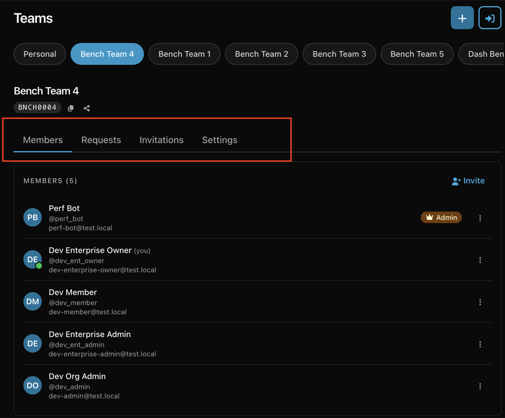
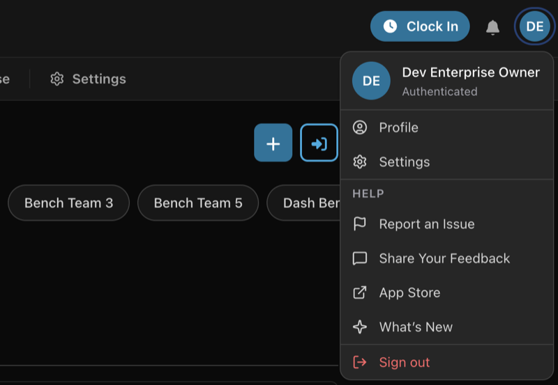

Settings, People, Enterprise and Teams have been redesigned so that each page
does one job, every setting has one place to live, and members and admins see
the same layout, with admins' tools added.

[Watch a walkthrough of the redesign on YouTube](https://youtube.com/shorts/YwLLpD56eMg)

## Settings, one section at a time

Settings used to be one long column of cards. It now has a menu of sections —
Profile, Appearance, Notifications, API tokens, Integrations, and Account and
privacy — and shows one at a time. On a computer the menu sits down the side.
On a phone, Settings opens on the menu; pick a section to open it, and the
**‹** beside the Settings heading takes you back. It stays at the top while you
scroll.

[Watch the new Settings in action (video in #763)](https://github.com/mieweb/timehuddle/pull/763)

- **Links go straight to a section.** "Connect Redmine" from a ticket opens
  Integrations, and coming back from GitHub opens Account and privacy.
- **Push notifications are a switch**, like Dark mode, in Notifications —
  next to **Send test notification**, which has moved there from the bottom of
  the sidebar.
- **Settings is in the menu bar**, and on a phone in the More menu.
- **The version and What's new** sit under the menu, in place of the old list
  of the tools the app is built with.
- **On a phone, Settings is lighter:** sections are plain lists instead of boxes
  inside the page.

## Long pages scroll to the end on phones

On a touchscreen, the last part of a long page could stay hidden behind the
bottom bar. Every page now scrolls all the way to its end.

## The menu moves to the top

On a computer, Dashboard, Huddle, Clock, Tickets and the rest of the menu now
sit in a bar under the header instead of down the left side, so every page gets
the full width of the window. It is shorter too:

- **Organization is now People**, the org chart of everyone you work with.
- **Activity Log has moved into Settings**, as the Activity log section. Old
  links to it still work and open it there.

On a phone the bottom bar works as before, with the same two changes in its
More menu.

[Watch the menu bar under the header (video in #765)](https://github.com/mieweb/timehuddle/pull/765)

## People: the org chart and Members in one place

**People** in the menu opens the org chart for everyone. Organization owners and
admins also see **Members** and **Pending invitations** tabs there, so the
roster, invitations and the chart share one page instead of two.

[Watch People, with Members and the org chart (video in #768)](https://github.com/mieweb/timehuddle/pull/768)

- **Members is one table.** Search by name, username or email, filter by role
  (with how many of each), and change someone's role or manager right in their
  row. Each row shows their photo, and a Blocked badge when they are blocked.
- **Fewer buttons per row.** View profile, Block access and Remove from
  organization are in the row's **⋯** menu.
- **Add existing user** and **Invite by email** are buttons at the top, each
  opening its own small dialog.
- **Pending invitations** is a tab instead of a pop-up.
- **Team defaults and ticket IDs have moved to Settings → Organization**, under
  a new Administration heading that only owners and admins see. The
  **Organization settings** button on People takes you there. Old links to the
  Members page still work and open the Members tab.

## Enterprise, for everyone

**Enterprise** is now in the menu for everyone.

[Watch the Enterprise page for owners and members (video in #769)](https://github.com/mieweb/timehuddle/pull/769)

- **Everyone** sees which enterprise they belong to, and the organizations
  they are in there, with their role in each.
- **Enterprise owners and admins** see its organizations (create, edit, or open
  one on People), a summary of the defaults it sets for organizations and teams,
  and its owners and admins. Removing an owner or admin now asks first.
- **The enterprise name and its defaults have moved to Settings → Enterprise**,
  next to Organization under Administration. **Enterprise settings** and **Edit
  in Settings** take you there.

## Teams in four tabs

A team's page now has **Members**, **Requests**, **Invitations** and **Settings**
tabs for the team's admins. Everyone else sees Members, as before.

- **Requests** is always there for admins (with a count when someone is waiting),
  not only when a request comes in.
- **Invitations** and **Settings** used to be inside the gear pop-up; they are tabs
  now, and the gear is gone.

## A shorter account menu

The menu under your avatar now has Profile, Settings, Help, What's New and Sign
out. The rest moved to where it belongs:

- **Enterprise** and **Members** are in the menu bar: Enterprise, and People →
  Members.
- **Usage** is in **Settings → Usage**, under Administration, for organization
  owners and admins. Old links to it still work.

## Work is now My Week, in Tickets

The Work page has moved into **Tickets**, as **My Week**, beside My Board and
All Sources. It is the same week strip, daily totals and day of timers as
before. Work is no longer in the menu, and old links to it open My Week on the
same day.

## Pulse opens from its own link

Pulse links are now Pulse's own. On a computer, scan the QR code with your
phone's camera; on a phone, Pulse opens straight away. If Pulse isn't on your
phone yet, you go to the App Store or Google Play first, and it connects once
it's installed. TimeHuddle no longer shows its own store badges.

## Videos play where they're posted

A Pulse video in a Huddle post shows its thumbnail with a play button, instead
of a link to a file. Tap it and it plays right there; starting another one
pauses the first. Videos on tickets and clock sessions, and the walkthrough on
a timesheet change, play the same way. Videos posted before this update get
their thumbnail too, and one uploaded from a file shows the play button on a
plain card.

## Name your videos

Every video shows its name on the video itself: on a ticket's Videos, a clock
session's videos, a timesheet walkthrough and in Huddle. A Pulse recording
starts with its draft's name, and a video you upload starts with its file's
name.

To rename one of your own videos, tap **⋯** on the video, choose **Rename** (or
**Add a name**), type the name and tap **Save**. The new name shows everywhere
that video appears. On a ticket's or a clock session's videos the same menu has
**Remove**, which takes the video off.

- Only the person who added a video can rename it.
- Renaming a video in Huddle doesn't change the post's text.
- Clear the name and save to remove it.
- Videos added before this release have no name until you add one.

In Huddle, a post with a video is as wide as the video, and its text wraps to
fit.

## Pull requests in this release

- Settings split into sections with a side menu ([#763](https://github.com/mieweb/timehuddle/pull/763))
- The app menu, moved from the left side to a bar under the header ([#765](https://github.com/mieweb/timehuddle/pull/765))
- People: the org chart and Members on one page, with organization settings in Settings ([#768](https://github.com/mieweb/timehuddle/pull/768))
- Enterprise in the menu for everyone, with its name and defaults in Settings ([#769](https://github.com/mieweb/timehuddle/pull/769))
- Teams in four tabs: Members, Requests, Invitations and Settings ([#770](https://github.com/mieweb/timehuddle/pull/770))
- A shorter account menu, with Usage and Seeder in Settings ([#771](https://github.com/mieweb/timehuddle/pull/771))
- Work moved into Tickets as My Week ([#772](https://github.com/mieweb/timehuddle/pull/772))
- Pulse opens from its own link, in one tap on a phone ([#748](https://github.com/mieweb/timehuddle/pull/748))
- Pulse videos play inline, with their thumbnail, in Huddle and wherever else they show ([#749](https://github.com/mieweb/timehuddle/pull/749))
- Every video has one name, shown on its card and renamed from its ⋯ menu ([#795](https://github.com/mieweb/timehuddle/pull/795))
