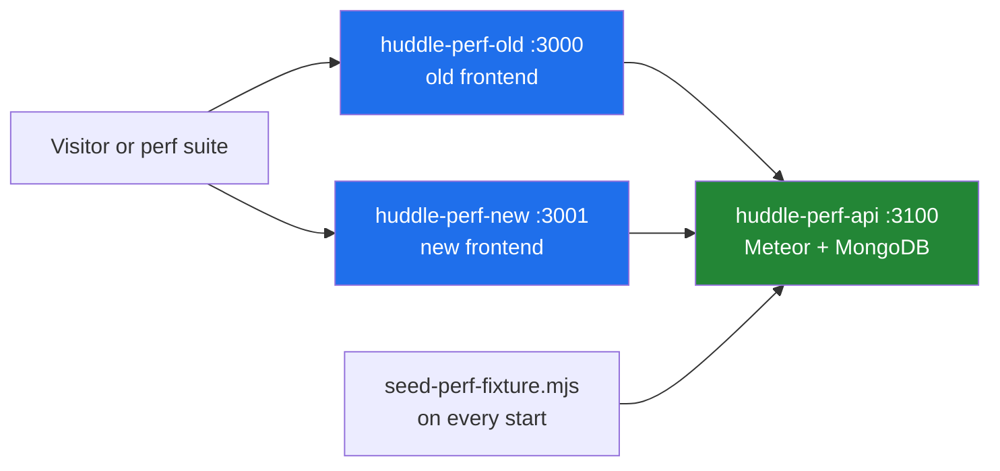

# Perf comparison environment

A shared, public before/after environment for the performance suite: one
container runs the **old** frontend, the **new** frontend and **one backend**
with a seeded perf fixture. Anyone can open both sites, follow the same deep
link on each and watch the difference, and the suite can be pointed at either
site to reproduce the published numbers and videos.

| Port | Serves                                             | URL                                     |
| ---- | -------------------------------------------------- | --------------------------------------- |
| 3000 | Old frontend (`OLD_REF`, `main` as measured)       | `https://huddle-perf-old.os.mieweb.org` |
| 3001 | New frontend (the commit the image was built from) | `https://huddle-perf-new.os.mieweb.org` |
| 3100 | Meteor backend + MongoDB, used by both             | `https://huddle-perf-api.os.mieweb.org` |



**Both frontends use the new backend.** The comparison isolates the frontend
and the API calls it makes; backend-only gains (new indexes, for example) also
help the old frontend, so "old" reads a little faster than true `main`.

## Signing in

- **Perf account** — `perf-bot@test.local`, with the password from the
  `PERF_ENV_PASSWORD` repository secret (also posted on the PR that publishes
  results). It owns the organization and enterprise, so every page the suite
  measures is visible — this is what the videos show.
- **Quick sign-in** — the login page's dev buttons (member, org admin/owner,
  enterprise admin/owner). These accounts are members of the fixture team, but
  a member can't open admin pages such as Members or Usage.

The data is fake and the environment is isolated; don't reuse the password.

## The fixture

[`seed-perf-fixture.mjs`](seed-perf-fixture.mjs) runs on every container start,
so its time-relative data always ends "now":

- **Dash Bench** — 46 members (the perf account, the five quick sign-in
  accounts, 40 bench users), 400 tickets, 95 clock sessions over 90 days (one
  still open), 2,000 activity entries, 40 tickets on the perf account's board.
- **Bench Team 1–5** — 5 members and 100 tickets each.

Ids are fixed, so deep links never change. Dash Bench is
`7e2f01000000000000000000`, e.g. `/app/teams?teamId=7e2f01000000000000000000`.
It can also seed a local database:

```bash
MONGO_URL="mongodb://127.0.0.1:27017/<scratch-db>?directConnection=true" \
  PERF_PASSWORD=… node tests/performance/env/seed-perf-fixture.mjs
```

It replaces any existing perf fixture, so point it at a throwaway database.

## Build and deploy

The [Perf Comparison Environment](../../../.github/workflows/perf-env.yml)
workflow does both. It builds `ghcr.io/mieweb/timehuddle:perf`, smoke-tests it,
then replaces the Launchpad container `huddle-perf` and maps its ports to
`huddle-perf-old` (3000), `huddle-perf-new` (3001) and `huddle-perf-api` (3100)
on `os.mieweb.org`. It runs on demand (once merged; the `name` input changes
the `huddle-perf` prefix) and on pushes to the PR branch that touch this
folder. Replacing the container wipes its database; the seed refills it.

To build and smoke-test locally, with Docker and buildx:

```bash
PERF_PASSWORD=… tests/performance/env/build.sh   # see the script for options
tests/performance/env/smoke-test.sh
```

- [`build.sh`](build.sh) builds the repo-root `Dockerfile` (the PR-preview
  image) at the checked-out commit as the new side, then
  [`Dockerfile`](Dockerfile) adds the old frontend from `OLD_REF`.
- [`start.sh`](start.sh) starts the base entrypoint, the new frontend on 3001
  and the seed.

## Running the suite against it

The workflow's `measure` job does this after every deploy (or on its own with
`measure_only`): it runs the suite against both sites from a clean GitHub
runner and attaches the `perf-comparison` artifact — results, logs, the
before/after table (also on the run's summary page) and one video per page
flow. Locally, the same script:

```bash
PERF_PASSWORD=… tests/performance/env/run-comparison.sh perf-comparison
```

[`run-comparison.sh`](run-comparison.sh) runs the suite once per site with
`PERF_VIDEO_DIR`, which records every run and keeps the video of the median
one, so each video matches its reported number. Videos are named
`<side>-<page>-<returning|signin>-<ms>ms.webm`; keep `PERF_RUNS` odd so the
median is a real run.
