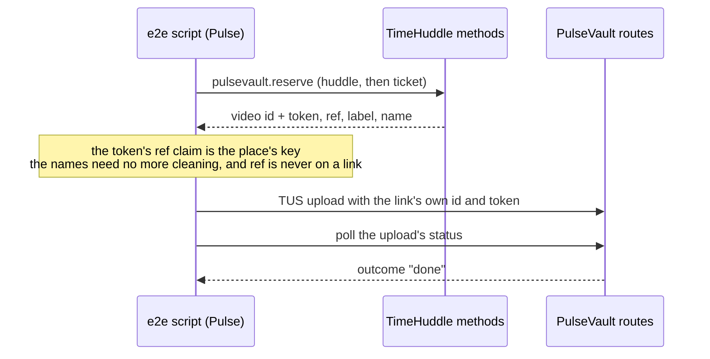

# tests/pulse-links/

**Pulse links, end to end, without a phone.** `pulse-links.e2e.mjs` does to a
running backend what a Pulse app does with a TimeHuddle link, over plain HTTP,
and checks each answer. `lib.mjs` holds the steps (sign in, call a method, read
a token, upload). It is not a Playwright spec: there is no browser in it, so it
lives beside `tests/e2e/` rather than in it, and `npm test` doesn't run it.

```bash
cd meteor-backend && npm start                                      # the backend, on :3100
npm run e2e:pulse-links                                             # in another terminal
```

It signs in through dev quick-login, so the backend must be a development one
(or have `DEV_QUICK_LOGIN_ENABLED=true`). `TH_BASE` points it at another
backend (default `http://localhost:3100`), and `TH_ROLE` picks the dev account
(default `member`). It exits non-zero when a check fails.

**Not for CI, and not for a backend anyone else is using.** Every run posts a
video to a team's Huddle and attaches one to a ticket (see
[What it leaves behind](#what-it-leaves-behind)), so run it by hand against
your own local backend, or a throwaway one.

## What it checks

For a team's Huddle and for a ticket:



- **The place is named:** a Huddle by its team with "Huddle update" for the
  recording, a ticket and its recording by the ticket's title. A name longer
  than 40 characters (or 120 once percent-encoded in the link) is cut, ending
  in an ellipsis.
- **The token signs the place's key:** a 16-character hash of who and where,
  the same on the next link for that place.
- **The names are ready for a link:** `@mieweb/pulsevault`'s own
  `buildUploadLink` carries them as reserved, with no `ref` parameter. This is
  the package's builder, not the page's: the script can't run the page. The
  page's builder (`src/features/pulse-upload/pulseLinks.ts`) is held to the
  package's by its unit tests, and the link a phone really opens is checked in
  a browser.
- **A link is still one upload:** a video sent with its id and token is
  delivered.
- **A destination that isn't a place** (a video for a post being written) gets
  a plain link.

## What it leaves behind

- **A Huddle post with the test video** in the dev account's team, and **the
  test video on one of that team's tickets**.
- **A ticket called "Pulse links e2e"**, only when the team had no ticket to
  use.
