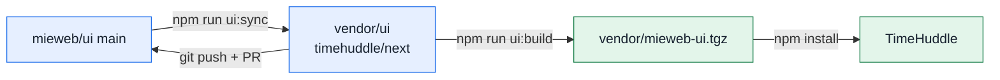
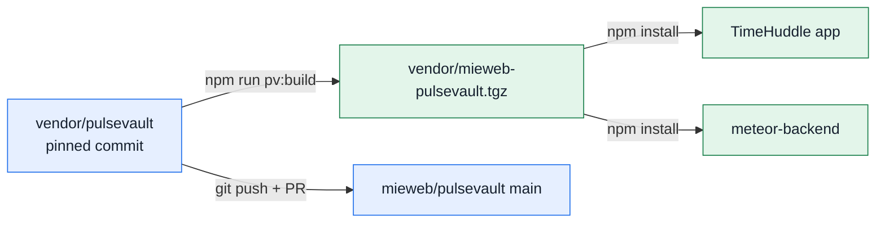

# vendor/

Code TimeHuddle builds from source instead of installing from npm.

| Path              | What it is                                                                                         |
| ----------------- | -------------------------------------------------------------------------------------------------- |
| `meteor-wormhole` | Submodule: Meteor package that exposes methods over REST, loaded by `meteor-backend`.              |
| `ui`              | Submodule: [mieweb/ui](https://github.com/mieweb/ui) on `timehuddle/next`, ahead of its release.  |
| `mieweb-ui.tgz`   | `@mieweb/ui` packed from `ui`. The app installs it (`"@mieweb/ui": "file:vendor/mieweb-ui.tgz"`). |
| `.ui-tarball-commit` | The `ui` commit the tarball was built from, so `ui:build` can skip an unchanged rebuild.        |
| `pulsevault`      | Submodule: [mieweb/pulsevault](https://github.com/mieweb/pulsevault), at the commit the app runs.  |
| `mieweb-pulsevault.tgz` | `@mieweb/pulsevault` packed from `pulsevault`. The app and `meteor-backend` install it.      |
| `.pulsevault-tarball-commit` | The `pulsevault` commit that tarball was built from, so `pv:build` can skip a rebuild. |

Both libraries are vendored the same way: a submodule to work in, and a **committed tarball** that
everything installs. CI, Docker, the deploys and a fresh clone never check either submodule out;
`npm install` is all they need. The scripts share their steps in
[`scripts/vendor-tarball.mjs`](../scripts/vendor-tarball.mjs).

## Why `@mieweb/ui` is vendored

Changes TimeHuddle needs from `@mieweb/ui` (see [`docs/superchat-inbox-gaps.md`](../docs/superchat-inbox-gaps.md))
are built in the library itself, on a branch that is sent upstream as a PR, rather than worked
around in this app. Vendoring lets the app use that branch before it is released.

`ui` points at `mieweb/ui`, branch `timehuddle/next`: an integration branch that is `main` with
the changes TimeHuddle needs merged in ahead of their release. Each change is its own PR to `main`:
the SuperChat host extension points (`Dharp02/ui`'s `feat/superchat-host-extension-points`), the
SuperChat media work in [mieweb/ui#676](https://github.com/mieweb/ui/pull/676) (its MediaFeed and
MediaPlayer half, [#675](https://github.com/mieweb/ui/pull/675), is merged),
[#699](https://github.com/mieweb/ui/pull/699), which keeps `Textarea`'s Kerebron editor out of the
app's first load, [#700](https://github.com/mieweb/ui/pull/700), which hands SuperChat hosts each
attachment's `File` so Huddle can post large videos, and upload on attach (`useAttachmentUploads`,
ChatComposer's `uploadAttachment`, `UploadAnnouncer`), committed straight to `timehuddle/next`
for now, with no PR to `main` yet. As those merge, `timehuddle/next` shrinks back toward `main`. CI and Docker never check the submodule out: they
install the committed tarball.

## Working on the library

1. Make the change in `vendor/ui` (it's a normal git checkout; use `pnpm`, never `npm`, there).
2. Make it on its own branch off `main` and open a PR to `main`; merge that branch into
   `timehuddle/next` and push it: `git -C vendor/ui push`.
3. `npm run ui:build` rebuilds `vendor/mieweb-ui.tgz` and refreshes `package-lock.json`.
4. Commit the submodule pointer, the tarball, `.ui-tarball-commit` and `package-lock.json` together.

To pull in upstream changes: `npm run ui:sync`. It merges `mieweb/ui` `main` into the branch
(a merge, so the branch never needs a force-push) and rebuilds. Then push `vendor/ui` and commit
as in step 4. Check `vendor/ui/patches/` against [`patches/`](../patches/README.md) afterwards: the
app applies the library's Kerebron fixes itself.

The build takes a few minutes; it is skipped when `vendor/ui` hasn't moved. `npm run ui:build -- --force`
rebuilds anyway.

## `@mieweb/pulsevault`

PulseVault is vendored so that a change TimeHuddle needs in it (a new protocol revision, a fix)
runs here before it is released. `pulsevault` points at `mieweb/pulsevault`; `.gitmodules` names
the branch `timehuddle/next` for it, as for `ui`: the branch to put such changes on, `main` with
whatever is ahead of its release. The app depends on the tarball
(`"@mieweb/pulsevault": "file:vendor/mieweb-pulsevault.tgz"`, and
`"file:../vendor/mieweb-pulsevault.tgz"` in `meteor-backend`), never on the folder: a `file:` link
to the submodule puts its devDependencies in both lockfiles and has to be checked out and built
wherever anything installs.

To move it to another commit:

1. Check that commit out in `vendor/pulsevault` (it's a normal git checkout; `npm` there). **Push
   it first** if it is new: a pinned commit that isn't on `mieweb/pulsevault` can't be fetched by
   anyone else, or by Dependabot.
2. `npm run pv:build` builds it, packs `vendor/mieweb-pulsevault.tgz`, installs it in the app and
   refreshes both `package-lock.json` files. It is skipped when the submodule hasn't moved
   (`npm run pv:build -- --force` rebuilds anyway).
3. With the backend stopped, `cd meteor-backend && meteor npm ci`: installing under a running
   Meteor breaks it, and `ci` leaves the lockfile as `pv:build` wrote it (Meteor's own, older npm
   rewrites one it is allowed to).
4. Commit the submodule pointer, the tarball, `.pulsevault-tarball-commit` and both
   `package-lock.json` files together.

A tarball packed from a release's commit is the release: packed from `v0.8.0` it has the checksum
of `@mieweb/pulsevault@0.8.0` on npm.

Dependabot's `gitsubmodule` updates ([`.github/dependabot.yml`](../.github/dependabot.yml)) follow
the branch `.gitmodules` names. A pull request of its moves only the submodule pointer: run
`npm run pv:build` on it before merging, or the tarball and its marker stay at the old commit.

## Going back to npm

For PulseVault, once what the app needs is released: set `"@mieweb/pulsevault"` to the released
version in both `package.json`s, install, and remove the `pulsevault` submodule, the tarball,
`.pulsevault-tarball-commit`, `scripts/vendor-pulsevault.mjs`, the `pv:build` script and the
`COPY vendor/mieweb-pulsevault.tgz` lines in the `Dockerfile`.

For `@mieweb/ui`, once the PR is merged and released: set `"@mieweb/ui"` back to the released version, run
`npm install`, and remove the `ui` submodule, the tarball, `.ui-tarball-commit`, the `ui:*` scripts
and the `COPY vendor/mieweb-ui.tgz` lines in the `Dockerfile`. The previous round of this is
archived in [`.attic/mieweb-ui-tarball/`](../.attic/mieweb-ui-tarball/README.md).
